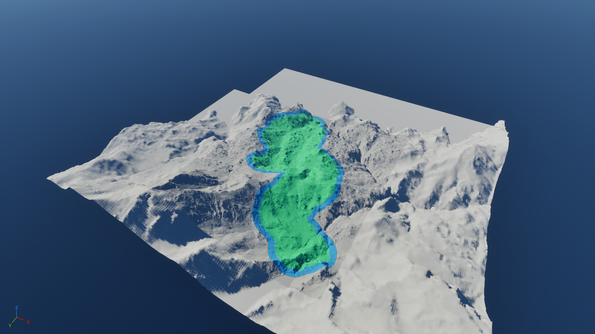
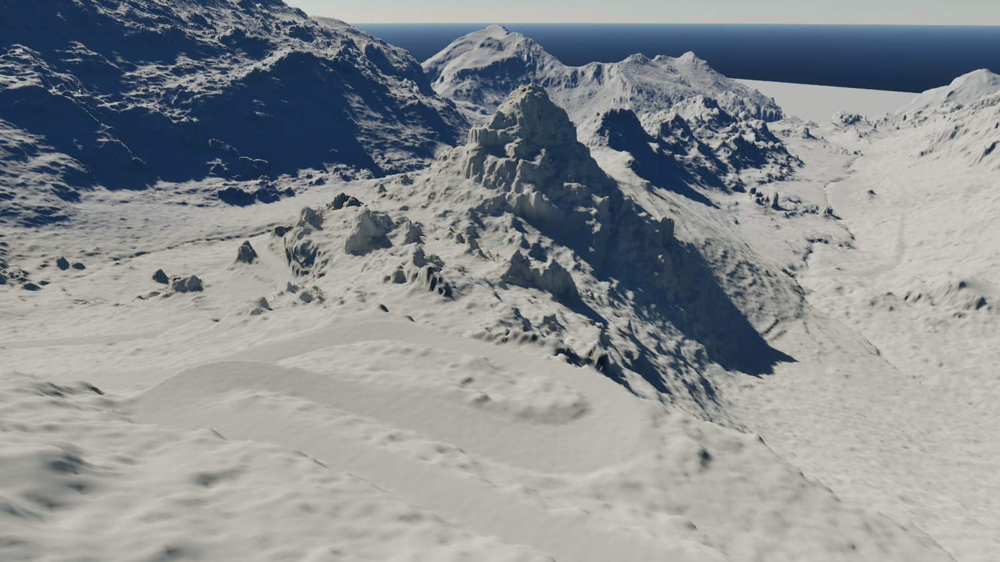

# Sa Calobra: Houdini terrain and Ma-2141 500 m corridor report

**Date:** 2026-10-16, Europe/Warsaw. **Reporting issue:** [#479](https://github.com/karnalooch/YetAnotherCyclingSim/issues/479). **Milestone:** M3. **Overall status:** local terrain/mask preview delivered; production admission incomplete.

The existing UE Remote session now displays the real Sa Calobra terrain with Houdini-authored masks for the complete supplied Ma-2141 reference and a 500 m buffer on each side. The scene contains five native Landscape actors and four lighting/atmosphere/exposure actors. It contains no road, roadbed, vegetation, buildings or cliff mesh dressing. The map was saved locally. This report publishes evidence and findings, not the implementation or its binary assets.

Green denotes the interior procedural influence, blue the transition within the working corridor, orange its boundary, and gray terrain outside the corridor. The colors are a diagnostic material, not production terrain surfacing. The orange display band uses a 5 m mask-shrink parameter; it does not change the approved 500 m extent.

## 1. Authority and exact scope

The owner selected Houdini as the primary terrain/world-authoring executor and SideFX Project Pegasus as the method source. The accepted interpretation is **real Sa Calobra geography with Pegasus methods**, allowing subtle, separately controllable deformation. The fictional Pegasus island's shape and large height remapping were rejected as a substitute for Sa Calobra.

The latest scope is boundaries and masks only, over the existing fresh terrain. The road reference supplies geographic distance and extent; no road geometry is generated. The wider terrain is a background candidate, not a visibility-optimized final world. No claim is made that all 8 km × 8 km source pixels need full-detail production rendering.

The World Building Bible remains the world-method authority, the Roadmap the milestone authority, and the terrain/route source records the geographic authority. Local `AGENTS.md`, the AI router, role policies and `docs/tooling/sidefx/README.md` were revised to state the owner's Houdini-first direction. Those authoring-workspace changes are **not included in this documentation-only report commit**. The report branch must not be mistaken for their delivery to `main`.

## 2. Source and version inventory

| Item | Recorded value | Evidence / limitation |
|---|---|---|
| Authoring checkout HEAD | `b41b3fdc6a4ddfdf28a4852cb47967367d667d36` | Dirty local `codex/365-world-graph` workspace; not an exact-SHA implementation proof |
| Report branch base | `4dd792219bfc2eaf7dc216bd60cbde6628bba792` | Separate checkout of fetched `origin/main` |
| Houdini | Indie 22.0.466 | Native HIP/cache generation; no claim of a commercial-license migration |
| Unreal | 5.8.2, CL 56702186 | Existing editor session, matching locally installed Houdini Engine integration |
| Geographic CRS | EPSG:25831 | Metric projected coordinates |
| DTM source | `sa_calobra_8x8km_mdt50cm_epsg25831.tif` | 16,000 × 16,000 float32 cells, 0.5 m spacing |
| DTM SHA-256 | `6092a48a949b7b7e8ccf120cb46d59cfd7fdd3522085e8a55162fd52fe5a139a` | Source retained locally; not republished here |
| Route source | `ma2141_cartociudad_source_2026-10-02.json` | Complete supplied reference: six parts, 12,643.476205049112 m |
| Route SHA-256 | `6520b92486b5d1c63353b8253d388ab21d380c78fda119849311be8344d8ae36` | Source identity, not road construction acceptance |
| Original SideFX HIP | `ProjectFiles_LandscapeCreation_DigitalAsset.hip` | SHA-256 `35194d7f7c2784c17f9b539cfc46b76df89d01cbb602618aab43dd803283f645` |
| Original SideFX HDA | `sop_pe_landscape.1.0.hda` | SHA-256 `23dcea9051f5d4d980b548eec95005d2616dc0093717aa6df0cbdce4a8faee27` |

See the [recipe](evidence/recipe.json) and [source preflight](evidence/source_preflight.json). The source corpus and geospatial attribution remain attached to the retained original source packages. This report does not grant redistribution rights to SideFX projects, third-party assets or terrain datasets.

The local source concordance indexes 16 Pegasus series, 130 parts, 304 extracted material files from 14 original downloads and two nested archives, 13 supplementary videos and the three Embark/Far Cry talks. Indexing and caption availability are not proof that every tutorial was implemented. No missing transcript is synthesized or represented as a downloaded original. Only the following bounded methods are attributed to this terrain/mask session.

## 3. SideFX method-to-implementation mapping

| Original method | Source / location | Local application | Adaptation |
|---|---|---|---|
| Source / manual / procedural separation and caches | [Pegasus Landscape Workflow](https://www.sidefx.com/tutorials/project-pegasus-landscape-workflow/), [Pipeline Overview](https://vimeo.com/888567622), 01:40 and 02:43 | Preserved real-source stage, separate procedural detail, native caches | Real DTM replaces the sample island; manual stage remains empty |
| Shaping curve and geometry mask | [Pegasus Landscape Creation](https://www.sidefx.com/tutorials/project-pegasus-landscape-creation/), [Building the Landscape](https://vimeo.com/888565929), 00:59 and 07:49 | Geographic corridor boundary feeds native HeightField masking | Boundary derived from the complete route reference and metric 500 m buffer |
| Mask shrink and blur | Same lesson, 08:14 and 08:31 | Original native Pegasus mask workflow supplies the gentle transition | Original project nodes reused; geographic inputs and display parameters are recorded |
| Noise / distortion / erosion chain | Original HIP/HDA; [HeightField Erode Introduction](https://vimeo.com/888565731), 04:44 | Separate, low-strength procedural detail candidate | Island-specific 350/400 m remapping bypassed; blend set to 0.001 and measured |
| Boundary mask | Original `/obj/PEGASUS_DETAIL_SOURCE/heightfield_maskshrink1`, actual type `heightfield_blur`, and native HeightField Layer subtraction | Copy `working_area`, shrink its interior, subtract to show the edge | Radius parameter 5 m is a review-display choice, not a SideFX standard |
| Mask export | [SideFX HeightField Output](https://www.sidefx.com/docs/houdini/nodes/sop/heightfield_output.html) | Native RGB PNG export with no remapping | R=`working_area`, G=`gentle_transition`, B=`boundary_500m`; 8-bit display copy |
| UE consumption | Native Houdini Engine transfer plus UE material/render-target APIs | Five native Landscapes, four world-coordinate mask material instances | Unit/axis/grid adapter; no custom terrain or erosion algorithm |

Python/HOM orchestrates files, nodes, checks and exports. It does not replace the SideFX terrain algorithms. The RGB material graph and visibility rotation are UE integration adapters, not a claim that SideFX supplied this exact Sa Calobra scene.

## 4. Geography, extent and measured terrain fidelity

The buffer is a horizontal metric distance in EPSG:25831, not 500 m measured along a sloping surface. Its union covers all six supplied route parts. Where buffers overlap, the union is one working area; it is not six independent strips.

| Measurement | Result |
|---|---:|
| Geometric buffer area | 7,996,503.912180085 m² |
| Houdini rasterized working-mask area | 7,996,517.5 m² |
| Missing source cells inside the corridor | 0 |
| Working HeightField | 7,154 × 9,829 at 0.5 m |
| Valid source cells compared | 70,316,666 |
| Source HeightField vs original valid DTM samples | Maximum and mean difference 0.0 m |
| Validity/Alpha mismatches | 0 |
| Geographic working-mask IoU | 0.9999979991289959 |
| Differing boundary cells | 64 |
| Procedural detail maximum absolute delta | 0.17791748046875 m |
| Mean absolute delta inside corridor | 0.02350447326898575 m |
| 95th percentile absolute delta inside corridor | 0.072998046875 m |
| Maximum absolute delta outside corridor | 0.0 m |

The assistant proposed a conservative first-variant 0.5 m maximum displacement limit; this was not a SideFX recommendation or an owner-specified numerical requirement. The measured candidate is below it. The original DTM and reversible source/detail switch remain retained.

Evidence: [geographic comparison](evidence/geographic_verification.json), [detail comparison](evidence/gentle_detail_verification.json), [fresh Houdini reopen](evidence/fresh_readback.json), [preview and switch](evidence/preview_and_switch_verification.json). These are different proofs and must not be conflated with survey accuracy, production acceptance or the final UE collision state.

## 5. Mask generation and transfer contract

`SaCalobra_Corridor_Masks.hiplc` is the local editable workflow. `Ma2141_Corridor_Masks.bgeo.sc` retains native HeightField layers and the unchanged height field. The height SHA-256 is `44aadb58f7a5027bc0573027e459bccce4f0440182a124251db619a02c6e18d7`.

The mask build compares complete float32 height arrays before and after generation and for every detail tile. All are identical. The native cache remains the authoritative precision; RGB PNGs are 8-bit visualization exports. PNG orientation was checked against native voxel arrays: image rows correspond to the reversed native volume Y index. This is recorded in the [orientation comparison](evidence/houdini_texture_orientation.json), not inferred from appearance.

Four detail textures are 3,811 × 5,081. The context visibility texture is 2,017 × 2,017. The [texture manifest](evidence/houdini_texture_manifest.json) records first sample positions and axis increments. World-coordinate sampling uses the minimum sample position minus half a cell and an extent of sample count times spacing, so pixel centers align with source samples. The textures use linear, non-sRGB, uncompressed BGRA8 data and nearest filtering, without mipmaps; texture streaming is disabled for these review masks.

**Native UE paint layers for the three corridor masks were not imported.** The current display uses a material and four per-tile instances. The editable masks exist in Houdini. `ShowMasks` is a material parameter; a viewer toggle has not been wired up. Treat the current state as a mask-review delivery, not a completed paint-layer authoring pipeline.

Evidence: [Houdini mask manifest](evidence/houdini_manifest.json), [UE material bindings](evidence/corridor_mask_display.json), [native parameter/transform basis](evidence/landscape_transforms.json), and [corrected GPU pixel readback](evidence/texture_gpu_probe_after.json).

## 6. Unreal scene and Remote delivery

Saved map: `/Game/Worlds/SaCalobra_Houdini_20261016/L_SaCalobra_LandscapeOnly`.

| Actor group | Configuration |
|---|---|
| `SaCalobra_Detail_0_0`, `_1_0`, `_0_1`, `_1_1` | Four 3,811 × 5,081 native Landscapes, 0.5 m spacing; 300 components each |
| `SaCalobra_Context_Valid` | 2,017 × 2,017 background Landscape, 3.90625 m spacing; 256 components |
| Review actors | Directional light, sky atmosphere, skylight and post-process exposure |
| Roads and environment assets | None |
| Temporary HDA actor | Empty probe removed before final save |

Houdini coordinates use X=east, Y=elevation, Z=south, in metres, relative to E483650/N4409899.5. World-space UE uses east/south/elevation in centimetres. The actual native Landscape actors also have a local **−90° yaw**, as recorded in the transform receipt. Native weightmap import must respect those local axes; world-coordinate material sampling must not apply that rotation a second time.

The local Epic Pixel Streaming 2 viewer remains at `http://127.0.0.1/sa-calobra.html?HoveringMouse=true&MatchViewportRes=true&MouseInput=true&KeyboardInput=true`. This address is local to the authoring machine, not a public remotely accessible service. A fresh browser frame was visually checked in the owner's in-app browser, including the color legend. The existing UE process was kept running; no new public endpoint or server was introduced. VP9 was retained. Persistence after logon/job termination was not re-proven in this session.

The cliff close-up was recovered from the geographic footprint of former LandscapeComponent_230, rather than copying obsolete local coordinates into the new origin. Its center is E483409.75/N4409043.75. The close view was retained before switching to the corridor overview. [Camera readback](evidence/cliff_camera_focus.json).

The final [scene inventory](evidence/corridor_scene_inventory.json), [save receipt](evidence/final_map_saved.json), and [completion record](evidence/corridor_completion.json) establish the local state. A fresh UE reopen **after** mask assignment and visibility correction was not performed, to preserve the owner's live session. Earlier fresh-open terrain proof does not certify this later saved state.

## 7. Problems encountered and their actual status

| Problem | Diagnosis and attempted action | Current result |
|---|---|---|
| Wrong material input names | `Input`/`Coordinates` connections failed; installed API reported the actual default input and `UVs` | Corrected; native material bindings and rendered masks verified |
| Parameter setter returned false | `set_material_instance_vector_parameter_value` returned false even though getter read back the requested value | Verified by native value readback; setter return alone is not treated as proof |
| Large regions incorrectly appeared orange | Two textures logged `contains no miplevels`; a native GPU test returned white instead of RGB `(255,255,0)` | Rebuilt texture resources with supported data settings; GPU readback became `(255,255,0)` and full-view masks aligned |
| Unsupported texture property | `compression_none` is not exposed on this UE Texture2D | Attempt stopped; final settings use supported `TC_VECTOR_DISPLACEMENTMAP` and `never_stream` |
| Context visually overlapped detailed terrain | Earlier Houdini visibility bake did not retain the required result; the first native render-target import also used the wrong local orientation | Corrected visible result through native `__LANDSCAPE_VISIBILITY__` weightmap import with UV `(v,1-u)` for −90° yaw |
| Context collision still overlaps | Unfiltered vertical traces still hit context at 33 of 80 interior samples; forced layer update, `RecreateLandscapeCollision`, and collision disable/restore did not clear it | **Unresolved. Do not use the context collision as authoritative terrain/road support** |
| Mouse wheel zoom in Remote | Rotation worked; camera position stayed fixed. Scroll speed 5→8 and hovering-mouse mode did not establish working zoom | **Unresolved.** Explicit editor camera positioning works; do not claim wheel control is repaired |
| Temporary command execution queue | Used locally for bounded integration/debugging | Slate callback unregistered and file-execution loop removed from the startup review script; Remote remains running |

The rendered visibility correction is not a collision fix. The native trace report remains deliberately failing for background overlap. The 80 detail-only traces have zero misses and a maximum absolute transfer-height error of **8.005000423203455 cm**, consistent with the recorded native Landscape quantization check. This is not a combined bound against the original DTM and not a complete collision acceptance test. [Trace evidence](evidence/corridor_native_verification.json), [visibility import](evidence/context_visibility_import.json), [queue shutdown](evidence/temporary_queue_disabled.json).

The earlier rejected fictional-island deformation, failed material/texture attempts and stale probes must not be reused as final proof. The report image is the corrected final native render.

## 8. Delivery inventory and reproducibility limits

The local workspace retains the complete editable recipe at `D:/yacs/work/sa-calobra-houdini-unreal-20261016/SaCalobra_Corridor_Masks.hiplc`, original source terrain and source projects, per-tile native caches, the export HIP, exported mask PNGs, and UE assets under the new map folder. The original accepted world remains separate.

The task output folder `SaCalobra_Maski_500m` additionally contains:

- `SaCalobra_Maski_500m.hiplc`: portable native-cache viewer project, not the complete source reconstruction graph;
- `Ma2141_Corridor_Masks.bgeo.sc`: native height and mask layers;
- four detail RGB PNGs and one context visibility PNG;
- mask, grid and orientation manifests;
- the Houdini build/export and orientation-check scripts.

The cache-viewer project uses `$HIP`-relative input and was saved successfully; a separate fresh reopen of this small packaging project was not performed. The earlier full terrain project's fresh-reopen receipt is a different proof. [Local artifact hashes](evidence/local-artifacts.json).

This GitHub delivery contains only this report, bounded JSON evidence, two native screenshots and the experiment-journal record. Full tutorial transcripts/archives, source DTM, HIP/HDA/cache binaries, UE maps/materials, vendor plugins and the dirty authoring implementation are not part of this commit. A report push therefore does not make the live scene reproducible from this commit alone.

Evidence JSON is reformatted as UTF-8 and task-home paths are normalized to `${TASK}`. The [evidence manifest](evidence/manifest.json) records original and published hashes so the normalization is explicit. Screenshots are copied without image manipulation.

## 9. Verification boundaries and next actions

| Gate | Status |
|---|---|
| Whole supplied route covered by 500 m buffer | Verified by source/preflight evidence |
| Source DTM identity and native source heights | Verified over the recorded working grid |
| Delicate procedural detail and outside-mask preservation | Verified, numerical results above |
| Mask build changes terrain height | No; full-array comparisons are equal |
| RGB orientation / material binding / visible Remote output | Verified locally |
| Native UE corridor paint-layer import | Not performed |
| Background visual overlap | Corrected and inspected |
| Background collision overlap | Fails: 33/80 traces still hit context |
| Saved final map | Save receipt present |
| Fresh reopen of final masked UE map | Not run |
| Wheel zoom / keyboard travel acceptance | Not established |
| Exact report-commit runtime proof | Not claimed; runtime was produced in a dirty authoring workspace |
| Owner final visual acceptance | Pending |
| Performance | `DEFERRED_AFTER_M3`, `performance_pass: false` |
| Road, gameplay and complete world admission | Outside this stage; not claimed |

The next bounded actions are: repair and re-test context collision without replacing the source terrain; verify the final saved map in a deliberate reopen window; finish Remote movement diagnostics; decide whether native UE paint layers are required for the next authoring stage; and only then proceed under the owner's next scope decision. Keep the terrain-only scope until explicitly expanded.

Documentation verification is recorded in [report-validation.json](evidence/report-validation.json). The existing documentation index and experiment-journal guards are used; report-local links, JSON and evidence hashes are checked separately. No new terrain benchmark, heavy UE job or production acceptance is inferred from documentation checks.
