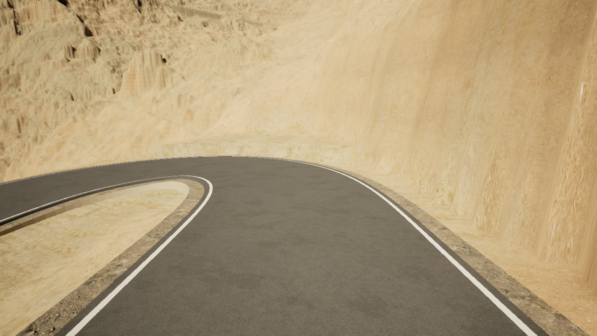
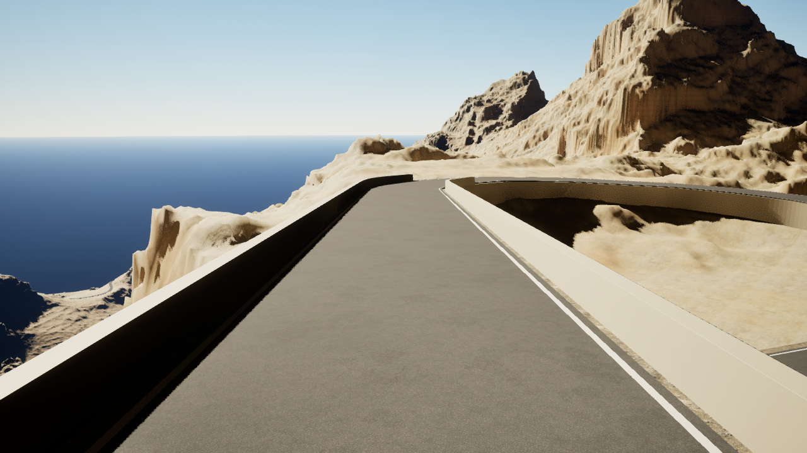

# M3 road material review — 2026-10-11

**Issue:** #364; contact observations remain under #459. **PR:** #470, Draft.
**Reviewed runtime:** `b9fddea3f6023239da98bec7a5107ed1124cf52e`.

## Evidence identity

[Native run 38116299783](https://github.com/karnalooch/YetAnotherCyclingSim/actions/runs/38116299783)
completed all selected stages. The original archive is 476,694,696 bytes,
SHA-256 `d580f706d7b645ada9ebea9244126a30de1d22d88a4a0da5a68594ef6a84f7d6`.
Its live GitHub artifact identity, ZIP digest and all 629 extracted file
sizes/hashes were verified. [Source manifest](b9fd/source-artifact.json) records
the original identities of the small retained subset; PNGs are unchanged.
Five authenticated scene-copy metadata files are also retained here. Full logs,
priming frames and remaining originals stay in
[artifact 11694637100](https://github.com/karnalooch/YetAnotherCyclingSim/actions/runs/38116299783/artifacts/11694637100).

## Role handoff

The [role registry](../../ai/ROLE_REGISTRY.json) and
[handoff contract](../../ai/TASK_HANDOFF.md) define the boundaries. These are
actual assignments for this continuation, not new agent types or privileges.

| Role | Bounded assignment | Output / resource boundary |
|---|---|---|
| `visual-dcc` | Inspect all 68 final Lit frames and the 16 crack controls; assess grain, crack appearance, white lines and transitions | Image findings and material recommendations; no source/geometry mutation or host use |
| `road-bob` | Compare 16 window0112 and six hairpin0081 images with retained source/native/CUT data | Surface ownership and source-relative contact analysis under #459; no pavement or Landscape mutation |
| `unreal-integration` | Retarget the Level Editor stream to authenticated b9fd and implement the owner-requested bounded persistent material preview | Stream/UE scripts and tests; no host dispatch, geometry changes or acceptance authority |
| `proof-qa` | Independently review workflow admission, scene pins and the persistent-preview boundary | Actual checks and blockers; no implementation or host writes |
| `unreal-integration` helper | Diagnose propagation of the established workspace cache configuration | Runner/config correction only where supported; no cache deletion or listener restart |
| Primary coordinator | Authenticate artifacts, inspect findings, update current documentation, integrate and publish | One writer per affected path; serial native/GPU/home-runner work through existing ownership gates |

The independent `visual-dcc` reviewer also checks the stream-preparer patch.
Protected CI, actual Unreal evidence, owner visual acceptance and merge remain
separate from specialist recommendations.

## Current findings

- Save and separate fresh reload passed, followed by actual GPU exit zero.
  Coverage is **68 Lit + 16 crack controls + 16 window0112 + 6 hairpin0081**
  final images. Priming images do not increase that coverage.
- Dry aggregate is visible without the previously rejected glossy response.
  The two local crack motifs look restrained, with no visible rectangular
  patch outline in the reviewed Lit views. This is two canaries, not network
  distribution or an edge-erosion result.
- The neutral, BaseColor, Roughness and WorldNormal controls were captured and
  inspected. The two actual patches use UV rotations 0 and 90 degrees. Their
  crack-normal signal is too small in these rider views to resolve normal
  orientation confidently. `normal_space_verified` remains false.
- Near white lines follow the road. Far pixel gaps, transverse asphalt bands,
  and the sharp outer gravel/Landscape transition remain unresolved.
- At 0112, hiding support022 removes the lower wall strip and its beige shoulder.
  A separate thin upper line touching the asphalt remains when support112,
  support022 or the selected local Landscape is hidden independently. The
  source projection attributes that upper line to the existing 8 cm pavement
  slab side. These are two distinct features; support022 is not excluded as
  the owner of the lower wall.
- At 0081, support185 owns the tall exposed wall. The new native wall/source
  CUT payload is present; source-relative analysis belongs to #459. Final
  native Landscape height is still not established by this payload.

## Original preview frames

The [0112 support022-hidden control](b9fd/shoulder-contact/capture/frames/window-0112-forward-00002-support022-hidden.png)
and [0081 reverse baseline](b9fd/shoulder-contact-0081/capture/frames/window-0081-reverse-00004-baseline.png)
retain visible defects, rather than implying geometry acceptance.

## Next bounded proof

The [workflow cost review and optimization proposal](workflow-review.md) combines
the measured native timings, current code and official Epic documentation.

The owner requested a lighter iteration loop on 2026-10-11. The
[current cadence](../../CI_VALIDATION_TIERS.md#m3-road-material-iteration-cadence)
now requires explicit full native/source intent; ordinary pushes keep CI but
do not request either complete material proof. This changes scheduling, not
the evidence bar. The separate
[2ec534c checkpoint](https://github.com/karnalooch/YetAnotherCyclingSim/actions/runs/38119538994)
failed during outer material preparation. Its
[authenticated record](outer-2ec534c/README.md) shows successful terrain
authentication followed by D3D12 resource allocation failure in the
`terrain.build_surface_terms` interval. It created no new saved scene or images.

The failed attempt selected the existing five-owner outer terrain blend plus
ten band/paint controls and retained all 68 original Lit cameras. It did not
request the separate crack or contact families. Its 18 exact selected textures,
save/fresh/GPU checks, source/buffer conservation and unchanged strict native
texture checks remain required. The latest stage records locate the failing
interval, but not its exact node or allocation cause. Further diagnosis must
precede another full checkpoint.

The corrected [road-contact analysis](road-contact-source-analysis/README.md)
retains the independently checked source-CUT differences and the separate 8 cm
pavement step. It is not an applied geometry correction or final Landscape proof.

The stream launcher is retargeted to the authenticated b9fd saved scene:
278 files / 758,655,493 bytes, including the 193,018,676-byte saved map. Its
metadata parser handles the actual 3,225,316-byte saved manifest: only that
named manifest receives a 4 MiB bound; all other metadata retain 2 MiB. The
source receipts, six project/config pins and complete copy inventory passed
independent review. Windows source-byte preflight and a real receiving-client
check remain required; no working live stream is claimed here.

On 2026-10-11 the owner explicitly requested implementation of the lighter
workflow and a persistent MCP material-preview loop alongside the stream. This
permits the bounded isolated-session integration described in the cost review;
it does not confer geometry, source-world save or final admission authority.

Owner audit: `PENDING_FINAL_M3`. Performance: `DEFERRED_AFTER_M3`,
`performance_pass: false`. #364, #459 and M3 remain unfinished.
