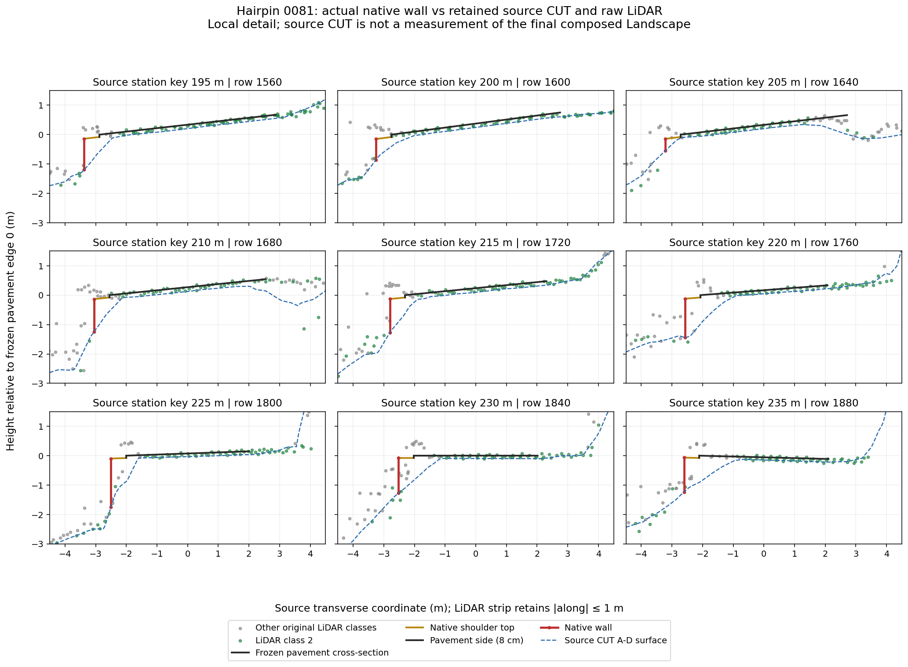
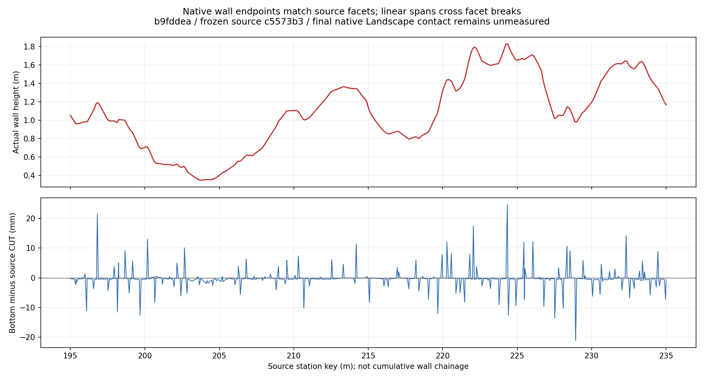

# Native wall contact against frozen source CUT — 2026-10-11

**Owner:** `road-bob`. **Scope:** offline #459 evidence; #364 remains a material consumer.
**Status:** source-relative analysis and hypothetical envelope, **NOT APPLIED**.
Final composed Landscape contact and owner visual acceptance remain unproved.

## Finding and bounded proposal

The native support185 payload covers source rows **1560–1880**, or source station
keys **195–235 m**; these keys are not cumulative wall chainage. Its 640 top and
640 matched wall triangles yield 321 consistent endpoint pairs. All 175 retained
CUT nodes match the original patch bytes, grid indices and XYZ.

Wall bottom endpoints follow the authenticated source CUT A–D triangles closely.
Linear spans between them cross source facet boundaries, causing a local
source-relative difference of **+24.685 mm / −21.177 mm**, with the full computed
values below. Positive means the native bottom is above the source triangle;
negative means it lies below that source surface.

| Measurement | Result |
|---|---|
| Native wall height, minimum / median / maximum | 0.349092 / 1.066566 / 1.828051 m |
| Endpoint bottom minus source CUT, minimum / median / maximum | −1.965558 / −0.320095 / +0.442360 mm |
| Interior source grid/facet crossings | 139 |
| Maximum positive difference | +24.685419 mm; segment 1794, `t = 0.7512474543744376` |
| Minimum difference | −21.177388 mm; segment 1831, `t = 0.4019773530787544` |
| Segments above +10 mm / below −10 mm | 11 / 9; descriptive counts, not acceptance thresholds |

The [summary](native-wall-source-comparison.json) retains full precision,
coordinates and nine transects; the [CSV](wall-transects.csv) is the compact
transect table. The A–D basis follows the historical native evidence recorded in
the [World Building Bible](../../../WORLD_BUILDING_BIBLE.md) and
[road preview consumer](../../../../scripts/ue/ma2141_road_preview.py).

The [hypothetical bottom envelope](hypothetical-bottom-envelope.json) is
`min(original bottom line, authenticated source CUT A–D triangles)`. It partitions
at facet breaks and zero crossings, preserves existing burial and moves only
downward by at most **24.685419 mm**. There are 903 per-segment records including
shared endpoints, representing 584 unique ordered points. It is analysis data;
no mesh, source profile, shoulder top, pavement XYZ, banking or terrain was changed.

**Essential next measurement:** obtain owner-verified Landscape-only traces,
including the negative owner control, at the same 321 endpoints and 139 crossings
on the final composed consumer. The existing
[`_landscape_only_trace` implementation](../../../../scripts/ue/capture_sa_calobra_whole_map_prep.py)
provides the pattern. The payload explicitly records
`final_native_landscape_height_observed = false`; actual rendered Landscape LOD
is unknown. The frozen source grid cannot substitute for that measurement.

If it confirms the local defect, a separate bounded #459 change can recompute the
envelope against the actual owned surface in `bob_vertical_support`, preserving
top faces, existing burial and geometry outside the measured area. Retain
rollback and fresh native views from the same cameras. Collision contact alone
does not establish rendered contact. This evidence does not justify lowering the
road centre or changing the material-only #364 consumer; the #337 centre-profile
question remains separate.

## Shoulder and pavement attribution

At 0112, hiding support022 removes the beige shoulder and the **lower shaded wall
strip**. A separate thin line directly touching the asphalt survives support022,
support112 and local Landscape isolation. The pinned source projection supports
attribution of that upper line to the existing **8 cm closed pavement slab side**
from `network_pavement.pavement_slab`; this is source-to-image correspondence,
not a native per-pixel owner-ID measurement. See the
[original support022-hidden control](../b9fd/shoulder-contact/capture/frames/window-0112-forward-00002-support022-hidden.png)
and the [parent native review](../README.md).

At 0081, hiding support185 removes the tall wall while the broad dark pavement
remains. In the corrected transect plot, the gold shoulder line comes from actual
`native_top_triangles`. Its inner edge is **0.08 m below** the pavement edge at all
321 vertices; the black pavement step is drawn separately. Raw LiDAR points are
observations, not surveyed wall-foot targets. Sparse nearby class-2 points do not
define a continuous contact surface or a road-height correction.





## Pinned inputs and retrieval

Large originals are deliberately referenced rather than duplicated. Retrieve the
named members from these authenticated artifacts; `proof/` in the original local
paths is an extraction convention, not an archive member prefix.

| Key | Exact execution/source revision | Run and artifact | Archive bytes | Archive SHA-256 |
|---|---|---|---:|---|
| N — native diagnostic | `b9fddea3f6023239da98bec7a5107ed1124cf52e` | [38116299783, attempt 1 / 11694637100](https://github.com/karnalooch/YetAnotherCyclingSim/actions/runs/38116299783/artifacts/11694637100) | 476694696 | `d580f706d7b645ada9ebea9244126a30de1d22d88a4a0da5a68594ef6a84f7d6` |
| C — frozen profile and CUT | `c5573b3cf545c51ce83ad1fb0a5ca3111f5ad7f6` | [37170332840 / 11291895548](https://github.com/karnalooch/YetAnotherCyclingSim/actions/runs/37170332840/artifacts/11291895548) | 114891888 | `55072f97d9f24ba66eeb463926280474e18144abd59404a3276318e1afd05ecb` |
| L — source LiDAR export | `e81a4377cc6b8d635c0036adf01fc8427f987ff9` | [38111916772, attempt 1 / 11691832102](https://github.com/karnalooch/YetAnotherCyclingSim/actions/runs/38111916772/artifacts/11691832102) | 113742 | `aac8adf0c09a7594a4a436f03a2ff1259334b03a98c2e4a891e5beac27345eb3` |

| CLI input | Artifact member | Bytes | SHA-256 |
|---|---|---:|---|
| `--native-receipt` | N: `shoulder-contact-0081/shoulder-contact.json` | 484371 | `2139bd0a735f4d7222bc4293db99b89dd95adacd44f8becb22e3a8767db32feb` |
| `--cut-patch` | C: `ma2141-cut-patch.f32` | 256136 | `cabf471cf108017a1a15624880dd8ca531f880ddfeaf747bd0769b05abb75642` |
| `--cut-manifest` | N: `shoulder-contact-0081/source-cut-manifest.json` | 1749 | `5ccfd9ece2c8cdf8140b47b4a771e5a530d7aa4835554771824bf9fd1d23404f` |
| `--lidar-csv` | L: `hairpin-lidar-points.csv` | 417842 | `6af3704cc525bcc7282989e74beb061ba6fdec9f3c7492ee6d428ca3b603fb0d` |
| `--lidar-receipt` | L: `hairpin-lidar.json` | 26853 | `f7bcf44f948672f70f22f055fd4781d50622ccdfa0ae8840e35ef4136449e13d` |
| `--profile` | C: `ma2141-profile-candidate.json` | 9232773 | `c0ca612dd5af5a311d1917e41d66f44aa83a9d40eed5e9e784432e06e2a52253` |

Original absolute acquisition paths remain in the summary's `inputs` array.
The native archive and retained original images are additionally anchored by
the [parent artifact manifest](../b9fd/source-artifact.json). The native support
triangle digest is `86cf0faea6014e369f8f1d4f05baa0c46401f024c19ac97d75ddb742f0a0ed09`;
the wall payload digest is `615f76466b70e7c48589274caba3ab955f1407a3dfec6f00e3fc9735a2f3f3b7`.
The former matches the native restoration receipt.

## Reproduce and review

Use Python 3.12 with Matplotlib; the recorded replay used Python **3.12.14** and
Matplotlib **3.10.8**. No Unreal process or producer is required. From this
directory, point the three variables to extracted artifact roots and choose a
new output directory:

```bash
ROAD_CONTACT_NATIVE=/path/to/extracted-native-artifact
ROAD_CONTACT_CUT=/path/to/extracted-frozen-source-artifact
ROAD_CONTACT_LIDAR=/path/to/extracted-lidar-artifact
MPLCONFIGDIR="$PWD/replay/mplconfig" PYTHONDONTWRITEBYTECODE=1 \
python3 analyze_native_wall.py \
  --native-receipt "$ROAD_CONTACT_NATIVE/shoulder-contact-0081/shoulder-contact.json" \
  --cut-patch "$ROAD_CONTACT_CUT/ma2141-cut-patch.f32" \
  --cut-manifest "$ROAD_CONTACT_NATIVE/shoulder-contact-0081/source-cut-manifest.json" \
  --lidar-csv "$ROAD_CONTACT_LIDAR/hairpin-lidar-points.csv" \
  --lidar-receipt "$ROAD_CONTACT_LIDAR/hairpin-lidar.json" \
  --profile "$ROAD_CONTACT_CUT/ma2141-profile-candidate.json" \
  --output-dir ./replay
```

The script verifies all six SHA-256 pins before and after analysis. It writes the
five retained numerical/plot outputs plus reproducible endpoint and facet-crossing
JSON tables. The unretained tables are indexed in
[reproduction-check.json](reproduction-check.json). If input paths are relocated,
the summary's absolute path strings change; its numerical content does not.
PNG bytes may also depend on the plotting runtime.

Packaging replaced only hardcoded paths with CLI arguments. AST comparison found
all four original analysis functions unchanged; replay against the original
input paths produced **all seven outputs byte-identically**, including both PNGs.
[package-manifest.json](package-manifest.json) hashes every retained file except
the manifest itself. The full profile, original archives and redundant derived
tables/crops are not copied into this package.

Independent proof QA reproduced the numerical endpoints, facets and extrema to
within **2.92 × 10⁻¹³ m**. Independent `material_review` inspected the corrected
transect image, verified all 321 native inner vertices and their 0.08 m step,
checked nine LiDAR transects and the original 14-file analysis hash index, and
reported no blocker to offline preservation. The reviewed transect PNG SHA-256
is `e0fe73224c331bc23d2b4069c1849841edf4f867cd88d39b6e19f956e942b01c`.

These are diagnostic and offline reproduction passes. **Geometry repair is not
applied; final Landscape contact, owner visual acceptance and performance remain
separate and unpassed by this analysis.**
