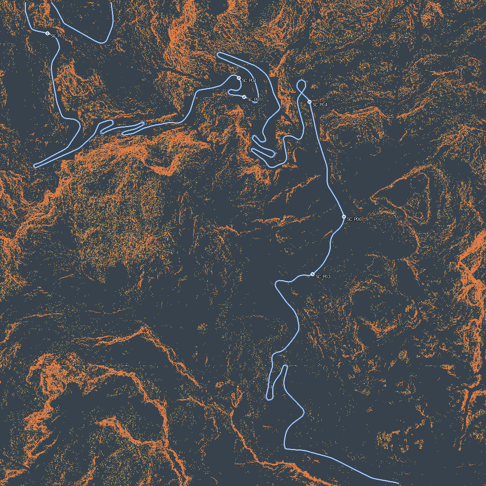

# Sa Calobra source-backed spatial treatment draft — 2026-10-13

Issue #365 / M3. This planning derivative precedes placement. It reuses the
existing [observation map](../sa-calobra-detail-planning-map-20261008/README.md)
and the [cliff/scree selector contract](../../tooling/SA_CALOBRA_CLIFF_EROSION_PASS.md).
No Landscape, Base_DTM, road, source raster, material or UE scene was modified.

[Open interactive map](spatial-plan.html) · [Machine-readable provenance](spatial-plan.json)



## Reading the map

| Colour | Meaning | Area |
|---|---|---:|
| Orange | Cliff mesh investigation candidates | 368,234.75 m² |
| Yellow | Loose rock / scree investigation candidates | 127,164.75 m² |
| Blue | Protected: road carriageway only | 42,434.75 m² |
| Grey overlay, hidden by default | Other exclusions: shoulder/BOB/building/water/infrastructure | 273,770.00 m² |
| Purple | Unknown terrain neighborhood; no placement | 4,032.00 m² |
| Dark grey | Keep existing material; treatment unresolved | 3,250,744.75 m² |

Owner display correction, 2026-10-13: Protected now shows only pavement bit 1.
Other hard presentation exclusions have a separate, default-hidden layer.
Candidate validation and planting restrictions still use the original masks;
this display correction grants no new placement eligibility. The prior broad
protected display is retained under the external spatial-plan work directory.

Cliff and scree are source-derived presentation hypotheses, not surveyed geology
or approved final mesh footprints. Scree uses the existing 24–42° art selector;
it does **not** override the rock-contact V1 limit of 10° or imply any natural20
asset passes. Protected and unknown layers may overlap; counts retain their
independent semantics. No region is automatically assigned texture-only.

The HTML embeds full 4033×4033 registered raster layers and supports separate
layer toggles, pan, zoom and coordinate readout. The PNG is a nearest-neighbor
1100-pixel overview, not the analytical raster. White lines join observations
only within each of 185 disconnected windows; 669 observation dots and six card
anchors are not rock positions or classified world surfaces. Their A/B/C
physical mapping remains unresolved. No hidden D region is inferred.

Pixel centers map to local `(col*0.5, row*0.5)` metres, X east / Y south.
The first pixel edges are -0.25 to +0.25 m; the complete footprint is
[-0.25, 2016.25] m in each axis. EPSG:25831 center origin is
(483000.25, 4409516.25). This preserves the accepted grid without a half-pixel shift.

## Provenance and reproduction

Producer source is the new
[`build_sa_calobra_spatial_treatment_plan.py`](../../../scripts/assets/build_sa_calobra_spatial_treatment_plan.py)
in the local continuation based on `0dd86495fab674a9d6aee22ba0759539d8bd7242`.
The selector was regenerated by the coordinator using the existing producer;
its fingerprint is `b0699b6004237ca0fe719ed69941734bbd6208350153641297fe417fc54063e7`.
The current draft records actual input paths and hashes in `spatial-plan.json`.
The generator verifies selector raster hashes, source manifest hashes, exclusion
raster hash, fixed raster CRS/transform/shape, candidate counts and the original
survey CSV hash. It rejects candidate intersections with protected/unknown cells
and refuses to overwrite an existing output directory.

```powershell
python -B scripts/assets/build_sa_calobra_spatial_treatment_plan.py `
  --selector-manifest D:/yacs/work/pcg365/spatial-plan-20261013/selectors/cliff-erosion-manifest.json `
  --observations docs/experiments/sa-calobra-detail-planning-map-20261008/planning-data.json `
  --output <new-output-directory>
python -B -m unittest scripts.assets.test_sa_calobra_spatial_treatment_plan
```

The exact selectors remain authority for candidate cells. Component230 pilot
registration and whole-area A/B/C physical boundaries were not expanded here.
Further decisions require source-backed physical surface registration, reviewed
visible form needs, complete asset footprints/exclusion clearance and native
contact proof. The map changes no acceptance gate.

Validation: six focused CPU tests pass; PNG visually inspected. UE/GPU, asset
placement and new render capture NOT RUN. `qualified_assets: []`, `placement:
false`, `performance_pass: false`, `DEFERRED_AFTER_M3` remain. This is a local
candidate, without push or merge.
