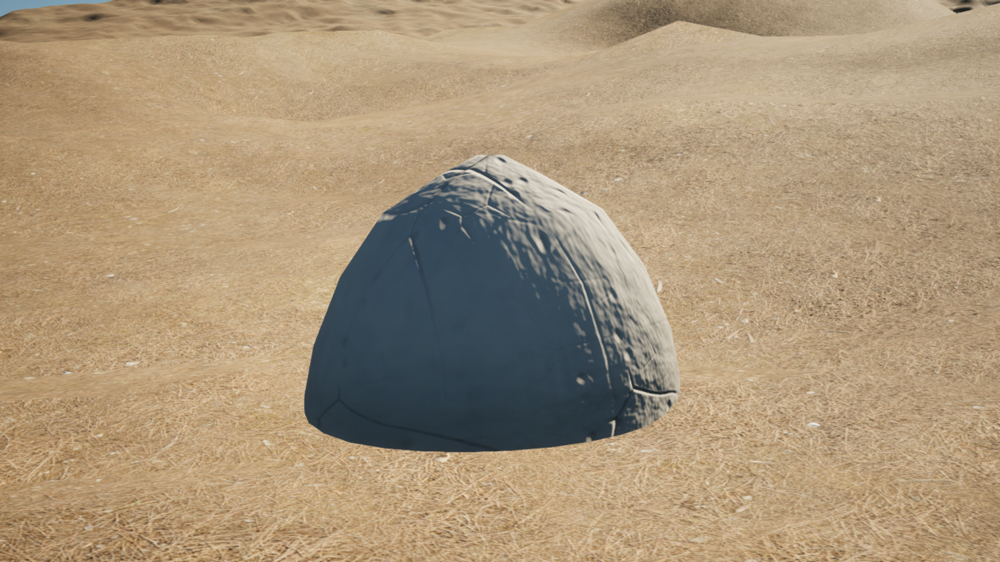
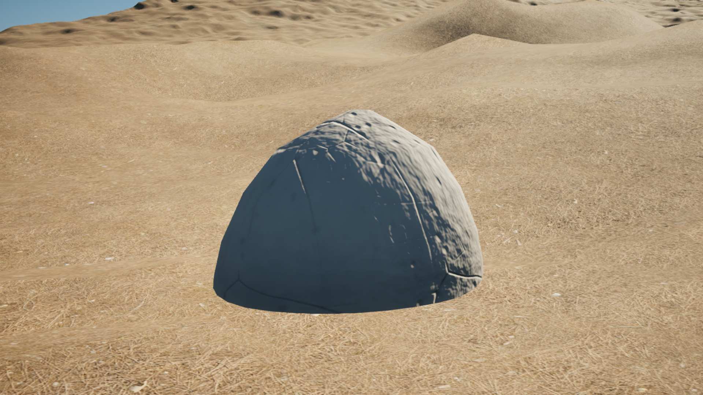
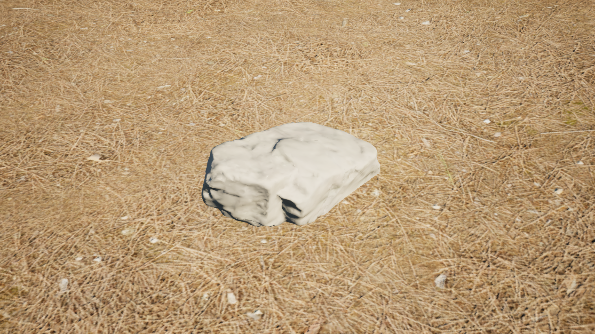
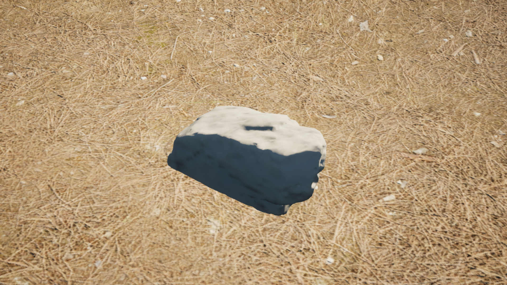

# Sa Calobra PCG world graph — #365 kickoff

## Local continuation — 2026-10-13

The owner requests repaired contact and Remote import/planting, with spatial
treatment planning **before placement**. P0–P4 are accepted diagnostic anchors;
live Remote replaces separate new review renders for this continuation.
The [local source/Remote candidate](../assets/pcg365-source-support-remote-20261013/README.md)
contains twenty source-envelope derivatives and an incremental preview consumer.
Owner authorized push/CI/deployment and discarding unsaved edits. Reviewed
release `a3dcb57829fd5b89b5a7376ef05ef872690dcc27` reopened saved v0.3.1;
native world/material readback and independent browser frames passed. Native import of all twenty candidates and three receiver requests passed at
`a5e2730c`. Contact rolled back before sampling because UE struct allocation
addresses were compared as transform values. The numeric-value guard passed in native UE. A missing instance query API
then rejected the job with zero actors; the tested explicit Geometry Script
library correction passed in native UE at `f0588aa2`: all 559 guards bound,
2,911,650 triangle IDs scanned twice, 104,330 contact positions measured,
one diagnostic `rock_09_02` placed at P3 with camera readback. P0/P1/P2/P4
were rejected for slope/embedding/exposure. Fresh independent post-job
browser frames passed. This sampled preview does not admit regional
placement, continuous support, owner visual acceptance or merge.

The [source-backed spatial draft](../experiments/sa-calobra-spatial-treatment-plan-20261013/README.md)
reuses the [surface atlas](SA_CALOBRA_SURFACE_DETAIL_ATLAS.md) and existing
cliff/scree selectors. Candidate counts were reproduced. Physical treatment
boundaries, native review and asset-specific eligibility still control rollout.
The remainder keeps its current material with treatment unresolved; it is not
automatically texture-only. Scree's 24–42-degree selector cannot override the
rock trial's 10-degree limit. Performance remains deferred and false.

**Status:** M3, CPU candidates, native mesh inspection and saved/reloaded mechanical graph; regional placement pending.
**Owner:** procedural-world. **Base:** `4dd792219bfc2eaf7dc216bd60cbde6628bba792`.
**Current owner instruction (2026-10-12):** implementation resumed for #365,
using subagents and the existing Material Forge contract. The planning-only
instruction of 2026-10-11 is superseded; acceptance gates remain unchanged.
The complete researched continuation is recorded in the
[detailed execution plan](SA_CALOBRA_WORLD_GRAPH_PLAN.md),
[primary-source/tutorial ledger](SA_CALOBRA_WORLD_GRAPH_RESEARCH.md) and
[handoff for another LLM](SA_CALOBRA_WORLD_GRAPH_LLM_HANDOFF.md).
Evidence below separates CPU candidates, isolated native diagnostics and pending
regional asset/contact admission; none closes #365.
The [Roadmap](../ROADMAP.md), [World Building Bible](../WORLD_BUILDING_BIBLE.md)
and [World Authoring Library](../YACS_WORLD_AUTHORING_LIBRARY.md) own scope,
methodology and reusable tooling. This adapter is not a second proof framework.

## Dependency and bounded task envelope

#364 completed through squash merge [#470](https://github.com/karnalooch/YetAnotherCyclingSim/pull/470).
[PR CI](https://github.com/karnalooch/YetAnotherCyclingSim/actions/runs/38174079043)
and [main CI](https://github.com/karnalooch/YetAnotherCyclingSim/actions/runs/38174992518)
passed. The owner [manually accepted](https://github.com/karnalooch/YetAnotherCyclingSim/pull/470#issuecomment-6113634845)
the remaining route/latest-save gate; this does not manufacture an automated
whole-area review or latest fresh-readback PASS. #459 geometry debt is separate.

The first #365 implementation authenticates the existing World Authority masks,
pins graph-input version/seed and emits a deterministic relocatable input
manifest. Scope covers the full 2016.5 m square, not only the Golden Kilometer.
One source writer owns the adapter/config/tests; the coordinator owns docs.
Three read-only specialists audited dependency/proof, source masks and APIs.
No exclusive Unreal, build, GPU or home-runner resource is claimed.

## Resumed implementation — 2026-10-12

`scripts/assets/sa_calobra_world_graph_candidates.py` consumes the authenticated
inputs with an explicit lattice, horizontal probe radius, clearance and overlap
priority. Geographic anchor IDs do not change with seed or manifest identity;
density and native point seeds use separate named streams. The conservative
footprint rejects unknown/excluded cells, including partial cell intersections.
These are XY probes, not qualified mesh transforms or terrain contact.

Two local runs on the real 4033-square source grid used spacing 16 cells (8 m),
radius 0.5 m, clearance 0.25 m, priority `[2,0,1]` and configured seed 36501.
Both produced fingerprint
`17110fb45f877586ccbeb9c3ec1e914392abcf9bb548ecf6b24714c4e272e943`:
64,009 anchors, 124 admitted XY probes, 483 outside-footprint, 37,983 without
selected centre, 19,216 insufficient-clearance, 5,315 semantic-footprint and
888 density rejections. Receipts are ignored local artifacts under
`Saved/RuntimeProof/WorldGraph365/candidates-run-{c,d}/`; this is CPU candidate
evidence and does not replace Gumball native proof or exact-commit CI.

The PCGEx bootstrap now preserves existing source checkouts,
validate exact upstream or reviewed-patched state, and reject hidden local
changes, including assume-unchanged/skip-worktree flags. This does not install
PCGEx or prove its native build/load. Local validation: 7 candidate tests,
7 existing input-adapter tests, 4 existing mask tests and 8 real-Git bootstrap
tests PASS. Sandbox TemporaryDirectory access initially failed with WinError 5;
the affected suites passed outside the sandbox. Critical Ruff checks and all four
docs-index guards (links/i18n/structure/freshness), plus agent contracts, PASS.

### Material Forge integration

Reuse [Material Forge](MATERIAL_FORGE.md) and the accepted
[whole-map material baseline](SA_CALOBRA_WHOLE_MAP_SURFACE_PREPARATION.md).
PCG/PCGEx owns classification and placement; Forge owns appearance. Forge may
consume authoritative masks without changing their classification or hashes.
Its local DetailMasks and Height EXR never supply geography, collision support
or Landscape displacement. Preserve the accepted Landscape material consumer.

For each future qualified mesh, bind the material receipt, package dependency
closure, UV/physical scale and validated PBR maps to that mesh qualification.
Reuse `scripts/ue/import_material_forge_variant.py` for validated Forge variants;
do not treat a material package or the `regional_limestone` family as a qualified
rock mesh. The accepted five-role surface library and optional Forge variants
are separate identities; do not silently replace the accepted consumer.

### Native admission remaining

The host audit found UE 5.8.2 CL56702186 and no canonical PCGEx installation.
Latest road checkpoint `Rc6b061b933e6` resides in the isolated
`b9fddea3f602-y473install01` project and reports `reload_proof: NOT_RUN`.
Canonical Content has no corresponding LiveCheckpoints package. Do not substitute
the older accepted canonical map for this road consumer. Regional StaticMesh
qualification, admitted terrain contact, native generation, save/fresh reopen,
intermediate images and protected exact-head CI remain pending. No real-scene
scatter or completion of #365 is claimed.

Forbidden: changing canonical road/physics, `Base_DTM`, Landscape geometry,
BOB semantics, source masks, live Editor state or streaming; treating isolated
plugin preparation as canonical installation or native placement admission;
inventing rock geography, species, terrain contact or placement acceptance.

## Native preparation and mesh qualification — 2026-10-12

[CI run 38179277475](https://github.com/karnalooch/YetAnotherCyclingSim/actions/runs/38179277475)
passed for `1c14beecfd81a6463711ebc9957047900f45b36e`, including the
Aggregate CI gate and hosted script tests. Unreal build/Automation was skipped;
that run is not native PCG evidence.

`scripts/assets/sa_calobra_pcg_qualification.py` adds a structural binding check
for source/license, imported StaticMesh bounds/support, materials/UV/world WPO,
terrain identity/datum and measured contact policies plus native fixture claims.
It always returns `placement: false` and `proof_authenticity: NOT_VERIFIED`.
It does not admit evidence, replace Gumball, set tolerances, or qualify a real
asset. Retained source/license/material evidence keeps its own producer SHA;
new native observations must match the qualification SHA. Nine CPU fixtures PASS.

The retained PCGEx checkout under the runner's `_phase2c-pcgex-cliff` project
matches approved commit `39a8f1bdc65b2c4613a1e87b71d93b4576db0a66` and the
reviewed patch; its 40 DLLs declare engine BuildId `55116800`. These are retained
prebuilt binaries, not a build of current YACS code. The isolated local diagnostic
launcher `scripts/ue/Invoke-YacsPcgNativeProbe.ps1` authenticates retained sources,
stages the plugin without PDB/Intermediate, and preserves canonical Content.
Its Python consumer reads Epic's installed `Skill_PCGGraphGeneration` through
the reflected skill API before graph authoring, then inventories native APIs
and mesh dimensions. Outputs are `LOCAL_DIAGNOSTIC_ONLY`, never a new broker
receipt. Graph generation/save/fresh reload are still pending at this checkpoint.
The first diagnostic attempt at `ab932af13f1e35103a2ca8cf5a02f03ca76c0750`
stopped before Editor launch: Git's CRLF warning entered bootstrap's changed-path
array through merged stderr/stdout and caused `clean_checkout, expected_patch_only`
failure. The fix separates Git output streams, with a CRLF regression fixture;
it does not change retained plugin files or weaken checkout authentication.
The second attempt at `e8e2c2fd18cea949bfad23f801ef988fa38040d1` authenticated
and loaded the staged PCGEx modules, then failed in the skill reader because
the official registry wraps output in `returnValue`. The retained emitted schema
also confirms input `skillPaths` and output `instructions`. The consumer was
corrected to those observed names. No graph or source map was saved by this run.

Native inspection at `fba989c91d9f83842ace99960ffdfeb5f0ba3fa6`, token
`inspect03`, completed in an owned isolated Editor. The skill path was
`/PCGToolset/Skills/Skill_PCGGraphGeneration.Skill_PCGGraphGeneration_C`,
instruction-content identity
`fc1113b6d72c9a629af6bda19293104968d991671d0b9d32e922fcdaa8aa7d50`.
No primitive or example graphs were available in that isolated catalog. The
next mechanical fixture therefore uses native Create Points and graph Output,
with three synthetic fixed-seed points; it is deliberately not regional scatter.
It reads node schemas before authoring, binds completion/cancellation/cleanup
events before execution, compares cleanup/regeneration, and saves only a new
isolated diagnostic graph/map. Fresh reload must read the stored recipe before
regeneration and preserve package bytes. Analytic engine-cube ground and an
unrelated collider test sampled support/owner exclusion; they cannot supply
Terrain Authority admission. Completed fixture evidence is recorded below.

Boulder native inspection: bounds origin cm
`[-11.01963996887207,-3.200286865234375,43.01846694946289]`, extents cm
`[64.36442565917969,91.6882553100586,50.434513092041016]`, four LODs,
vertex inventory `[234411,122537,44796,15918]`. The material slot `boulder_01`
currently references `/Engine/EngineMaterials/WorldGridMaterial`. Source-model
UV-channel query returned `[1,0,0,0]`; installed `GetNumUVChannels` inspects
MeshDescription, so zeros on generated LODs are not proof of missing render UVs.
Render UV/material physical scale and support geometry remain unverified.
At identity rotation/scale, the conservative pivot-centred XY radius from native
AABB is `hypot(abs(origin.x)+extent.x, abs(origin.y)+extent.y)/100 =
1.2118825350159463 m`; local AABB Z is `[-0.07416046142578125,
0.9345298004150391] m`. These are bound calculations, not measured support geometry.
The existing CPU candidate fixture assumes radius 0.5 m: its 124 admitted probes
cannot be reused for this Boulder. Re-evaluate eligibility with the final scaled
footprint, material/WPO envelope and admitted support/contact contract first.
Two CPU envelope sensitivity runs at `137a367395e76d406408e6f8f38fd54313b7d8e7`
used this 1.2118825350159463 m radius, spacing 16 cells, clearance 0.25 m and
priority `2 0 1`. Both produced fingerprint
`8e8849465bed2d0f72e1f9b6a92e700cbd9a9dce5f51dbfd72136dcadd98b69f`:
64,009 anchors, 5 selected XY envelopes; 23,898 clearance, 1,588 footprint-semantic,
483 AOI, 37,983 no-centre and 52 density rejections. Outputs are retained in
`Saved/RuntimeProof/WorldGraph365/boulder-envelope-{a,b}/world-graph-candidates.json`.
This remains the existing **vegetation-selector** probe contract: the five XYs
are not rock-placement semantics or qualified Boulder positions. No Z/contact,
regional rock mask, material/WPO envelope or native spawner admission is inferred.
ImportData points to the historical `D:/ExternalAssets/.../boulder_01_2k.fbx`,
which does not prove correspondence with the newly recovered bytes. All staged
source packages remained byte-identical. No real mesh qualification PASS.

The single Boulder source was recovered with the existing bounded downloader
(2K, five files, 34.2 MiB, 256 MiB cap, no overwrite) into
`D:/yacs/data/assets/pcg365-boulder-source`. The acquisition SHA256 receipt
records provider URLs, CC0-1.0, source/index/config hashes and command/time.
FBX: 6,482,860 bytes, SHA256
`b1125cd1e08a425fa89bc62b96279b40e9a921618e12bfbbe0d575cb78f53c95`.
Initial acquisition status was `NOT_MATCHED_TO_HISTORICAL_IMPORT`. Later native
readback at `7c57428546ea447617d621abc09e440e27147268`, token `mechanical04`,
read the loaded mesh's `AssetImportData` registry JSON: exactly one FBX row with
`FileMD5=e20c1ed68dc10e039761d6bda58c8ef4`, matching the recovered source.
This establishes correspondence with recorded historical import metadata without
editing ImportData or reimporting; legacy MD5 metadata is not a new mesh geometry,
material or regional qualification receipt. The provider's
[Boulder 01](https://polyhaven.com/a/boulder_01) describes weathered rock, not
measured Mallorcan limestone. [Provider license](https://polyhaven.com/license)
was rechecked. Forge appearance cannot supply lithology or mesh support proof.

Retained Forge candidate `D:/yacs/material-forge-v2-final/run-a/regional_limestone/base`
(Weathered pale) was rechecked with the existing `material_forge.check_variant`
CPU validator without rewriting its receipt: `MAP_CHECKS_PASS_UE_REVIEW_PENDING`.
Producer SHA: `ba9e9cfef724f5a7ab2fbaaa0269e4442398be3d`; Material Maker
`4d29a815489866aae483281cf44b2cfe48d3cc3e`, Godot 4.7.2, seed 211,
physical tile 4 m. It is a procedural artistic candidate, not a geological scan.
`refined_b` was not found among retained files; do not substitute its historical
description for the actual `base` bytes. The accepted five-role baseline is unchanged.

| Retained 2048-square map | SHA256 |
|---|---|
| BaseColor | `a397b418d316763afcb4fd0b8a80670bd9fad3080b8495b7e8259b6fb8303bb0` |
| Normal_DX | `90c78d7cc53a02a6ca2e052643712b7065b7b05e9300e9dc493263786183a034` |
| ORM | `99ed7cada4a03578495fe9f179fadcb7f7d7df7bea578c49b09ff0b64284d032` |
| DetailMasks | `40bc6bf1d71bf5fcffccf457f9afad1e6f3a52da3ad9ef768c81e4d58e9df7fc` |
| Height EXR | `13df224ee533162ae91ca7ca11504dc242bb09355928f0ebd16571de18d96c19` |

Retained validation/provenance/render receipt identities respectively:
`2da21368e9dd52a0528cfcf3926fa3f6464a287913186f660c13b44f8cb629fa`,
`e05fc44a876959b0692d4bd3faf3c49e70ccaa4ed74d9b88a674a7e104a8cdf9`,
`3ef37e8d3d862ac5d8bd9f1fd3f7b9088be233b25158bf3a8c8c5be5bc6cc3d6`.
These authenticate a retained material source candidate only. A derived Boulder
material package, native binding and 4 m/repeat UV proof are still missing.
Height is inspection/authoring data, never elevation/contact or displacement authority.

### Native mechanical graph and persistence evidence

Implementation SHA `8e0a38b60dc9ef98c8346548ff2e4dd88333c8cd`, token
`mechanical06`, staged at `D:/yacs/work/pcg365/<SHA>/mechanical06`.
Run the committed launcher with that SHA/token and actions `inspect`, `create`,
then `reload`, serially on an idle host. Existing action outputs are never overwritten.
Inspect and create completed with clean process exit and unchanged staged source
bytes. `create` reports `MECHANICAL_GRAPH_SAVED`: three fixed synthetic points,
two equal inventories separated by component cleanup; 27 finite support traces
hit only `PCG365_AnalyticGround` at Z=0. An unfiltered trace hits the unrelated
collider, owner-filtered traces exclude it, and an unsupported XY misses.
Numeric epsilon is analytic fixture precision, not an admitted regional tolerance.

Saved package identities:

| Package under `Content/Generated/YACS/PCG365Mechanical` | Bytes | SHA256 |
|---|---:|---|
| `PCG_XYFixture.uasset` | 25206 | `a94915336ffd1ce093b5d43a1fd6af67d3af5054f59ecca6b053f622273e692f` |
| `L_XYFixture.umap` | 33441 | `a12197b17bb6b7a13dbda601cd2580764ab48beb538b20702d208893b08de9e1` |

Fresh reload completed: `MECHANICAL_GRAPH_FRESH_RELOAD_REGENERATED`, clean exit 0,
`saved_recipe_verified_before_explicit_generation: true`, two matching inventories
of three points, repeated 27-sample contact fixture and unchanged saved/source bytes.
Receipts are in `proof/{inspect,create,reload}` with per-action
`launcher-completed.json`; logs and staged-file registry remain beside them.
The reload checks stored node/points, component seed 36501, GenerateOnDemand
and package hashes before explicit generation, then compares both completed runs
and verifies unchanged package bytes. Cleanup/regeneration can reuse node cache;
this is lifecycle/inventory evidence, not proof of uncached node execution.

Preserved failed attempts are part of the evidence: `90985ed8/mechanical02`
used the wrong collision enum; `38d8c03c/mechanical03` auto-exited before the
asynchronous result; `7c574285/mechanical04` used the C++ class name instead of
its Python ScriptName; `97f2a346/mechanical05` accessed the new tagged-data wrapper
as a direct property. That inspection also returned process exit `-1073741819`
during shutdown, so its receipt alone is not clean completion. Current code uses
`CollisionResponseType.ECR_BLOCK`, `EditorPythonScripting` keepalive and the
four-output native tagged-data break. Launcher requires both an error-free receipt
and clean inspection exit before graph operations; callback exceptions force FAILED.
API decisions were checked against installed UE 5.8.2 headers, including
`EngineTypes.h` ScriptName, `EditorPythonScriptingLibrary.h`, `PCGData.h`,
`PCGComponent.cpp` completion/cleanup ordering and `CreatePoints.cpp` seed behavior.

All native receipts are `LOCAL_DIAGNOSTIC_ONLY`, `placement: false`,
`qualified_assets: []`, regional terrain contact `NOT_RUN`, native build
`NOT_RUN_PREBUILT_DEPENDENCY`. There is no PCGEx-specific node execution,
Material Forge native binding/render, real terrain-owner contact, regional spawner,
full-area invalidation/override or protected Gumball native admission yet.

Local validation: final bootstrap 10 real-Git cases completed; the initial combined
test invocation then failed to import the qualification module. Correct direct
qualification invocation passed 9/9; agent contracts passed 8/8. Critical Ruff,
PowerShell parser and docs links/i18n/structure/freshness passed. GitHub CI
[38181719536](https://github.com/karnalooch/YetAnotherCyclingSim/actions/runs/38181719536)
for `90985ed858bdb19e1520fa7b711bd989a56ac481` passed, including aggregate,
hosted discovered scripts and security checks; Unreal build/Automation was skipped.
Later delivery-head CI must be checked independently in Draft PR #474.

## Authenticated source contract

### Material binding and real-ground measurement packet — 2026-10-12

Owner explicitly requested native Forge binding and real-terrain contact assessment.
Base `462668bcbc07e720e03c821d39925a2d33ec256f` is clean; its
[CI run38182535894](https://github.com/karnalooch/YetAnotherCyclingSim/actions/runs/38182535894)
passed. This packet remains #365/M3, owner procedural-world; visual-dcc owns the
new material helper, coordinator owns staging/contact/docs, specialists review
source and native API boundaries. Host was IDLE before staging; native actions
remain serialized. No canonical content, terrain, route/physics or accepted
five-role material package may be saved or edited.

Prepared helpers duplicate the staged Boulder into
`/Game/Generated/YACS/PCG365Qualification`, import the pinned Forge variant through
the existing producer, and verify stored mesh slots, effective MI/parent, 400 cm
 world-aligned projection, disconnected public WPO and disabled tessellation.
Protected displacement inputs remain unverified as recorded below. Explicit save and fresh
readback must complete before contact measurement. Native results are NOT RUN
until the per-action process finishes cleanly with matching source/package hashes.

Real ground is deliberately the retained #363 accepted Landscape material consumer,
not the latest #364 road checkpoint. Source config
[`pcg365_qualification_sources_v1.json`](../../worldgen/sa_calobra/pcg365_qualification_sources_v1.json)
pins its map and all 14 delivered/material dependency packages, Forge sources and
source-height witness. Map SHA256
`bf2b92945865e2307990b6d3da40095dfa0774d28affb32a1e42e55f288764dd`;
DTM SHA256 `6092a48a949b7b7e8ccf120cb46d59cfd7fdd3522085e8a55162fd52fe5a139a`.
This explicit substrate diagnostic cannot close latest-road compatibility.

Two source witness preparations produced identical SHA256
`72b312c5371d38265dd1821d3a416bb658fde39a8d0a86dcf52c9d00b50bc6ae`:
five bounded XYs, each 9x9 interior AABB samples, four valid DTM neighbours per
bilinear height, preserved EPSG:25831/0.5 m mapping. The fixed source producer
checks DTM/inventory/XY hashes again after reading. Four real-GeoTIFF tests cover
interpolation, NoData, wrong SHA and concurrent drift; PASS is CPU only.
The XYs remain vegetation-selector diagnostics, not regional rock placement.

Native contact will measure upward complex-collision rays against the derived
mesh's lower surface and exact Landscape-only owner/component queries, with
unrelated/generated collider and no-hit controls. A vertical analysis transform
minimizes sampled penetration; gaps, slope and source/native height residuals are
measurements, not approved embedding or placement. Finite interior samples do not
prove continuous support, render-triangle equivalence or perimeter coverage.
Contact/slope/float/penetration/source-uncertainty limits remain REQUIRED_UNSET
until justified from measurement and frozen. The source declares inherited
orthometric height; a specific geoid and independent vertical-datum proof are
not supplied. Qualification must remain pending while these gates are unresolved.

Native attempt `a634ba6fb7c0d3e86c26578d91073c45447da1f1/qualification01`:
qualified-source inspection completed with process exit 0 and unchanged staged
bytes. Material action exited 3 before explicit asset save: Python could not
resolve `world_position_offset` on `MaterialEditorOnlyData`. Its failed receipt
is retained under `D:/yacs/work/pcg365/<SHA>/qualification01/proof/material/`.
Fresh material readback and real-terrain contact were NOT RUN for that attempt;
no material/contact PASS follows from successful source staging. The correction
must preserve strict displacement checks and use a new exact-SHA attempt.

Attempt `146ddf750153c87e9006ef90ec05863238919200/qualification02` inspected
cleanly, but material action again exited 3 before save: native property names
resolve, while Python refuses protected `WorldPositionOffset` input readback.
Shutdown also logged a UObject fatal error; no clean completion is admitted.
The diagnostic binding may verify public disconnected WPO and disabled Nanite
tessellation, but must report protected constant/displacement input readback as
UNAVAILABLE and maximum geometric displacement as unknown. It cannot claim zero
displacement or completed material/contact qualification from those partial checks.

Attempt `d08343354bdd172a516f7909ffef4b8f9f1a30ee/qualification03` passed
the bounded public material readback and reached explicit save of seven assets,
then failed direct-dependency enumeration (`get_dependencies()` returned `None`).
No completed binding receipt or clean launcher marker was admitted. Fresh reopen
and terrain measurement remain NOT RUN for this attempt; partially saved files
are retained only as failed-attempt evidence, never reused as an accepted result.

Attempt `49214a1a5574286b9703a3350ecd773fa1d14367/qualification04` reached
saved-asset registry validation, then rejected `SoftObjectPath`: this installed
Python binding requires an FName/string for `get_asset_by_object_path`. Material
completion and downstream measurements were not admitted; next attempt passes
the observed string argument without changing verification scope.

Attempt `0ae3e97967d8100b983952e376391cadb95c07b9/qualification05` wrote
the material binding receipt and seven packages, but editor shutdown exited 3:
`Object is not packaged: ModeManagerInteractiveToolsContext None`. Successful
action JSON does not override failed process completion. Next attempt initializes
an unsaved diagnostic editor world and lets the startup Python stack unwind before
requesting quit through a Slate callback; clean exit remains mandatory.

Attempt `1920c6f40b5ae7aa3ae2296e4b30ae39e404b392/qualification06` completed
inspect, material save and fresh material readback with exit 0, launcher markers,
unchanged source/staged bytes and saved-package hashes. Derived mesh package
SHA256 `6613bf07604ea255acceda9eee4686cc0314b78d8b997840a853cf7575a9a1f9`;
one slot, native 400 cm WorldAligned projection, expected four textures and MI
parent. All direct registry queries returned; recursive engine closure and GPU
shader/render acceptance remain unverified. Protected material-input limits above
still apply. Terrain action exited cleanly but its receipt FAILED the exact mesh
bounds identity guard before contact sampling. Next diagnostic records both
bounds values; no tolerance or qualification is inferred from that mismatch.

Owner requested an end-M3 visual concept. Imagegen produced an explicitly labelled
concept (`KONCEPT M3 — NIE RENDER Z UE`), SHA256
`62dbfa03962595740ea76ec132b17363cefcf8f1d9c04185372f5ec976d77c87`.
It illustrates weathered limestone/asphalt/shoulder composition only; invented
road shapes, shoreline, walls and vegetation are not source authority, scope
approval, a native screenshot, implementation evidence or visual acceptance.

Attempt `9d4fc8e6e219db17639c6208f1aa57fc85a1ee5d/qualification07` repeated
clean material save/reload. Terrain diagnostic measured derived bounds origin
`[-11.20713996887207,-3.307353973388672,42.83029317855835]` cm, extent
`[63.63415336608887,91.53669357299805,50.19459390640259]` cm. These differ
from original serialized bounds but lie strictly inside the source AABB on all
three axes. The saved duplicate is independently package-hash bound. Next bounded
measurement uses the unchanged, larger source grid only if exact containment
holds (no numerical tolerance), records both bounds and their nonidentity, and
traces the actual derived collision. This permits a conservative diagnostic;
it does not certify original/derived geometry equivalence or regional admission.

Attempt `9b86a55a62e13071283537ea167cae2551354c7b/qualification08` repeated
clean material save/reload and passed conservative bounds, then stopped because
the direct component ray returned a nonblocking geometry hit. Installed
`PhysInterface_Chaos.cpp:985–992` uses `BuildOverlapAll()` for `LineTrace_Geom`;
its successful geometry result is not a world collision-channel blocking claim.
Next diagnostic accepts the component API's successful return with exact owner,
component, finite hit and no initial overlap. Landscape world traces still
require blocking hits. This changes API interpretation, not ground acceptance.

### Completed isolated material and real-ground measurements

Exact code `796429df484ca46e6657b4ecce178410a0fd8850`, token `qualification10`:
inspect, material save, fresh material readback and terrain measurement each
completed with exit 0, matching launcher markers and unchanged staged/source
and saved-package bytes. Token `qualification09` at the same SHA retained an
inspection shutdown failure (`-1073741819`); it was not admitted or overwritten.
Evidence root: `D:/yacs/work/pcg365/796429df484ca46e6657b4ecce178410a0fd8850/qualification10/proof`.
Terrain receipt SHA256
`b3ed101371549ab8edebb7165b6ecb17fff1869f088f4f6fc9109a9de2099d86`.
Material Forge is bound to the saved diagnostic Boulder duplicate, with one slot,
four pinned textures, verified MI parent and native 4 m WorldAligned projection.
Original Boulder and accepted Landscape packages remain unchanged. This is
material binding/persistence evidence, not GPU render or visual acceptance.

The 9x9 source-envelope grid produced 59 actual complex-collision mesh hits and
22 misses. Each of five diagnostic centres therefore yielded 59 Landscape-only
height/slope comparisons (295 total). Five exact Landscape collision components
were observed, `QUERY_AND_PHYSICS`, `BlockAll`. Unrelated and PCG-tagged collider
controls intercepted unfiltered traces while filtered traces hit Landscape;
all-actors-excluded and outside-ground controls missed. No scene was saved.

| Diagnostic UE XY (cm) | Max sampled gap (m) | Max slope (deg) | Max absolute source/native residual (m) |
|---|---:|---:|---:|
| 16800, 70400 | 1.186259 | 39.726149 | 0.013497 |
| 4800, 96800 | 1.050903 | 52.809230 | 0.038569 |
| 184800, 180800 | 1.149272 | 37.469204 | 0.016132 |
| 181600, 189600 | 0.648728 | 18.773911 | 0.014474 |
| 91200, 200800 | 0.507792 | 27.694986 | 0.006143 |

These are identity rotation/scale, zero embedding and the lowest sampled
nonpenetrating vertical translation. Large gaps demonstrate that this naive
transform does not establish a visually grounded placement. No regional rock
selector, approved orientation/embedding policy, continuous support, protected
material displacement, independent datum uncertainty or latest-road compatibility
has been qualified. Numeric acceptance limits remain REQUIRED_UNSET; do not turn
observed maxima into arbitrary thresholds. `qualified_assets: []`, `placement:
false`, owner visual audit PENDING_FINAL_M3, performance DEFERRED_AFTER_M3/false.
The next bounded work is a justified support/orientation/embedding policy and
fixture matrix, followed by render/owner review through existing proof admission.
Do not alter accepted terrain or conceal these gaps with vegetation/materials.

Final hosted CI for documentation head
`c811d7710b9bbd9d6c951ca2c9459d831adb6890`,
[run38185349182](https://github.com/karnalooch/YetAnotherCyclingSim/actions/runs/38185349182),
FAILED four contact-witness test setups: the clean Linux checkout has no ignored
`Saved` directory, so `TemporaryDirectory(dir=ROOT / "Saved")` raised
FileNotFoundError before any assertion. Fix the fixture to provision its parent;
retain all interpolation/NoData/identity/drift assertions. Hosted governance,
repository policy and security lanes passed, but aggregate CI correctly failed.
The native receipt remains exact to `796429df`; a test/docs-only successor does
not establish native execution at the newer head or override pending admission.

Existing Julka profiles `sa-calobra-pcg-masks-candidate` and
`sa-calobra-mask-transitions-candidate` verified with zero issues, including
inherited source closure. Existing `verified_manifest()` also checked fingerprints,
byte hashes, logical raster hashes and grid. These results authenticate inputs,
not production placement.

| Input | Manifest SHA-256 |
|---|---|
| `pcg-masks-v1-2026-10-04/pcg-mask-manifest.json` | `465788e5d74cf3eccf59bdddc1480fa4d7dac50d6f22255ca69ac3b9f174b5df` |
| `mask-transitions-v1a-2026-10-04/transition-manifest.json` | `2cb28c018f2ed3562762d8c47976307b64397f06417c5c8efc4221bd92182950` |

Grid: EPSG:25831, 4033 × 4033 at 0.5 m; affine
`[0.5,0,483000,0,-0.5,4409516.5]`. UE origin in EPSG metres:
`[483000.25,4409516.25]`; X east, Y south, centimetres. Pixel centres map to
`col=floor(Xcm/50+0.5)`, likewise row; footprint bounds
`[-25,-25,201625,201625]` cm. No Z is inferred from a selector texture.

Reuse `scripts/assets/read_sa_calobra_pcg_masks.py::evaluate` for eligibility:
band must equal 1; reject 0/255, outside AOI and unknown clearance; full horizontal
asset radius must fit inside AOI. Subtract point-to-cell-centre distance from
the conservative clearance lower bound, then require radius + explicit clearance.
PNG alone is insufficient. Density/transition may only reduce admitted domains.

Selector bands low/medium/high overlap and describe source vegetation classes,
not species or plant positions. Preserve the exclusion bit inventory: asphalt,
0.51 m conservative shoulder, complete BOB affected rectangles, buildings,
decorative water/infrastructure holdbacks, other LiDAR classes and missing samples.
Mapped point/line holdback is 5 m, not measured channel width or safety clearance.
High rejects invalid height; low/medium class evidence does not repair height.

Transitions retain NoData. Their relative return fractions and authored fades
are not physical density or confidence. Water gap candidates remain review only.
Unknown rock/bare-soil subtype must not become rocks from yellow/RGB candidates.

## Tools and exact version audit

Installed engine `Build.version`: UE **5.8.2, CL56702186**; native PCG descriptor
Version 8 / VersionName 1.0. Installed matching headers establish graph creation
and edges (`PCGGraph.h`, `AddNodeOfType`/`AddEdge`), stock mesh-selector setup
(`PCGStaticMeshSpawner.h`) and delayed generation/cleanup (`PCGComponent.h`).
Submitting generation is not proof of completion.

Approved PCGEx revision: `39a8f1bdc65b2c4613a1e87b71d93b4576db0a66`, version
0.79 / descriptor UE 5.8.0. Retained source exists outside the live project;
its only tracked modification is `clipper.triangulation.cpp`. The reviewed
compatibility patch LF hash is
`8182824990670e560d1a1f0d052288cc8a98dc5cdb370bdbf63f2666f9593d89`.
Exact patched-source compatibility remains unverified here. PCGEx is absent
from the active review snapshot; an optional enabled entry is not installation.

The attempted [Epic 5.8 documentation](https://dev.epicgames.com/documentation/en-us/unreal-engine/procedural-content-generation-overview?application_version=5.8)
and [PCGEx agent index](https://pcgex.gitbook.io/pcgex/llms.txt) were inaccessible
during this audit. Matching installed native headers were inspected instead.
No PCGEx-specific node is implemented or asserted as verified.

Later planning research successfully read canonical Epic pages labelled UE 5.8
and specific PCGEx pages, while the version-query URLs and PCGEx agent indexes
remained inaccessible. See the [research ledger](SA_CALOBRA_WORLD_GRAPH_RESEARCH.md)
for exact retrieval limits, installed headers, bootstrap hazards and the unresolved
PCGEx documentation/source mismatch. This does not retroactively change the
original audit's evidence or establish native compatibility.

Existing Stage3G Forest/RouteExclusion graphs and generic patch candidates are
reusable API patterns. Their Alpine recipes, rectangle exclusions and counts
are not Sa Calobra source-mask, contact or production admission.

## Validation and next gates

The CPU adapter uses seed `36501` from
`worldgen/sa_calobra/world_graph_inputs_v1.json`:

```powershell
.\.venv\Scripts\python.exe scripts/assets/prepare_sa_calobra_world_graph_inputs.py --root D:/yacs/data/world-data/sa-calobra-working-v1 --config worldgen/sa_calobra/world_graph_inputs_v1.json --output Saved/PCG365/fresh-inputs
```

The output directory must be new. Two authenticated local runs produced identical
receipt SHA-256 `2028657f97977250e0ec479ec6d90bf61ee09b2fc9a1657a30fa2d51e1bc4c2b`.
Both Julka candidate profiles passed with zero issues. The input-adapter, PCG-mask,
transition and road-mask suite passed **21 tests**. These are CPU checks;
`native_execution: NOT_RUN`, `placement: false` and `qualified_assets: []`
remain explicit in the receipt.

Input adapter validation covers deterministic regeneration, source/config drift,
seed/grid/bounds rejection and unchanged exclusion/unknown semantics. Run the
existing PCG mask, transition and road-mask tests plus docs links, i18n,
structure and freshness. Keep generated receipts outside Git; record exact code
SHA and results in the PR. Use existing Gumball proof admission when native work
is ready; do not invent a separate PASS mechanism.

Next: qualify concrete asset identity/license/mesh hash and footprint; authenticate
Terrain Authority contact/Z and current road-envelope compatibility; connect the
admitted inputs to native PCG and stock spawner. Then prove deterministic
regeneration, local invalidation, override survival and saved reload/render.
All live-editor, build/GPU/runner work remains serialized under existing ownership.

Final whole-area owner audit: `PENDING_FINAL_M3`. Performance:
`DEFERRED_AFTER_M3`, `performance_pass: false`. This kickoff does not close #365,
implement later vegetation/rock stages or conceal unresolved geometry.


### Boulder contact correction and Remote UE — 2026-10-12

The owner requested a real Unreal GPU render with Material Forge and correction
of the diagnostic Boulder's visible support gaps. The owner also explicitly
allows bounded local terrain repair only if fitting the asset cannot solve the
defect. This is not a global Landscape thaw: preserve `Base_DTM`, accepted map,
spatial registration and road/physics authority; any necessary local repair must
follow World Building Bible section 6 with AOI, delta and rollback proof.

Current implementation first changes only a transient diagnostic Boulder at
existing candidate index 3. `sa_calobra_pcg_boulder_settle.py` measures a 33 x 33
source-AABB grid using paired native complex bottom/top collision rays and
Landscape-only ground hits. `pcg_boulder_support.py` computes the highest vertical
root without positive bottom gaps at those sampled rays, reports the embedding
relative to the nonpenetrating root and rejects complete sampled submergence.
No arbitrary burial margin is added. Identity orientation and unit scale remain
explicit; finite samples and vertical intervals do not establish continuous
silhouette closure or solid concavity. This is not production qualification.

The new `settle-render` action uses GPU rendering, never `NullRHI`, and captures
before/after with the same two camera poses and Material Forge binding in the
owned isolated project. Source/staged packages and saved material packages are
hash-checked before and after; no map or terrain is saved. Native execution and
image inspection remain pending until their receipts are recorded below.

Remote UE exists through the repository's Pixel Streaming workflow. Inspection
on 2026-10-12 found no running local UnrealEditor process and no listening viewer
port among 80/8888/8889 or bridge ports 18784/18785. The existing
`Start-YacsRemoteFromGitHub.ps1` targets the superseded PR #470/#364 branch;
`Start-YacsLevelEditorStream.ps1` pins the retained #364 road map. Neither is a
validated #365 Boulder session, so do not publish an unchanged-tree checkpoint
on that old branch to claim Boulder delivery. A captured GPU PNG is separate
from a received live Remote UE frame.

PR #474 source `6cf9511127afbec4286fe8a11d9c409e26d8d5cb` has Aggregate CI gate
SUCCESS in run `38185894294`; that result predates this correction and does not
validate the new source. Owner visual acceptance stays `PENDING_FINAL_M3` and
performance stays `DEFERRED_AFTER_M3`, `performance_pass: false`.


First GPU attempt `fe18308fb76d4402b6246de3c30b16790235dd3d/boulderfit01`
completed its processes and produced four real 1920 x 1080 PNGs on RTX 2070
SUPER / D3D12 SM5. Visual review REJECTED the first after camera: the viewpoint
was below the local ground and exposed the underside of the Landscape. Native
log also reported missing `/Script/LandscapePatch`, deletion of an in-memory
edit layer and obsolete edit-layer data. No map was saved and staged hashes
remained unchanged, but the process receipt is not sufficient scene fidelity
proof. Preserve this attempt; do not present it as corrected contact acceptance.
The sparse earlier terrain measurements likewise do not establish edit-layer
preservation merely from source/staged byte identity.

The corrected diagnostic explicitly enables the installed Epic LandscapePatch
plugin and rejects missing imported script classes/edit layers or failed
material shader compilation in the native log. Each camera measures its local
Landscape-only height and uses an explicit 0.6 m ground clearance, with identical
poses before and after. Both asset translations require location readback.
The first sampled fit measured 698 paired intervals and 62.47 cm embedding,
with a maximum exposed interval of 37.78 cm; these are retained diagnostic
numbers from the rejected capture configuration, not final validation limits.


Second attempt `4532223a7018dac24bde962623a23021b1a2e2b8/boulderfit02`
completed all four processes with unchanged staged/source/saved package hashes.
LandscapePatch imports succeeded and the two corrected after views no longer
show the subterranean camera defect. The fitted mesh visibly enters the ground
in both views. However the first before image had visibly coarser Landscape
rendering than the after image, so it is not admitted as a like-for-like pair.
The next capture primes the actual level viewport at each pose before the native
loading barrier and requests a transient 120-second residency lease on the
map-owned Landscape height textures, following the existing capture workflow.
The content-only project cannot supply `YacsTextureAuditLibrary` resident-mip
telemetry; preserve that limitation instead of claiming full residency proof.


### Reviewed native Boulder result and collision ownership — 2026-10-12

Final local diagnostic code SHA: `51f641cea3807bd7228b55c12c917454ab014731`; token `boulderfit03`.
All four owned processes (inspect, material, material-reload, settle-render)
returned exit 0, with unchanged authenticated staged/source files and seven
saved material packages. Native receipt SHA256:
`74dffacbe0bb0c27a25a98ec320c04c1e71c551499f5ee3933030d6945ecb4db`.
Full receipt remains at `D:\yacs\work\pcg365\51f641cea3807bd7228b55c12c917454ab014731\boulderfit03\proof\settle-render\settle-render-receipt.json`.
The four unedited 1920 x 1080 GPU PNGs and their hashes/camera records are
retained in [the evidence manifest](../assets/pcg365-boulder-contact-20261012/evidence.json).
Actual RHI: D3D12 SM5, NVIDIA RTX 2070 SUPER; this is not an AI-generated image,
performance measurement or received Remote UE browser frame.

Selected diagnostic XY: `(181600, 189600)` cm. There were 698 paired mesh
intervals from 1089 grid locations; 391 paired misses. The nonpenetrating root
was `52558.256157027` cm; fitted root
`52495.789090928` cm; measured embedding
`62.467066099` cm. Maximum sampled bottom gap is zero by
the fitting objective. 426 intervals retain exposure, maximum
`37.781634053` cm; 697 have bottom penetration. This is a visibly
buried diagnostic asset, not an accepted regional embedding allowance.

Both after images were inspected: the visible lower silhouette enters the
preserved ground, with no exposed air slit in these two views. Pair 02 has a
readable before/after support comparison at identical camera pose/FOV; pair 01
still has visibly different first-before terrain detail and is **not** admitted
as a like-for-like pair despite viewport priming and requested mip leases.
Resident height-mip telemetry remains unavailable in the content-only project.
No terrain correction was needed or applied, no map was saved, and no foliage
or material covering was added to conceal contact. Continuous geometric support,
render/collision parity, numeric production limits, geological/regional asset
admission and owner whole-M3 acceptance remain unverified.

| Before — nonpenetrating diagnostic | After — sampled fitted diagnostic |
|---|---|
|  |  |

Collision clarification requested by the owner: Landscape support is queried
against its real `LandscapeHeightfieldCollisionComponent`, with native
`QueryAndPhysics` / `BlockAll` readback from the previous five-case packet;
non-Landscape actors are explicitly excluded. This is sufficient ground-query
ownership for the present diagnostic, not road collision proof.
The authenticated #364 manifest
[road-asphalt-saved-manifest.json](../experiments/sa-calobra-road-materials-20261011/b9fd/road-asphalt-saved-manifest.json)
SHA256 `974c86813d2ee95d4f3cc244fd3590f7f9711506973c10544f6ede954557344a`
records `edge_markings.original_source_state.road_supports`: 187 components,
including `YACS_PERSIST_ROAD` and 186 supports, all `NO_COLLISION`.
This is retained snapshot evidence, not a fresh collision trace against that
road. The current Boulder diagnostic does not enable or use road collision.
A separately measured query-only road consumer may support later asphalt ray
queries; physical ride/collision admission must preserve Road Physics Profile
and route authority. Do not silently turn the presentation mesh into physics
truth or count Landscape hits as successful asphalt hits.

Validation: 26 PCG asset tests PASS using unittest discovery (includes five new
solver tests); Ruff check/format and PowerShell parser PASS; docs links, i18n,
structure and freshness PASS. An initial direct multi-module invocation failed
on existing asset tests' local-module import convention and the sandbox's
Windows temporary-directory permissions; standard discovery in the host test
environment passed all 26 without weakening assertions. Source code was reviewed
by the delegated CPU specialist; both comparison moves now require readback.
PR #474 remains Draft, #365 OPEN, native build NOT RUN in this local diagnostic,
regional placement false, owner visual `PENDING_FINAL_M3`, performance
`DEFERRED_AFTER_M3` / `performance_pass: false`.

### Mask-derived native XY continuation — 2026-10-12

Approved scope remains #365 / M3; #364 is closed, PR #474 remains Draft.
Base `eb9293e35b5698a1310e9cba54f0f9ea7863b6e8` has final CI SUCCESS,
including [Aggregate CI gate](https://github.com/karnalooch/YetAnotherCyclingSim/actions/runs/38188603112).
This does not supply the skipped Unreal build or owner visual acceptance.

Delegated actual work: asset/contact inventory (read-only), CPU request adapter
and tests (one writer), and native point graph helper (one writer). The coordinator
owns launcher/probe integration and these documents; Unreal remains serialized.
The inventory confirms one locally acquired source rock mesh, Boulder 01;
Material Forge duplicates are the same geometry. Historical `rock_face_01`
approval is for a cliff role, while `mountainside` is a candidate; neither has a
verified local imported mesh for this bounded scatter task. Texture assets are
not additional shapes. Additional regional shapes require source/license/use
qualification; do not count rotations, materials or duplicate packages as mesh
diversity, or bypass the later cliff issue.

The request adapter reauthenticates source rasters, producer LF hash and candidate
file identity, rebuilds the complete CPU inventory and exports all five selected
points from `boulder-envelope-a`. Request SHA256:
`3cddcfcf4879895b5c850f4f7cec2111833baccbe28a3dd3f153126a6cf1b28e`.
Z=0 is only a diagnostic carrier, never ground height. Vegetation selector bands
are not regional rock selectors. This is CPU-authenticated point ingestion,
not native raster sampling. No mesh spawner is included.

The isolated graph is `PCG365MaskXYDiagnostic/PCG_MaskXY`: stock CreatePoints
to Output, fixed seeds, world coordinates, culling disabled. Intended verification
is generate/cleanup/regenerate, save exactly graph/map, then fresh process reload
and regenerate twice with exact ID/XY/seed readback and unchanged saved hashes.
Native execution is pending at this source commit; append its actual exact SHA,
process exits and receipts before claiming success. Candidate IDs/source cells
are request sidecar linkage by verified unique seed, not native metadata
propagation. Cleanup must leave empty output before regeneration. The original mechanical
fixture is unchanged. Numeric contact limits and production placement remain
unqualified; `qualified_assets: []`, `placement: false`.

Local verification: five request tests PASS, Ruff and PowerShell parser PASS,
docs links/i18n/structure/freshness PASS. Legacy Windows-1252 em dashes in two
evidence documents were normalized to UTF-8 without changing their wording.

#### Native execution result

Code `f683beecd3b8e618456136a09a74141a663b26e3`, token `maskxy01`:
inspect, mask-xy-create and mask-xy-reload all completed with exit 0 and clean
launcher markers. Each graph process produced two identical five-point outputs,
with empty output after cleanup. Fresh reload verified the saved recipe before
explicit generation. The two saved graph/map packages and all authenticated
staged bytes remained unchanged. The exact request, native receipts, launcher
markers and package inventory are copied into
[the evidence manifest](../assets/pcg365-mask-xy-20261012/evidence.json).
Full logs remain under `D:/yacs/work/pcg365/f683beecd3b8e618456136a09a74141a663b26e3/maskxy01/proof`.

Create receipt SHA256:
`f83f3a57c875862161635a8eea984d63f7b2559151847c932a3dc0af182a4389`.
Fresh-reload receipt SHA256:
`31d45a4d46c0e94b01d7767449800ba9aefb1d37654260efa97fedf898d3deb8`.
This proves bounded CPU-mask-point ingestion, deterministic native regeneration
and saved persistence. It does not prove native raster sampling, metadata
propagation, real surface placement or an exact-head C++/PCGEx build. Terrain,
road, physics and canonical content were not edited. Native build NOT RUN;
whole-area owner review remains pending; performance remains deferred/false.
Local regression verification: 31 PCG asset tests and seven candidate tests PASS.

#### Independent rock discovery, not acquisition or qualification

Official provider pages reviewed on 2026-10-12 identify three separate small-rock
sources. Their metadata and preview descriptions below are provider claims, not
native measurements or geological evidence. Each page links CC0, consistent with
[Poly Haven's license](https://polyhaven.com/license). No models were downloaded
or imported, no lifecycle status was promoted, and no regional use was approved.

| Discovery source | Provider metadata and reason for review | Remaining qualification |
|---|---|---|
| [Rock 07](https://polyhaven.com/a/rock_07) | 0.3 m wide, 28K tris, weathered erosion; clay and orthographic previews available | Compare actual silhouette with Boulder; source receipt, import, support, cost and regional rationale |
| [Rock 09](https://polyhaven.com/a/rock_09) | 0.1 m wide, 23K tris, rust-brown stone/dirt and erosion; clay and orthographic previews available | Same; texture coloration is not geological identity |
| [Stone 01](https://polyhaven.com/a/stone_01) | Provider describes reddish quartz with veins; separate small-stone source | Quartz description does not support limestone admission; assess whether any regional use is justified before acquisition |

Separate source IDs alone do not establish useful visual diversity. Compare
clay/orthographic silhouettes first, then use the existing Asset Plan lifecycle
and source authentication. Material Forge cannot convert an unsuitable shape or
geology into an admitted regional rock. The current graph remains point-only.

### Independent rock qualification packet — 2026-10-12

Owner scope: qualify different meshes and terrain-contact tolerances using
subagents and Material Forge. Base `88510d49e90c5b879c6abeda3f0abd02e8893fc9`
has final [CI SUCCESS](https://github.com/karnalooch/YetAnotherCyclingSim/actions/runs/38189751214).
#364 remains closed; #365 / M3 is open. Procedural-world owns this bounded task;
CPU policy and native helper each have one delegated writer, parent owns staging,
material readback and docs. No terrain/road/physics mutation or production scatter.

Two independent geometry-only sources were acquired through the existing
identified Poly Haven downloader: Rock 07 (1,160,220 bytes, SHA256
`a49a0fce3da2a976013aac8be3899817b0fe03a1f19628ea0677820df3bdbae1`)
and Rock 09 (890,732 bytes, SHA256
`a04920ea816c4a3ca88c57ce8cbe2a9ba9315130df1c32b589640819d5096333`).
Provider MD5 and sizes matched. Acquisition scope/license were recorded in
[provenance](../legal/DEPENDENCY_PROVENANCE.md) before copying. Sources stay under
`D:/yacs/data/assets/pcg365-rock-qualification01`; the two explicit manifests in
`worldgen/sa_calobra/pcg365_rock_*_v1.json` bind source URLs/bytes and intended use.
This is lifecycle acquired, not validated or regional geological admission.

Before the new native baseline, trial policy
`PCG_ROCK_SAMPLED_CONTACT_TRIAL_V1` is frozen in
`scripts/assets/pcg_rock_contact_policy.py`: identity rotation, unit uniform scale,
maximum local slope 10 degrees, embedding at most 20% of transformed AABB height,
retained maximum exposed height and exposed paired-ray fraction each at least
80%, no positive sampled bottom gap, and 100% admitted Landscape ground coverage
under the sampled mesh footprint. Missing/ambiguous data rejects. The 33-to-65
grid root/embedding deltas must each be at most 0.1 cm. These are conservative
engineering trial design gates, not measured DTM accuracy or owner visual limits;
they are not tuned to make the earlier deeply buried Boulder pass.

The validator always returns full qualification/placement false. A sampled PASS
is only one component of eventual admission; continuous/render-collision support,
source unit/pivot authority, semantics/holdbacks, native fresh reload and visual
review remain separate. A finite grid's convergence is not continuous proof.
New native helper imports only two FBX into isolated PCG365Rocks, binds the same
Forge MI, saves only meshes, measures each at five retained diagnostic XY centres
on preserved #363 Landscape with 33/65 grids, records raw hits/rejections and
supports fresh readback. NoData/seam/holdback/AOI fixture coverage is not inferred
from these five contact centres. Native import/contact/reload are pending at this
source commit. Six policy tests, Ruff and PowerShell parser pass locally.

The installed UE5.8.2 compiler source was also audited: MaterialShared.cpp:635
excludes WPO and displacement from inline-constant fallback; material attribute
defaults at MaterialAttributeDefinitionMap.cpp:407-408 are WPO zero and displacement
0.5. The native readback therefore attempts explicit Material Attributes path,
displacement root connection and instance tessellation override inspection.
Protected-field access failure remains recorded as pending, never inferred PASS.
This source audit is not GPU/render-collision parity proof.

#### First import rejected: source LODs combined

Code `bce913becd2fa5000ae99eca0713f56aca266e06`, token `rocks01`, completed
inspect/material/fresh-material/contact/fresh-mesh-readback with exit 0. All ten
trial contact cases rejected. However, subsequent pinned Blender inspection
found four source LOD meshes in each FBX: the native `combine_meshes` import had
combined all LODs into one LOD0. Rock 07's native 27,830 triangles differ from the
actual source LOD0's 14,844. This packet is rejected as a qualification baseline;
it is evidence of the diagnosed importer defect, not rejection of correctly
selected source LOD0. Preserve all raw measurements and original files.

The source inspector now supports explicit single-LOD0 export with no geometry
or pivot editing. Corrected imports must match selected source triangle counts.
Separately, two original YACS-authored decorative rock recipes with convex flat
bases and nested upper rings are prepared for qualification. These are artistic
forms, not scans or geological claims; Material Forge supplies their appearance.
This keeps source/terrain authority intact and tests appropriate support geometry
without changing the frozen trial limits or modifying Landscape.

The first native material readback also proved `MP_DISPLACEMENT` absent from the
Python enum. Do not call it or claim its root is disconnected. Installed
HLSLMaterialTranslator.cpp:1718-1720 and MaterialIRModuleBuilder.cpp:1276 guard
geometry displacement by effective tessellation, while MaterialInstance.cpp:
2526-2533 resolves the override/parent. The corrected readback checks attributes,
WPO root, master tessellation and instance override, retaining unavailable root
connection and separate GPU/deformer parity limitations.

Corrected source preparation ran in pinned Blender 4.5.9 with committed producer
code `7df636c2e96ccaf73864b2559b291db45f4e3cd7`, both processes exit 0.
The original FBX declarations use unit scale factor 1 (centimetre FBX units),
and source LOD0 has 14,844 / 12,416 triangles. Derived single-LOD0 files are
514,860 / 442,236 bytes, SHA256
`8f93bfba3e5abe10fcf51e76bd3ee3d60bb166d5fcfddb4eac6b6bf7b910b148`
and `e4d60fca53f426e986700ca90676452bd8ce3c3a7be26dec8d782251a6a82297`.
The complete selection/unit/topology receipt stays at
`D:/yacs/work/pcg365/rock-source-inspection01/lod0-source-report.json`.

Original authored forms A/B have 48/36 triangles, flat bases at local Z=0,
zero boundary/nonmanifold/wire edges and no horizontal overhang by nested convex
XY-ring construction. Source extents are approximately 50 x 46 x 42 cm and
54 x 49 x 44.5 cm. This is intentionally a bounded support/shape trial, not final
production art or geological scan. Producer recipe/vertices/faces/hashes are at
`D:/yacs/work/pcg365/7df636c2e96ccaf73864b2559b291db45f4e3cd7/support-rock-author01/authored-support-rocks.json`.
The new request manifests separately bind corrected scans and authored forms;
native import must match selected triangle counts and source dimensions within
0.01 cm serialization tolerance (horizontal axis permutation/reflection allowed;
this is not terrain accuracy or orientation qualification). GPU capture is prepared
for two views per mesh after fresh readback. Corrected native results are pending
at this source commit; original rejection evidence remains intact.

Corrected LOD0 packet `03b49def16e42a8a0f16a05742a7e72808024fba/lod0rocks01`
completed all five processes exit 0, with native 14,844/12,416 triangles and source
dimension agreement within 0.000000537 cm. All ten contact cases still reject:
even the gentle point 3 requires excessive embedding and loses exposed geometry.
These corrected results, unlike the combined-LOD packet, apply to selected LOD0.

Authored packet `03b49def16e42a8a0f16a05742a7e72808024fba/supportrocks01`
is **not admitted**: rock-qualify wrote measurements but exited -1073741819 during
process teardown. There is no clean completion marker for that action. Preserve
the receipt/logs as failed-attempt evidence, not PASS. At gentle point 3, B's
sampled policy passed; A's physical gates passed but embedding convergence was
0.102260601 cm, above the frozen 0.1 cm limit. Neither result overrides process
failure or supplies full asset admission.

The next baseline explicitly adds a 65-to-129 refinement stage only when the
33-to-65 decision fails solely numerical convergence. V1 and its failure remain
recorded. `PCG_ROCK_SAMPLED_CONTACT_REFINEMENT_V2` retains every physical limit and
the same 0.1 cm convergence threshold; it increases sampling density, not tolerance.
Incomplete refined coverage rejects. Before clean shutdown, the installed
`AutomationBlueprintFunctionLibrary.cpp:702` loading/asset-compilation barrier
is invoked, followed by 20 Slate ticks. This sequencing is a candidate teardown
fix; only actual exit 0 and an owning launcher marker can prove clean completion.

Refined packet `c03d71cac49fcd7ed8c061459929d074166e8663/supportrocks02`:
rock-qualify completed exit 0 and both gentle-point decisions passed sampled
contact. A: embedding 2.142962572 cm, exposed maximum-height fraction 0.970996327,
65-to-129 root/embedding deltas 0.017953489/0.034541895 cm. B: embedding
2.316429354 cm, exposed height fraction 0.966760123, 33-to-65 deltas
0.038779537/0.074120052 cm. Steep points reject. However rock-reload exited
-1073741819 after writing readback, so the packet remains incomplete and GPU
capture did not run. The next candidate applies the same loading/compilation
barrier and 20-tick shutdown sequencing to fresh readback and capture as well;
it does not reinterpret nonzero process exit as success.

Packet `074176f5001c5d688095a3fe37bbc863d2178894/supportrocks03` completed all
six owned processes with exit 0, including fresh mesh readback and four real
1920x1080 GPU PNGs. Both gentle-point sampled decisions pass. Visual review of
all four images nevertheless rejects revision 1 as production rock art: the
48/36-triangle forms are excessively prismatic. Contact success does not approve
appearance. First A/view01 also has visibly unready terrain/material detail;
do not use it as final visual evidence. Later images are readable but do not
remove that limitation or prove complete mip residency.

Revision 2 prepares original rounded irregular forms, smooth above the flat base,
with 32-sided nested rings and a gentle crown. These remain authored artistic
geometry, not scans. Every new source hash requires the same native import,
contact, fresh readback and GPU review; physical/convergence limits remain fixed.
The rock capture now retains two explicit warmup captures at the first camera
before its two review frames; original Boulder capture defaults remain unchanged.
Warmup frames are separately labelled and are not admitted review images or
resident-mip telemetry. New art remains pending actual inspection.

#### Rounded revision 2: sampled contact and native GPU review completed

Executed code `8be369c2f4415a4a7f8fb25fdbea2dd238e8fd3d`, token `roundedrocks01`:
all six processes (inspect, material, material-reload, rock-qualify, rock-reload,
rock-render) exited 0 with launcher completion markers. Authenticated staged
bytes, two saved rock meshes and seven saved Forge packages remained unchanged.
Both native LOD0 meshes have 448 triangles and source-matching dimensions.
Source FBX identities are
`a99ff2114db4925295177311a893e9127cf5898f1be99341ea16502eca926dfd`
and `94a7ec863f2c3ca700a75f852227c80b98b6226a93e48a87396c6559b9e907f0`.
These are original authored forms, not acquired scans or geological evidence.

The [complete evidence manifest](../assets/pcg365-rock-qualification-20261012/evidence.json)
copies the request, twelve native receipt/marker records, source/DCC proofs,
selected-LOD0 rejection receipts, saved inventory and 22 raw-sample file identities.
Raw grids and logs remain at
`D:/yacs/work/pcg365/8be369c2f4415a4a7f8fb25fdbea2dd238e8fd3d/roundedrocks01/proof`.
The four review PNGs are copied byte-for-byte with hashes/cameras. Four warmup
PNGs remain separately labelled in the native capture receipt, not review frames.
RHI was D3D12 SM5 on NVIDIA GeForce RTX 2070 SUPER; no AI image generation or live
Remote UE browser frame is involved.

At diagnostic point 3, XY `(181600,189600)` cm, maximum sampled ground slope is
5.877836 degrees. Both forms pass V2 65-to-129 sampled contact:

- A: embedding 3.134276720 cm (6.813645% of height), retained maximum exposed
  height 96.285969%, exposed paired rays 99.421242%, valid ground coverage 100%;
  root/embedding convergence deltas 0.049086589/0.071444874 cm.
- B: embedding 3.387000109 cm (6.912245%), retained maximum exposed height
  96.598552%, exposed paired rays 99.397355%, valid ground coverage 100%;
  root/embedding deltas 0.037968837/0.062490827 cm.

Both have zero positive sampled bottom gap. The other eight cases reject under
the same slope/embedding/exposure/convergence gates. Original corrected Rock 07
and Rock 09 remain rejected for this zero-air identity/unit-scale contact policy.
Do not turn those ten failures into source-wide geological or visual conclusions.

All four warmed review views were inspected. The new forms are rounded and their
visible bases enter the ground without an exposed air slit in these views.
They are a small, similar authored baseline; they do not establish a diverse
production palette, measured regional limestone or owner final-M3 acceptance.
The artistic Forge surface is shared; texture variation is not geometry diversity.





Result scope is **SAMPLED_CONTACT_TRIAL_PASSED**, lifecycle **imported**, with
`full_qualification: false`, `regional_production_qualified: false` and
`qualified_assets: []`. This supports the next isolated sparse-placement trial,
not whole-Landscape production scatter. Per-placement checks must retain all
physical limits, identity rotation/unit scale, known Landscape ownership,
complete footprint/unknown/holdback handling and convergence. Rock semantic
selectors, latest-road mask compatibility, additional seam/NoData/holdback/AOI
native cases, continuous/render-triangle parity and protected/native admission
remain open. The stateless CPU validator cannot grant any of those gates.
No Landscape, Base_DTM, road or physics change was made; no map was saved.
Native build NOT RUN; final owner audit pending; performance remains
`DEFERRED_AFTER_M3` / false.

Local validation: 38 PCG asset tests and seven candidate tests PASS; Ruff,
PowerShell parser, docs links/i18n/structure/freshness PASS. The first sandbox
regression invocation hit an existing Windows temporary-directory PermissionError;
the host invocation passed without weakening assertions. Code CI at `03b49def`
passed; its separate Blender Forge reference workflow refused LOCAL_BUSY while
our owned Editor ran (run 38194375332). Preserve that failure; run the current-head
reference workflow only with the now-idle host. Current delivered-head CI is not
claimed by this source evidence until its actual result is verified.

## Owner rejects authored rock appearance; natural-source continuation

On 2026-10-12 the owner described both rounded revision-2 forms as tent-like
and explicitly rejected their appearance. Record `OWNER_REJECTED_FOR_APPEARANCE`:
both are mechanical support fixtures only. The earlier sampled-contact results,
raw native renders and failed attempts remain evidence; none grants production
rock admission or permission to scatter the rejected forms. Material Forge
cannot replace natural geometry. No Landscape change is needed for this decision.

The resumed #365/M3 packet starts from `e15a47df8727bd6384106eeb0148b59160c0c82c`.
Dependency #364 is completed; PR #474 remains Draft. Its aggregate CI and Forge
reference workflows passed at that head (runs 38196733574 and 38196733224).
Three delegated read-only audits agree that corrected source LOD0 is closed and
that the full projected-footprint zero-air objective over-constrains rounded
natural scans. At gentle point 3, Rock07 lower hits span about 12.96 cm while
ground spans 1.03 cm; Rock09 lower hits span 2.34 cm while ground spans 0.49 cm.
The existing V1/V2 rejection history and thresholds remain unchanged.

The bounded next experiment preserves licensed asymmetric scan geometry above
a declared source-relative cut, prepares a separate capped underside and records
exact source/derived identities and upper-surface preservation. A source-defined
base patch is measured separately from the complete clearance footprint. It is
a diagnostic alternative, not a silently relaxed production contact policy.
Full-footprint unknowns/exclusions remain mandatory; natural overhangs outside
the patch do not establish whole-object floating. Any loss of silhouette,
visible artificial plinth, ambiguous topology or unsupported placement rejects
the variant. No terrain mutation, source overwrite, regional scatter, new asset
provider, native-build PASS or visual acceptance is authorized by this experiment.

Independent Blender first-hit comparison executed at
`222c564fd4492856df41b3f224a46c6ec4dc6b16`: all retained corrected-LOD0 point-3
grid-65 paired hits/misses agree in classification. Largest measured source/native
height differences are 0.000024302 cm (Rock07) and 0.000024522 cm (Rock09).
Both source meshes have consistent edge winding, closed manifold topology and
positive signed volume. This finite comparison reports errors without inventing
a new acceptance threshold; it does not prove unsampled/self-intersecting geometry.
Receipt: `D:/yacs/work/pcg365/c9f10e9dd00c99566e62f241c92426910217c421/ray-parity.json`.
The directory prefix is historical; the host receipt records the actual producer
head `222c564f`, not `c9f10e9d`.

The frozen 10%-height underside experiment executed at
`8a29d61f7c90879df2137e895fee8b37bc1b90e9` in pinned Blender 4.5.9, process exit 0,
with aggregate result `SCAN_PLANAR_BASE_DERIVATIVES_PARTIAL_REJECTION`.
Rock07 retains 10,327 wholly upper source triangles exactly before the declared
base-Z translation, 92.4237% of source volume and 75.8033% of original surface
area; 90% retained height does not mean 90% surface preservation. Its derivative
has 11,256 triangles and connected, consistently wound closed manifold topology.
The derived FBX SHA256 is
`4f064163b5af7ca0908f6cac6eaaadbd2e939105f360d1250f55a4c3575fc70d`.
Rock09 rejects with `Multiple or ambiguous cut loops`; no loop merging, alternate
cut or geometry substitution is permitted by that result. All source hashes
remain unchanged. Two prior failed producer receipts are retained: `c9f10e9d`
exposed the actual API's integer tessellation indices; `231cb12a` prepared Rock07
then stopped on the correct Rock09 topology rejection. No failed attempt is PASS.

The native request `worldgen/sa_calobra/pcg365_scan_base_diagnostic_v1.json`
pins the Rock07 derivative and unchanged Rock09 control, the producer receipt,
source-defined cap polygon, uniform-volume COM projection and expected native
bounds. Cap fitting reports distinct full-footprint ground coverage, cap coverage,
embedding/exposure and 33-to-65 convergence; COM inside a sampled cap hull is not
a physical load/contact-force stability proof. Numeric 20% embedding, 80% exposure,
10-degree slope and 1 mm convergence rejection limits remain diagnostic. V1/V2
still run on the full mesh and retain their own decisions. Only complete cap
diagnostics may receive a transient GPU review; Rock09 is omitted from that review.
Native execution for this new request remains NOT RUN until recorded below.

### Natural-source native packet and honest visual result

Code `e1d821a0405253c1d4a2953a0372e18bad993927`, token `naturalbase01`, completed
inspect -> material save -> material fresh readback -> rock measurement -> rock
fresh readback -> real GPU render, all six process exits 0 with authenticated
completion markers. Two mesh packages and seven Forge packages retain their
saved identities. Native bounds match the declared source-frame conversion and
Rock07 has the expected 11,256 triangles. Twenty raw grids retain verified SHA256
and sizes. The [portable evidence](../assets/pcg365-natural-scan-20261012/evidence.json)
and [full native receipts](../assets/pcg365-natural-scan-20261012/native-receipts.json)
preserve source, DCC, negative attempts, exact code and separate decisions.

Rock07 source-cap diagnostic at point 3 has:

- 2509/2509 cap rays and 3345/3345 full-footprint ground rays; the 75.0075% ratio
  describes sampled rays, not a measured surface-area/contact-force ratio.
- Root Z 52548.36838418628 cm; full-geometry embedding 0.9242159087 cm.
- 3319 exposed rays; 33-to-65 root delta 0 cm and embedding delta 0.0201441371 cm.
- COM projection inside the sampled cap hull, without physical stability admission.
- Remaining positive gap beneath a natural overhang **11.6417020181 cm**, with
  native mesh height 12.9348125458 cm. This is not a zero-air whole-footprint result.

The other four Rock07 sites reject their diagnostic limits. The unchanged Rock09
control remains V1-rejected at all five sites. All ten V1 full-footprint decisions
are REJECTED; none is relabelled by the alternative cap calculation. Rock09 was
explicitly omitted from GPU cap review because its preparation rejected.

Both raw 1920x1080 review images were inspected by parent and independent peer:
the natural asymmetric silhouette improves on the rejected authored tents, but
view02's undercut gives a strong floating impression. The Forge surface is very
pale with insufficient readable detail at this stone scale. **REVIEW_REQUIRED;
no visual PASS or production qualification.** A complete cap diagnostic does not
resolve the remaining overhang/silhouette problem. Preserve these images as the
current unsuccessful artistic trial; do not hide the undercut with material,
foliage or invented shadows. Resolve source/pose geometry separately from Forge
appearance, then remeasure/review from additional low perimeter views.





No Landscape/Base_DTM/road/physics change, canonical scene save, regional scatter
or new source-provider acquisition occurred. The #363 Landscape-only consumer
still does not establish parity with the complete latest #364 road/CUT checkpoint.
Native build remains NOT RUN; continuous support, protected admission and final
M3 owner audit remain open. Performance is DEFERRED_AFTER_M3 / false.
Validation: 45 scoped PCG asset tests plus seven candidate tests, Ruff and docs
guards PASS. The initial sandbox test invocation hit the existing temporary-folder
WinError5; the unchanged 45-test host rerun passed. The newer delivered-head CI
is separate from this exact native execution and must be verified after push.

The source-discovery specialist also inspected official clay previews for two
larger, visibly distinct next candidates, without downloading model payloads:
[Namaqualand Boulder 02](https://polyhaven.com/a/namaqualand_boulder_02) and
[Namaqualand Boulder 06](https://polyhaven.com/a/namaqualand_boulder_06).
Their provider pages identify CC0. The files API reports 2K FBX sizes 3,095,484
and 3,421,948 bytes, with MD5 `68c7309b72b32a7946a6d6a52d26fba7` and
`8983d2b17c574b34162d69cb854e01d7`, respectively. These are discovery metadata,
not acquired identities or measured physical dimensions. Boulder02 depicts
multiple rocks: select one named geometry explicitly and keep LODs separate;
never combine the set into a supposed single boulder. Boulder06 provides a
different asymmetric faceted silhouette. Closed topology, units, underside,
regional geology, source-to-collision parity and terrain contact remain UNKNOWN.
Any next acquisition must first update the existing source/provenance manifest
and use the existing bounded downloader; these previews admit no production use.

## Larger scanned rocks: autonomous production packet

On 2026-10-12 the owner explicitly requested both larger scans, improved seating,
Material Forge detail and real UE renders, with subagents and documentation,
without asking the owner to participate in intermediate rock production.
The accepted Landscape, Base_DTM and road remain unchanged. This delegates bounded
source/art iteration, not final whole-M3 human acceptance, protected proof or merge.
The verified starting head is `078a56e4b9bdd4103b6a445eb9b23771c73472e6`;
#365 is open, #364 completed, PR #474 Draft, shared host initially IDLE.

The existing downloader resolved exactly two geometry-only 2K FBX files (6.2 MiB,
32 MiB cap), verified MD5 and stored originals under
`D:/yacs/data/assets/pcg365-large-rocks01`. The acquisition and source-identity
manifests pin Namaqualand02 (3,095,484 bytes, SHA256
`ee43e9e5b274337c62b83b921ed472f5456f3441c393ec144c658fdd47cc430a`)
and Namaqualand06 (3,421,948 bytes, SHA256
`697f69814e3c2f33873dd4aa424505ee82ec6e4c940a6c1540afb0a4ef3897c7`).
Both official provider pages identify CC0. Their South African provenance does
not establish Sa Calobra geology; Forge supplies a separately labelled appearance.

Pinned Blender 4.5.9 inspection found one named LOD0 object and one connected
component per FBX, not several objects to combine. Namaqualand02 has 97,964
triangles, dimensions 2.532142 x 1.234263 x 0.882638 m and 396 open boundary edges.
Its original signed-volume number is not a closed-volume/COM proof. Namaqualand06
has 109,114 triangles, dimensions 0.674983 x 1.211876 x 0.651631 m and closed,
consistently wound source topology. Explicit names are pinned in the selection
manifest. Neither file is scaled or merged with another LOD.

Source02's original boundary reaches Z=0.04504789785 m, above the first frozen
10%-height cut at 0.028790560 m; that attempt correctly rejected. A separately
recorded 12% source repair places the cut at 0.04644331709 m, above the diagnosed
open boundary. This source-only correction precedes terrain measurement and does
not relax any contact limit. The single-loop recipe still rejected it. A later
derived-only component selection removes disconnected scan fragments, preserving
the selected upper triangles and reporting excluded triangles; the largest
component still has two separate planar outer contours. The actual Blender 4.5.9
`triangle_fill` implementation uses HOLES/POLYS scanfill flags. Its bounded cap
validates simple non-touching loops, nesting, planar area, triangle interiors,
non-overlap, closed connected manifold topology and consistent outward winding.
It does not fill a bounding hull or conceal a hole. All earlier rejections remain.
Namaqualand06 keeps the original 10% source preparation; originals stay unchanged.

The source-cap diagnostic includes a declared additional 5%-of-derived-height
planting depth, counted within the same total 20% embedding budget. Full geometry
exposure, known-ground coverage and convergence are recomputed after planting.
Disjoint support contours are explicit source regions, not holes or terrain-chosen
subsets. V1/V2 still measure their own full-footprint zero-air objective unchanged;
the cap alternative remains diagnostic, without physical stability or admission.

The optional isolated `ROCK_APPEARANCE_V1` response uses the existing validated
Forge maps at the unchanged 4 m physical scale. Fixed gain 0.82, fracture contrast
0.20, pore contrast 0.12, mineral variation 0.10 and normal strength 1.35 expose
existing detail; ORM is unchanged. No texture is secretly shrunk, and no material
height, WPO or tessellation moves geometry. The native readback checks graph
connections, effective parameters, tangent-space flag and explicit WorldSpace=False.
The completed baseline/detail comparisons and exact-head results are recorded
below. Four real GPU views around each rock preserve geometry, seating, cameras
and light settings within each paired run; exposure is not explicitly locked.

The first native larger-rock packet (`8fef0e99041df25d52e3aa3ad32355b76132aa1f`,
`large-baseline01`) completed inspection, material save/readback, measurement and
mesh fresh readback. Full-size02 failed all five sites: at former gentle point 3
its wider actual footprint reaches 18.773911 degrees and requires 24.569473 cm
embedding against 77.672127 cm height. Source06 has one complete cap diagnostic
at point 3 after preserved 33-to-65 failure and 65-to-129 refinement. The renderer
correctly refused the two-asset review because02 had no complete diagnostic fit;
no GPU images or second-stage detail PASS are inferred from that packet.

A separately authenticated CPU envelope run with radius1.5m, clearance0.25m and
the same masks/seed produced zero density-selected candidates and17 eligible
but density-thinned controls. A preliminary source-height inspection found steep
neighbourhoods, not a new admitted gentle placement. No mask, unknown, density or
slope gate was relaxed. The unused alternate-contact preparer was retained only
under ignored diagnostic work and is not a new production pipeline.

The next bounded art recipe therefore creates an explicit0.5-scale source02
derivative (about1.25m wide) after original units/topology were verified. This is
a labelled decorative size variant, not a hidden import-unit correction. Original
2.53m source and full-size rejection remain unchanged. The source-to-derived
matrix, pre-art upper-triangle equality, before/after volume/area factors, exact
dimensions and source hashes are recorded. Source06 keeps its original size.
Both native actors still use identity transform and uniform scale1, with expected
derived-unit bounds and the same contact thresholds. Their conservative extents
fit the earlier authenticated1.211882535m diagnostic envelope. The5% planting
depth is computed from each final derived height and counted in total embedding.


### Completed larger-scan native and GPU evidence

The [larger-rock evidence guide](../assets/pcg365-large-rocks-20261012/README.md)
and [hash-bound manifest](../assets/pcg365-large-rocks-20261012/evidence.json)
retain 40 unedited 1920x1080 UE review PNGs, raw receipts, source recipes and
failed attempts. Binary FBX, engine caches and full host logs remain outside Git.
Original provider/source identities remain unchanged. Three delegated specialists
actually ran bounded source, material and contact/visual audits; the coordinator
serialized Blender, all UE processes and later CI.

The unrotated half-size02 still rejected:94/2757 point3 rays crossed a steep
strip at local X=-57.250569..-51.401289cm. Revision6 explicitly bakes Rz90 after
ART scale0.5 into a separate source, narrowing its X footprint without changing
its point, terrain or10-degree gate. Final native dimensions are about
0.615432 x1.247846 x0.388361m;06 remains0.674983 x1.211876 x0.586468m after
its separately recorded underside cut. Native actor/import scale remains1.

At code43d158e0cbc43af087864ab6ecb850ed6545ba05, baseline01 and detail01
completed all twelve owned actions with real exit0 and completion markers.
Both point3 source-cap alternatives reached DIAGNOSTIC_SUPPORT_PATCH_ONLY;
all unchanged V1 full-footprint decisions remain REJECTED. Source02 measured
6.762829cm total embedding,91.569171% exposed height,98.258977% exposed rays,
2757/2757 full rays and1953/1953 cap rays. Its33-to65 root/embedding deltas
are0/0.066295cm. Source06 retains the initial33-to65 convergence failure;
65-to129 refinement gives0.024237/0.048043cm deltas,5.669366cm embedding,
94.462951% exposed height,100% exposed rays,12776/12776 full rays and
5322/5322 cap rays. Both maximum slopes are9.937148degrees. Planting depths
1.941803/2.932342cm are included in embedding, not an additional allowance.
Remaining peripheral positive overhang gaps are20.693365/50.458336cm.

ROCK_APPEARANCE_V2 preserves V1 as an independently selectable recipe. V2 uses
fixed gain0.64, fracture0.38, pore0.22, mineral0.18 and normal strength0.85,
with unchanged4m texture scale, ORM and zero audited displacement. At exact
code39815d33190fe0fce10727e35d196081e6fc8d1a, large-shadow-baseline02 and
large-shadow-detail03 completed twelve clean actions including effective graph/
scalar fresh readback and sixteen GPU review PNGs. Only transient rock mobility
changes to MOVABLE; geometry/position and saved source assets stay identical.
The earlier large-shadow-baseline01 rock-reload failed with access violation
-1073741819 after log close; no success marker or render is inferred. The same
failure at408383fe is retained. The five-second/twenty-tick grace is a mitigation,
not a verified teardown root-cause repair.

Final exact native code d1903aa952da2f30c237c589e924f95a1b2d994a,
large-dynamic-detail01, completes six clean processes and eight GPU views.
A temporary DirectionalLight mobility-only lease switches STATIONARY to MOVABLE,
verifies identical intensity/color/rotation/shadow flags/contact-shadow length,
and restores all original settings before cleanup. No Landscape, road, Base_DTM,
map, route or physics source is edited or saved. This lease is render diagnostics,
not canonical lighting authoring. Real frames still do not establish convincing
rock ground-cast-shadow parity; changing mobility alone did not resolve it.

Parent inspection of all final views and independent review of all eight V2 pair
views find natural silhouettes, local02 base seating improvement and slightly
stronger Forge response. Bright faces remain pale/chalky. Source06's rounded
lower edge still appears raised in multiple views; it is not admitted for scatter.
Neither darker material nor shadows waive the recorded overhang. A future bounded
source-pose investigation may inspect natural alternative support orientations;
no artificial plinth, hull fill or terrain change has been applied.

This packet produces two reproducible diagnostic mesh/material variants and real
UE images, not finished regional assets. Placement/full qualification/regional
admission remain false, qualified_assets is empty, native build NOT_RUN using
prebuilt dependencies, performance DEFERRED_AFTER_M3/false. Latest-road parity,
continuous support, renderer parity, production asset admission and final whole-M3
owner visual review remain open. #365 and Draft PR474 are not complete or merged.
Local validation:52 scoped asset tests plus7 candidate tests, Ruff and final
architecture contract PASS. Documentation guards and exact delivery CI are
recorded separately from the native execution SHA.

## Current local natural rock library — 2026-10-12

[Twenty natural derivatives](../assets/pcg365-natural20-20261012/README.md) from eight licensed scan families have completed native import, save, fresh reload, Material Forge V2 binding and real GPU capture at exact producer `92f5184c0e5df7cf7698d2c8b28b9e5796e831d7`. [Independent QA](../assets/pcg365-natural20-20261012/VISUAL_QA.md) verified twenty package hashes and five final image hashes. The original terrain and road were not modified. This local library candidate replaces the earlier two-family preview; it does not close #365 or admit scatter. This studio checkpoint records Landscape contact NOT_RUN; the separate diagnostic below supplies subsequent contact evidence. qualified_assets remains empty, placement false and performance_pass false.


## Natural20 actual Landscape contact transfer — 2026-10-12

[Current result and portable evidence](../assets/pcg365-natural20-contact-20261012/README.md)
record producer `1a02ac21a7fb1dbc84364843e862b186a2ea0a18` / `natural20-contact04`.
Six actions completed with real exit 0, including all 100 mesh/site contact cases
in one editor process. **Every case is REJECTED; no mesh passed any of the five
tested sites.** Independent raw replay of all 200 grids found zero discrepancies.
No threshold, Landscape/source bytes or actor scale/pose policy was changed.

The next fresh aggregate process wrote a consistent receipt but exited
`-1073741819` / `0xC0000005`; it has no completion marker. Terrain rendering is
**NOT RUN**, zero new PNGs. Earlier run02 batch04 and run03 batch07 also retain
post-log-close AV failures. No faulting module was established; fewer shutdowns
do not establish a root-cause repair. Previous studio images remain studio-only.

The owner requests the absolute minimum of restarts. Contact batch restarts are
already removed. The [three-session continuation](../assets/pcg365-natural20-contact-20261012/RESTART_MINIMIZATION_PLAN.md)
combines prepare, measure and review while retaining actual fresh consumers and
clean producer exit gates. At the original transfer it was NOT IMPLEMENTED.
A later candidate was committed on Draft PR #474 at `f4d6c0ce`, with a fixed
three-session launcher, offline tests and opt-in native workflow; this is
implementation source only, **not verified native execution or visual evidence**.
Original 100 REJECTED measurements and zero terrain PNGs remain the latest
native result until the new exact-SHA stages finish with real exit-0 markers.
The original complete code/evidence/handoff remains preserved. Continue from
[SESSION_HANDOFF](../assets/pcg365-natural20-contact-20261012/SESSION_HANDOFF.md).

All 202 terrain packages, twenty saved meshes, seven Forge packages and raw grid
hashes were verified. No Landscape/Base_DTM, road, grid, georeferencing, physics
or canonical scene save occurred. The five sites still use diagnostic vegetation
selector semantics; per-mesh rock masks/exclusions, the new consumer's negative
control, continuous support and latest #364 road-checkpoint parity remain unproved.
`qualified_assets: []`, `placement: false`, `PENDING_FINAL_M3`,
`DEFERRED_AFTER_M3` and `performance_pass: false` remain. Local code validation:
26 scoped CPU tests, Ruff and PowerShell parser PASS; final documentation guards
are recorded in the handoff. New delivery CI and current-head native build are
separate from these retained-binary diagnostics. #365 remains open.

## Accepted native natural20 visuals and physical-contact continuation — 2026-10-12

Owner accepted the native real-Landscape render checkpoint in ChatGPT, following
the 40 final 1920×1080 views (two per rock) and 40 warmups produced by
[run 38278235093](https://github.com/karnalooch/YetAnotherCyclingSim/actions/runs/38278235093)
at exact source `d361e7651d16ff424ae4e812c7d8cbe1fe81d662`.
The three required owned UE processes completed with genuine exit 0, and the
Blender Material Forge / protected CI lanes also succeeded at this SHA.
This supersedes earlier transfer-language saying terrain PNGs were NOT RUN,
**for this later run only**; original run04's zero PNG/failure remains historical.

The [independent post-render triage](../assets/pcg365-natural20-contact-20261012/POST_RENDER_TRIAGE.md)
replays the protected aggregate/capture receipts and records the five diagnostic
sites' actual slope ranges. All 100 current contact cases are still
`REJECTED`, including on the visually accepted images. Visual acceptance here
does not make a physical qualification, per-rock World Authority mask,
regional placement, owner final whole-M3 audit or FPS pass.

Next: derive **source-valid per-rock XY** only from authenticated World Authority
unknowns/exclusions and owned rock masks, then separately audit Blender
source-cap/COM (especially Boulder01/N05 and disjoint N02/Rock09 loops), and
test a bounded source-derived pose/geometry candidate without changing existing
V1 thresholds, terrain, roads, Base_DTM, route/physics or source provenance.
Do not regenerate the same rejected images to report progress. No new UE
process/restart is required for the evidence triage itself.

Keep PR #474 Draft, #365 OPEN, `qualified_assets: []`,
`placement: false`, `full_qualification: false`, `PENDING_FINAL_M3`,
`DEFERRED_AFTER_M3`, and `performance_pass: false`.
