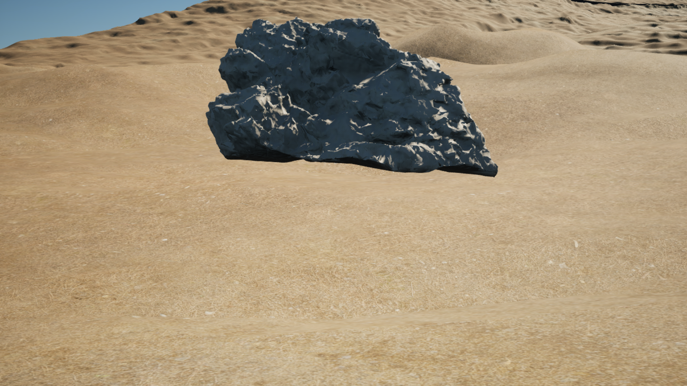
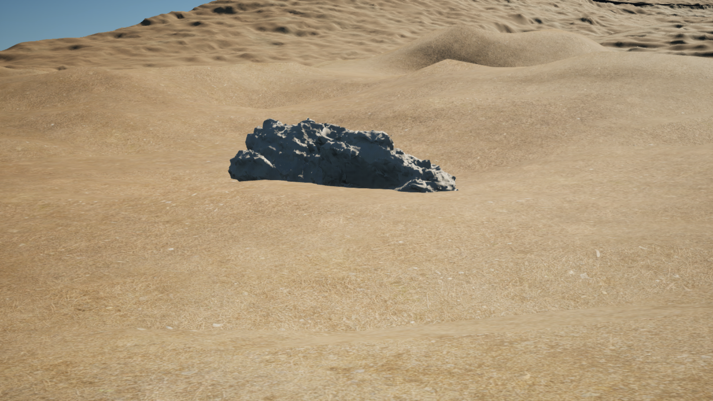

# Sa Calobra PCG world graph — #365 kickoff

**Status:** M3, CPU candidates, native mesh inspection and saved/reloaded mechanical graph; regional placement pending.
**Owner:** procedural-world. **Base:** `4dd792219bfc2eaf7dc216bd60cbde6628bba792`.
**Current owner instruction (2026-10-12):** implementation resumed for #365,
using subagents and the existing Material Forge contract. The planning-only
instruction of 2026-10-11 is superseded; acceptance gates remain unchanged.
The complete researched continuation is recorded in the
[detailed execution plan](SA_CALOBRA_WORLD_GRAPH_PLAN.md),
[primary-source/tutorial ledger](SA_CALOBRA_WORLD_GRAPH_RESEARCH.md) and
[handoff for another LLM](SA_CALOBRA_WORLD_GRAPH_LLM_HANDOFF.md).
Evidence below separates CPU candidates, isolated native diagnostics and pending
regional asset/contact admission; none closes #365.
The [Roadmap](../ROADMAP.md), [World Building Bible](../WORLD_BUILDING_BIBLE.md)
and [World Authoring Library](../YACS_WORLD_AUTHORING_LIBRARY.md) own scope,
methodology and reusable tooling. This adapter is not a second proof framework.

## Dependency and bounded task envelope

#364 completed through squash merge [#470](https://github.com/karnalooch/YetAnotherCyclingSim/pull/470).
[PR CI](https://github.com/karnalooch/YetAnotherCyclingSim/actions/runs/38174079043)
and [main CI](https://github.com/karnalooch/YetAnotherCyclingSim/actions/runs/38174992518)
passed. The owner [manually accepted](https://github.com/karnalooch/YetAnotherCyclingSim/pull/470#issuecomment-6113634845)
the remaining route/latest-save gate; this does not manufacture an automated
whole-area review or latest fresh-readback PASS. #459 geometry debt is separate.

The first #365 implementation authenticates the existing World Authority masks,
pins graph-input version/seed and emits a deterministic relocatable input
manifest. Scope covers the full 2016.5 m square, not only the Golden Kilometer.
One source writer owns the adapter/config/tests; the coordinator owns docs.
Three read-only specialists audited dependency/proof, source masks and APIs.
No exclusive Unreal, build, GPU or home-runner resource is claimed.

## Resumed implementation — 2026-10-12

`scripts/assets/sa_calobra_world_graph_candidates.py` consumes the authenticated
inputs with an explicit lattice, horizontal probe radius, clearance and overlap
priority. Geographic anchor IDs do not change with seed or manifest identity;
density and native point seeds use separate named streams. The conservative
footprint rejects unknown/excluded cells, including partial cell intersections.
These are XY probes, not qualified mesh transforms or terrain contact.

Two local runs on the real 4033-square source grid used spacing 16 cells (8 m),
radius 0.5 m, clearance 0.25 m, priority `[2,0,1]` and configured seed 36501.
Both produced fingerprint
`17110fb45f877586ccbeb9c3ec1e914392abcf9bb548ecf6b24714c4e272e943`:
64,009 anchors, 124 admitted XY probes, 483 outside-footprint, 37,983 without
selected centre, 19,216 insufficient-clearance, 5,315 semantic-footprint and
888 density rejections. Receipts are ignored local artifacts under
`Saved/RuntimeProof/WorldGraph365/candidates-run-{c,d}/`; this is CPU candidate
evidence and does not replace Gumball native proof or exact-commit CI.

The PCGEx bootstrap now preserves existing source checkouts,
validate exact upstream or reviewed-patched state, and reject hidden local
changes, including assume-unchanged/skip-worktree flags. This does not install
PCGEx or prove its native build/load. Local validation: 7 candidate tests,
7 existing input-adapter tests, 4 existing mask tests and 8 real-Git bootstrap
tests PASS. Sandbox TemporaryDirectory access initially failed with WinError 5;
the affected suites passed outside the sandbox. Critical Ruff checks and all four
docs-index guards (links/i18n/structure/freshness), plus agent contracts, PASS.

### Material Forge integration

Reuse [Material Forge](MATERIAL_FORGE.md) and the accepted
[whole-map material baseline](SA_CALOBRA_WHOLE_MAP_SURFACE_PREPARATION.md).
PCG/PCGEx owns classification and placement; Forge owns appearance. Forge may
consume authoritative masks without changing their classification or hashes.
Its local DetailMasks and Height EXR never supply geography, collision support
or Landscape displacement. Preserve the accepted Landscape material consumer.

For each future qualified mesh, bind the material receipt, package dependency
closure, UV/physical scale and validated PBR maps to that mesh qualification.
Reuse `scripts/ue/import_material_forge_variant.py` for validated Forge variants;
do not treat a material package or the `regional_limestone` family as a qualified
rock mesh. The accepted five-role surface library and optional Forge variants
are separate identities; do not silently replace the accepted consumer.

### Native admission remaining

The host audit found UE 5.8.2 CL56702186 and no canonical PCGEx installation.
Latest road checkpoint `Rc6b061b933e6` resides in the isolated
`b9fddea3f602-y473install01` project and reports `reload_proof: NOT_RUN`.
Canonical Content has no corresponding LiveCheckpoints package. Do not substitute
the older accepted canonical map for this road consumer. Regional StaticMesh
qualification, admitted terrain contact, native generation, save/fresh reopen,
intermediate images and protected exact-head CI remain pending. No real-scene
scatter or completion of #365 is claimed.

Forbidden: changing canonical road/physics, `Base_DTM`, Landscape geometry,
BOB semantics, source masks, live Editor state or streaming; treating isolated
plugin preparation as canonical installation or native placement admission;
inventing rock geography, species, terrain contact or placement acceptance.

## Native preparation and mesh qualification — 2026-10-12

[CI run 38179277475](https://github.com/karnalooch/YetAnotherCyclingSim/actions/runs/38179277475)
passed for `1c14beecfd81a6463711ebc9957047900f45b36e`, including the
Aggregate CI gate and hosted script tests. Unreal build/Automation was skipped;
that run is not native PCG evidence.

`scripts/assets/sa_calobra_pcg_qualification.py` adds a structural binding check
for source/license, imported StaticMesh bounds/support, materials/UV/world WPO,
terrain identity/datum and measured contact policies plus native fixture claims.
It always returns `placement: false` and `proof_authenticity: NOT_VERIFIED`.
It does not admit evidence, replace Gumball, set tolerances, or qualify a real
asset. Retained source/license/material evidence keeps its own producer SHA;
new native observations must match the qualification SHA. Nine CPU fixtures PASS.

The retained PCGEx checkout under the runner's `_phase2c-pcgex-cliff` project
matches approved commit `39a8f1bdc65b2c4613a1e87b71d93b4576db0a66` and the
reviewed patch; its 40 DLLs declare engine BuildId `55116800`. These are retained
prebuilt binaries, not a build of current YACS code. The isolated local diagnostic
launcher `scripts/ue/Invoke-YacsPcgNativeProbe.ps1` authenticates retained sources,
stages the plugin without PDB/Intermediate, and preserves canonical Content.
Its Python consumer reads Epic's installed `Skill_PCGGraphGeneration` through
the reflected skill API before graph authoring, then inventories native APIs
and mesh dimensions. Outputs are `LOCAL_DIAGNOSTIC_ONLY`, never a new broker
receipt. Graph generation/save/fresh reload are still pending at this checkpoint.
The first diagnostic attempt at `ab932af13f1e35103a2ca8cf5a02f03ca76c0750`
stopped before Editor launch: Git's CRLF warning entered bootstrap's changed-path
array through merged stderr/stdout and caused `clean_checkout, expected_patch_only`
failure. The fix separates Git output streams, with a CRLF regression fixture;
it does not change retained plugin files or weaken checkout authentication.
The second attempt at `e8e2c2fd18cea949bfad23f801ef988fa38040d1` authenticated
and loaded the staged PCGEx modules, then failed in the skill reader because
the official registry wraps output in `returnValue`. The retained emitted schema
also confirms input `skillPaths` and output `instructions`. The consumer was
corrected to those observed names. No graph or source map was saved by this run.

Native inspection at `fba989c91d9f83842ace99960ffdfeb5f0ba3fa6`, token
`inspect03`, completed in an owned isolated Editor. The skill path was
`/PCGToolset/Skills/Skill_PCGGraphGeneration.Skill_PCGGraphGeneration_C`,
instruction-content identity
`fc1113b6d72c9a629af6bda19293104968d991671d0b9d32e922fcdaa8aa7d50`.
No primitive or example graphs were available in that isolated catalog. The
next mechanical fixture therefore uses native Create Points and graph Output,
with three synthetic fixed-seed points; it is deliberately not regional scatter.
It reads node schemas before authoring, binds completion/cancellation/cleanup
events before execution, compares cleanup/regeneration, and saves only a new
isolated diagnostic graph/map. Fresh reload must read the stored recipe before
regeneration and preserve package bytes. Analytic engine-cube ground and an
unrelated collider test sampled support/owner exclusion; they cannot supply
Terrain Authority admission. Completed fixture evidence is recorded below.

Boulder native inspection: bounds origin cm
`[-11.01963996887207,-3.200286865234375,43.01846694946289]`, extents cm
`[64.36442565917969,91.6882553100586,50.434513092041016]`, four LODs,
vertex inventory `[234411,122537,44796,15918]`. The material slot `boulder_01`
currently references `/Engine/EngineMaterials/WorldGridMaterial`. Source-model
UV-channel query returned `[1,0,0,0]`; installed `GetNumUVChannels` inspects
MeshDescription, so zeros on generated LODs are not proof of missing render UVs.
Render UV/material physical scale and support geometry remain unverified.
At identity rotation/scale, the conservative pivot-centred XY radius from native
AABB is `hypot(abs(origin.x)+extent.x, abs(origin.y)+extent.y)/100 =
1.2118825350159463 m`; local AABB Z is `[-0.07416046142578125,
0.9345298004150391] m`. These are bound calculations, not measured support geometry.
The existing CPU candidate fixture assumes radius 0.5 m: its 124 admitted probes
cannot be reused for this Boulder. Re-evaluate eligibility with the final scaled
footprint, material/WPO envelope and admitted support/contact contract first.
Two CPU envelope sensitivity runs at `137a367395e76d406408e6f8f38fd54313b7d8e7`
used this 1.2118825350159463 m radius, spacing 16 cells, clearance 0.25 m and
priority `2 0 1`. Both produced fingerprint
`8e8849465bed2d0f72e1f9b6a92e700cbd9a9dce5f51dbfd72136dcadd98b69f`:
64,009 anchors, 5 selected XY envelopes; 23,898 clearance, 1,588 footprint-semantic,
483 AOI, 37,983 no-centre and 52 density rejections. Outputs are retained in
`Saved/RuntimeProof/WorldGraph365/boulder-envelope-{a,b}/world-graph-candidates.json`.
This remains the existing **vegetation-selector** probe contract: the five XYs
are not rock-placement semantics or qualified Boulder positions. No Z/contact,
regional rock mask, material/WPO envelope or native spawner admission is inferred.
ImportData points to the historical `D:/ExternalAssets/.../boulder_01_2k.fbx`,
which does not prove correspondence with the newly recovered bytes. All staged
source packages remained byte-identical. No real mesh qualification PASS.

The single Boulder source was recovered with the existing bounded downloader
(2K, five files, 34.2 MiB, 256 MiB cap, no overwrite) into
`D:/yacs/data/assets/pcg365-boulder-source`. The acquisition SHA256 receipt
records provider URLs, CC0-1.0, source/index/config hashes and command/time.
FBX: 6,482,860 bytes, SHA256
`b1125cd1e08a425fa89bc62b96279b40e9a921618e12bfbbe0d575cb78f53c95`.
Initial acquisition status was `NOT_MATCHED_TO_HISTORICAL_IMPORT`. Later native
readback at `7c57428546ea447617d621abc09e440e27147268`, token `mechanical04`,
read the loaded mesh's `AssetImportData` registry JSON: exactly one FBX row with
`FileMD5=e20c1ed68dc10e039761d6bda58c8ef4`, matching the recovered source.
This establishes correspondence with recorded historical import metadata without
editing ImportData or reimporting; legacy MD5 metadata is not a new mesh geometry,
material or regional qualification receipt. The provider's
[Boulder 01](https://polyhaven.com/a/boulder_01) describes weathered rock, not
measured Mallorcan limestone. [Provider license](https://polyhaven.com/license)
was rechecked. Forge appearance cannot supply lithology or mesh support proof.

Retained Forge candidate `D:/yacs/material-forge-v2-final/run-a/regional_limestone/base`
(Weathered pale) was rechecked with the existing `material_forge.check_variant`
CPU validator without rewriting its receipt: `MAP_CHECKS_PASS_UE_REVIEW_PENDING`.
Producer SHA: `ba9e9cfef724f5a7ab2fbaaa0269e4442398be3d`; Material Maker
`4d29a815489866aae483281cf44b2cfe48d3cc3e`, Godot 4.7.2, seed 211,
physical tile 4 m. It is a procedural artistic candidate, not a geological scan.
`refined_b` was not found among retained files; do not substitute its historical
description for the actual `base` bytes. The accepted five-role baseline is unchanged.

| Retained 2048-square map | SHA256 |
|---|---|
| BaseColor | `a397b418d316763afcb4fd0b8a80670bd9fad3080b8495b7e8259b6fb8303bb0` |
| Normal_DX | `90c78d7cc53a02a6ca2e052643712b7065b7b05e9300e9dc493263786183a034` |
| ORM | `99ed7cada4a03578495fe9f179fadcb7f7d7df7bea578c49b09ff0b64284d032` |
| DetailMasks | `40bc6bf1d71bf5fcffccf457f9afad1e6f3a52da3ad9ef768c81e4d58e9df7fc` |
| Height EXR | `13df224ee533162ae91ca7ca11504dc242bb09355928f0ebd16571de18d96c19` |

Retained validation/provenance/render receipt identities respectively:
`2da21368e9dd52a0528cfcf3926fa3f6464a287913186f660c13b44f8cb629fa`,
`e05fc44a876959b0692d4bd3faf3c49e70ccaa4ed74d9b88a674a7e104a8cdf9`,
`3ef37e8d3d862ac5d8bd9f1fd3f7b9088be233b25158bf3a8c8c5be5bc6cc3d6`.
These authenticate a retained material source candidate only. A derived Boulder
material package, native binding and 4 m/repeat UV proof are still missing.
Height is inspection/authoring data, never elevation/contact or displacement authority.

### Native mechanical graph and persistence evidence

Implementation SHA `8e0a38b60dc9ef98c8346548ff2e4dd88333c8cd`, token
`mechanical06`, staged at `D:/yacs/work/pcg365/<SHA>/mechanical06`.
Run the committed launcher with that SHA/token and actions `inspect`, `create`,
then `reload`, serially on an idle host. Existing action outputs are never overwritten.
Inspect and create completed with clean process exit and unchanged staged source
bytes. `create` reports `MECHANICAL_GRAPH_SAVED`: three fixed synthetic points,
two equal inventories separated by component cleanup; 27 finite support traces
hit only `PCG365_AnalyticGround` at Z=0. An unfiltered trace hits the unrelated
collider, owner-filtered traces exclude it, and an unsupported XY misses.
Numeric epsilon is analytic fixture precision, not an admitted regional tolerance.

Saved package identities:

| Package under `Content/Generated/YACS/PCG365Mechanical` | Bytes | SHA256 |
|---|---:|---|
| `PCG_XYFixture.uasset` | 25206 | `a94915336ffd1ce093b5d43a1fd6af67d3af5054f59ecca6b053f622273e692f` |
| `L_XYFixture.umap` | 33441 | `a12197b17bb6b7a13dbda601cd2580764ab48beb538b20702d208893b08de9e1` |

Fresh reload completed: `MECHANICAL_GRAPH_FRESH_RELOAD_REGENERATED`, clean exit 0,
`saved_recipe_verified_before_explicit_generation: true`, two matching inventories
of three points, repeated 27-sample contact fixture and unchanged saved/source bytes.
Receipts are in `proof/{inspect,create,reload}` with per-action
`launcher-completed.json`; logs and staged-file registry remain beside them.
The reload checks stored node/points, component seed 36501, GenerateOnDemand
and package hashes before explicit generation, then compares both completed runs
and verifies unchanged package bytes. Cleanup/regeneration can reuse node cache;
this is lifecycle/inventory evidence, not proof of uncached node execution.

Preserved failed attempts are part of the evidence: `90985ed8/mechanical02`
used the wrong collision enum; `38d8c03c/mechanical03` auto-exited before the
asynchronous result; `7c574285/mechanical04` used the C++ class name instead of
its Python ScriptName; `97f2a346/mechanical05` accessed the new tagged-data wrapper
as a direct property. That inspection also returned process exit `-1073741819`
during shutdown, so its receipt alone is not clean completion. Current code uses
`CollisionResponseType.ECR_BLOCK`, `EditorPythonScripting` keepalive and the
four-output native tagged-data break. Launcher requires both an error-free receipt
and clean inspection exit before graph operations; callback exceptions force FAILED.
API decisions were checked against installed UE 5.8.2 headers, including
`EngineTypes.h` ScriptName, `EditorPythonScriptingLibrary.h`, `PCGData.h`,
`PCGComponent.cpp` completion/cleanup ordering and `CreatePoints.cpp` seed behavior.

All native receipts are `LOCAL_DIAGNOSTIC_ONLY`, `placement: false`,
`qualified_assets: []`, regional terrain contact `NOT_RUN`, native build
`NOT_RUN_PREBUILT_DEPENDENCY`. There is no PCGEx-specific node execution,
Material Forge native binding/render, real terrain-owner contact, regional spawner,
full-area invalidation/override or protected Gumball native admission yet.

Local validation: final bootstrap 10 real-Git cases completed; the initial combined
test invocation then failed to import the qualification module. Correct direct
qualification invocation passed 9/9; agent contracts passed 8/8. Critical Ruff,
PowerShell parser and docs links/i18n/structure/freshness passed. GitHub CI
[38181719536](https://github.com/karnalooch/YetAnotherCyclingSim/actions/runs/38181719536)
for `90985ed858bdb19e1520fa7b711bd989a56ac481` passed, including aggregate,
hosted discovered scripts and security checks; Unreal build/Automation was skipped.
Later delivery-head CI must be checked independently in Draft PR #474.

## Authenticated source contract

### Material binding and real-ground measurement packet — 2026-10-12

Owner explicitly requested native Forge binding and real-terrain contact assessment.
Base `462668bcbc07e720e03c821d39925a2d33ec256f` is clean; its
[CI run38182535894](https://github.com/karnalooch/YetAnotherCyclingSim/actions/runs/38182535894)
passed. This packet remains #365/M3, owner procedural-world; visual-dcc owns the
new material helper, coordinator owns staging/contact/docs, specialists review
source and native API boundaries. Host was IDLE before staging; native actions
remain serialized. No canonical content, terrain, route/physics or accepted
five-role material package may be saved or edited.

Prepared helpers duplicate the staged Boulder into
`/Game/Generated/YACS/PCG365Qualification`, import the pinned Forge variant through
the existing producer, and verify stored mesh slots, effective MI/parent, 400 cm
 world-aligned projection, disconnected public WPO and disabled tessellation.
Protected displacement inputs remain unverified as recorded below. Explicit save and fresh
readback must complete before contact measurement. Native results are NOT RUN
until the per-action process finishes cleanly with matching source/package hashes.

Real ground is deliberately the retained #363 accepted Landscape material consumer,
not the latest #364 road checkpoint. Source config
[`pcg365_qualification_sources_v1.json`](../../worldgen/sa_calobra/pcg365_qualification_sources_v1.json)
pins its map and all 14 delivered/material dependency packages, Forge sources and
source-height witness. Map SHA256
`bf2b92945865e2307990b6d3da40095dfa0774d28affb32a1e42e55f288764dd`;
DTM SHA256 `6092a48a949b7b7e8ccf120cb46d59cfd7fdd3522085e8a55162fd52fe5a139a`.
This explicit substrate diagnostic cannot close latest-road compatibility.

Two source witness preparations produced identical SHA256
`72b312c5371d38265dd1821d3a416bb658fde39a8d0a86dcf52c9d00b50bc6ae`:
five bounded XYs, each 9x9 interior AABB samples, four valid DTM neighbours per
bilinear height, preserved EPSG:25831/0.5 m mapping. The fixed source producer
checks DTM/inventory/XY hashes again after reading. Four real-GeoTIFF tests cover
interpolation, NoData, wrong SHA and concurrent drift; PASS is CPU only.
The XYs remain vegetation-selector diagnostics, not regional rock placement.

Native contact will measure upward complex-collision rays against the derived
mesh's lower surface and exact Landscape-only owner/component queries, with
unrelated/generated collider and no-hit controls. A vertical analysis transform
minimizes sampled penetration; gaps, slope and source/native height residuals are
measurements, not approved embedding or placement. Finite interior samples do not
prove continuous support, render-triangle equivalence or perimeter coverage.
Contact/slope/float/penetration/source-uncertainty limits remain REQUIRED_UNSET
until justified from measurement and frozen. The source declares inherited
orthometric height; a specific geoid and independent vertical-datum proof are
not supplied. Qualification must remain pending while these gates are unresolved.

Native attempt `a634ba6fb7c0d3e86c26578d91073c45447da1f1/qualification01`:
qualified-source inspection completed with process exit 0 and unchanged staged
bytes. Material action exited 3 before explicit asset save: Python could not
resolve `world_position_offset` on `MaterialEditorOnlyData`. Its failed receipt
is retained under `D:/yacs/work/pcg365/<SHA>/qualification01/proof/material/`.
Fresh material readback and real-terrain contact were NOT RUN for that attempt;
no material/contact PASS follows from successful source staging. The correction
must preserve strict displacement checks and use a new exact-SHA attempt.

Attempt `146ddf750153c87e9006ef90ec05863238919200/qualification02` inspected
cleanly, but material action again exited 3 before save: native property names
resolve, while Python refuses protected `WorldPositionOffset` input readback.
Shutdown also logged a UObject fatal error; no clean completion is admitted.
The diagnostic binding may verify public disconnected WPO and disabled Nanite
tessellation, but must report protected constant/displacement input readback as
UNAVAILABLE and maximum geometric displacement as unknown. It cannot claim zero
displacement or completed material/contact qualification from those partial checks.

Attempt `d08343354bdd172a516f7909ffef4b8f9f1a30ee/qualification03` passed
the bounded public material readback and reached explicit save of seven assets,
then failed direct-dependency enumeration (`get_dependencies()` returned `None`).
No completed binding receipt or clean launcher marker was admitted. Fresh reopen
and terrain measurement remain NOT RUN for this attempt; partially saved files
are retained only as failed-attempt evidence, never reused as an accepted result.

Attempt `49214a1a5574286b9703a3350ecd773fa1d14367/qualification04` reached
saved-asset registry validation, then rejected `SoftObjectPath`: this installed
Python binding requires an FName/string for `get_asset_by_object_path`. Material
completion and downstream measurements were not admitted; next attempt passes
the observed string argument without changing verification scope.

Attempt `0ae3e97967d8100b983952e376391cadb95c07b9/qualification05` wrote
the material binding receipt and seven packages, but editor shutdown exited 3:
`Object is not packaged: ModeManagerInteractiveToolsContext None`. Successful
action JSON does not override failed process completion. Next attempt initializes
an unsaved diagnostic editor world and lets the startup Python stack unwind before
requesting quit through a Slate callback; clean exit remains mandatory.

Attempt `1920c6f40b5ae7aa3ae2296e4b30ae39e404b392/qualification06` completed
inspect, material save and fresh material readback with exit 0, launcher markers,
unchanged source/staged bytes and saved-package hashes. Derived mesh package
SHA256 `6613bf07604ea255acceda9eee4686cc0314b78d8b997840a853cf7575a9a1f9`;
one slot, native 400 cm WorldAligned projection, expected four textures and MI
parent. All direct registry queries returned; recursive engine closure and GPU
shader/render acceptance remain unverified. Protected material-input limits above
still apply. Terrain action exited cleanly but its receipt FAILED the exact mesh
bounds identity guard before contact sampling. Next diagnostic records both
bounds values; no tolerance or qualification is inferred from that mismatch.

Owner requested an end-M3 visual concept. Imagegen produced an explicitly labelled
concept (`KONCEPT M3 — NIE RENDER Z UE`), SHA256
`62dbfa03962595740ea76ec132b17363cefcf8f1d9c04185372f5ec976d77c87`.
It illustrates weathered limestone/asphalt/shoulder composition only; invented
road shapes, shoreline, walls and vegetation are not source authority, scope
approval, a native screenshot, implementation evidence or visual acceptance.

Attempt `9d4fc8e6e219db17639c6208f1aa57fc85a1ee5d/qualification07` repeated
clean material save/reload. Terrain diagnostic measured derived bounds origin
`[-11.20713996887207,-3.307353973388672,42.83029317855835]` cm, extent
`[63.63415336608887,91.53669357299805,50.19459390640259]` cm. These differ
from original serialized bounds but lie strictly inside the source AABB on all
three axes. The saved duplicate is independently package-hash bound. Next bounded
measurement uses the unchanged, larger source grid only if exact containment
holds (no numerical tolerance), records both bounds and their nonidentity, and
traces the actual derived collision. This permits a conservative diagnostic;
it does not certify original/derived geometry equivalence or regional admission.

Attempt `9b86a55a62e13071283537ea167cae2551354c7b/qualification08` repeated
clean material save/reload and passed conservative bounds, then stopped because
the direct component ray returned a nonblocking geometry hit. Installed
`PhysInterface_Chaos.cpp:985–992` uses `BuildOverlapAll()` for `LineTrace_Geom`;
its successful geometry result is not a world collision-channel blocking claim.
Next diagnostic accepts the component API's successful return with exact owner,
component, finite hit and no initial overlap. Landscape world traces still
require blocking hits. This changes API interpretation, not ground acceptance.

### Completed isolated material and real-ground measurements

Exact code `796429df484ca46e6657b4ecce178410a0fd8850`, token `qualification10`:
inspect, material save, fresh material readback and terrain measurement each
completed with exit 0, matching launcher markers and unchanged staged/source
and saved-package bytes. Token `qualification09` at the same SHA retained an
inspection shutdown failure (`-1073741819`); it was not admitted or overwritten.
Evidence root: `D:/yacs/work/pcg365/796429df484ca46e6657b4ecce178410a0fd8850/qualification10/proof`.
Terrain receipt SHA256
`b3ed101371549ab8edebb7165b6ecb17fff1869f088f4f6fc9109a9de2099d86`.
Material Forge is bound to the saved diagnostic Boulder duplicate, with one slot,
four pinned textures, verified MI parent and native 4 m WorldAligned projection.
Original Boulder and accepted Landscape packages remain unchanged. This is
material binding/persistence evidence, not GPU render or visual acceptance.

The 9x9 source-envelope grid produced 59 actual complex-collision mesh hits and
22 misses. Each of five diagnostic centres therefore yielded 59 Landscape-only
height/slope comparisons (295 total). Five exact Landscape collision components
were observed, `QUERY_AND_PHYSICS`, `BlockAll`. Unrelated and PCG-tagged collider
controls intercepted unfiltered traces while filtered traces hit Landscape;
all-actors-excluded and outside-ground controls missed. No scene was saved.

| Diagnostic UE XY (cm) | Max sampled gap (m) | Max slope (deg) | Max absolute source/native residual (m) |
|---|---:|---:|---:|
| 16800, 70400 | 1.186259 | 39.726149 | 0.013497 |
| 4800, 96800 | 1.050903 | 52.809230 | 0.038569 |
| 184800, 180800 | 1.149272 | 37.469204 | 0.016132 |
| 181600, 189600 | 0.648728 | 18.773911 | 0.014474 |
| 91200, 200800 | 0.507792 | 27.694986 | 0.006143 |

These are identity rotation/scale, zero embedding and the lowest sampled
nonpenetrating vertical translation. Large gaps demonstrate that this naive
transform does not establish a visually grounded placement. No regional rock
selector, approved orientation/embedding policy, continuous support, protected
material displacement, independent datum uncertainty or latest-road compatibility
has been qualified. Numeric acceptance limits remain REQUIRED_UNSET; do not turn
observed maxima into arbitrary thresholds. `qualified_assets: []`, `placement:
false`, owner visual audit PENDING_FINAL_M3, performance DEFERRED_AFTER_M3/false.
The next bounded work is a justified support/orientation/embedding policy and
fixture matrix, followed by render/owner review through existing proof admission.
Do not alter accepted terrain or conceal these gaps with vegetation/materials.

Final hosted CI for documentation head
`c811d7710b9bbd9d6c951ca2c9459d831adb6890`,
[run38185349182](https://github.com/karnalooch/YetAnotherCyclingSim/actions/runs/38185349182),
FAILED four contact-witness test setups: the clean Linux checkout has no ignored
`Saved` directory, so `TemporaryDirectory(dir=ROOT / "Saved")` raised
FileNotFoundError before any assertion. Fix the fixture to provision its parent;
retain all interpolation/NoData/identity/drift assertions. Hosted governance,
repository policy and security lanes passed, but aggregate CI correctly failed.
The native receipt remains exact to `796429df`; a test/docs-only successor does
not establish native execution at the newer head or override pending admission.

Existing Julka profiles `sa-calobra-pcg-masks-candidate` and
`sa-calobra-mask-transitions-candidate` verified with zero issues, including
inherited source closure. Existing `verified_manifest()` also checked fingerprints,
byte hashes, logical raster hashes and grid. These results authenticate inputs,
not production placement.

| Input | Manifest SHA-256 |
|---|---|
| `pcg-masks-v1-2026-10-04/pcg-mask-manifest.json` | `465788e5d74cf3eccf59bdddc1480fa4d7dac50d6f22255ca69ac3b9f174b5df` |
| `mask-transitions-v1a-2026-10-04/transition-manifest.json` | `2cb28c018f2ed3562762d8c47976307b64397f06417c5c8efc4221bd92182950` |

Grid: EPSG:25831, 4033 × 4033 at 0.5 m; affine
`[0.5,0,483000,0,-0.5,4409516.5]`. UE origin in EPSG metres:
`[483000.25,4409516.25]`; X east, Y south, centimetres. Pixel centres map to
`col=floor(Xcm/50+0.5)`, likewise row; footprint bounds
`[-25,-25,201625,201625]` cm. No Z is inferred from a selector texture.

Reuse `scripts/assets/read_sa_calobra_pcg_masks.py::evaluate` for eligibility:
band must equal 1; reject 0/255, outside AOI and unknown clearance; full horizontal
asset radius must fit inside AOI. Subtract point-to-cell-centre distance from
the conservative clearance lower bound, then require radius + explicit clearance.
PNG alone is insufficient. Density/transition may only reduce admitted domains.

Selector bands low/medium/high overlap and describe source vegetation classes,
not species or plant positions. Preserve the exclusion bit inventory: asphalt,
0.51 m conservative shoulder, complete BOB affected rectangles, buildings,
decorative water/infrastructure holdbacks, other LiDAR classes and missing samples.
Mapped point/line holdback is 5 m, not measured channel width or safety clearance.
High rejects invalid height; low/medium class evidence does not repair height.

Transitions retain NoData. Their relative return fractions and authored fades
are not physical density or confidence. Water gap candidates remain review only.
Unknown rock/bare-soil subtype must not become rocks from yellow/RGB candidates.

## Tools and exact version audit

Installed engine `Build.version`: UE **5.8.2, CL56702186**; native PCG descriptor
Version 8 / VersionName 1.0. Installed matching headers establish graph creation
and edges (`PCGGraph.h`, `AddNodeOfType`/`AddEdge`), stock mesh-selector setup
(`PCGStaticMeshSpawner.h`) and delayed generation/cleanup (`PCGComponent.h`).
Submitting generation is not proof of completion.

Approved PCGEx revision: `39a8f1bdc65b2c4613a1e87b71d93b4576db0a66`, version
0.79 / descriptor UE 5.8.0. Retained source exists outside the live project;
its only tracked modification is `clipper.triangulation.cpp`. The reviewed
compatibility patch LF hash is
`8182824990670e560d1a1f0d052288cc8a98dc5cdb370bdbf63f2666f9593d89`.
Exact patched-source compatibility remains unverified here. PCGEx is absent
from the active review snapshot; an optional enabled entry is not installation.

The attempted [Epic 5.8 documentation](https://dev.epicgames.com/documentation/en-us/unreal-engine/procedural-content-generation-overview?application_version=5.8)
and [PCGEx agent index](https://pcgex.gitbook.io/pcgex/llms.txt) were inaccessible
during this audit. Matching installed native headers were inspected instead.
No PCGEx-specific node is implemented or asserted as verified.

Later planning research successfully read canonical Epic pages labelled UE 5.8
and specific PCGEx pages, while the version-query URLs and PCGEx agent indexes
remained inaccessible. See the [research ledger](SA_CALOBRA_WORLD_GRAPH_RESEARCH.md)
for exact retrieval limits, installed headers, bootstrap hazards and the unresolved
PCGEx documentation/source mismatch. This does not retroactively change the
original audit's evidence or establish native compatibility.

Existing Stage3G Forest/RouteExclusion graphs and generic patch candidates are
reusable API patterns. Their Alpine recipes, rectangle exclusions and counts
are not Sa Calobra source-mask, contact or production admission.

## Validation and next gates

The CPU adapter uses seed `36501` from
`worldgen/sa_calobra/world_graph_inputs_v1.json`:

```powershell
.\.venv\Scripts\python.exe scripts/assets/prepare_sa_calobra_world_graph_inputs.py --root D:/yacs/data/world-data/sa-calobra-working-v1 --config worldgen/sa_calobra/world_graph_inputs_v1.json --output Saved/PCG365/fresh-inputs
```

The output directory must be new. Two authenticated local runs produced identical
receipt SHA-256 `2028657f97977250e0ec479ec6d90bf61ee09b2fc9a1657a30fa2d51e1bc4c2b`.
Both Julka candidate profiles passed with zero issues. The input-adapter, PCG-mask,
transition and road-mask suite passed **21 tests**. These are CPU checks;
`native_execution: NOT_RUN`, `placement: false` and `qualified_assets: []`
remain explicit in the receipt.

Input adapter validation covers deterministic regeneration, source/config drift,
seed/grid/bounds rejection and unchanged exclusion/unknown semantics. Run the
existing PCG mask, transition and road-mask tests plus docs links, i18n,
structure and freshness. Keep generated receipts outside Git; record exact code
SHA and results in the PR. Use existing Gumball proof admission when native work
is ready; do not invent a separate PASS mechanism.

Next: qualify concrete asset identity/license/mesh hash and footprint; authenticate
Terrain Authority contact/Z and current road-envelope compatibility; connect the
admitted inputs to native PCG and stock spawner. Then prove deterministic
regeneration, local invalidation, override survival and saved reload/render.
All live-editor, build/GPU/runner work remains serialized under existing ownership.

Final whole-area owner audit: `PENDING_FINAL_M3`. Performance:
`DEFERRED_AFTER_M3`, `performance_pass: false`. This kickoff does not close #365,
implement later vegetation/rock stages or conceal unresolved geometry.


### Boulder contact correction and Remote UE — 2026-10-12

The owner requested a real Unreal GPU render with Material Forge and correction
of the diagnostic Boulder's visible support gaps. The owner also explicitly
allows bounded local terrain repair only if fitting the asset cannot solve the
defect. This is not a global Landscape thaw: preserve `Base_DTM`, accepted map,
spatial registration and road/physics authority; any necessary local repair must
follow World Building Bible section 6 with AOI, delta and rollback proof.

Current implementation first changes only a transient diagnostic Boulder at
existing candidate index 3. `sa_calobra_pcg_boulder_settle.py` measures a 33 x 33
source-AABB grid using paired native complex bottom/top collision rays and
Landscape-only ground hits. `pcg_boulder_support.py` computes the highest vertical
root without positive bottom gaps at those sampled rays, reports the embedding
relative to the nonpenetrating root and rejects complete sampled submergence.
No arbitrary burial margin is added. Identity orientation and unit scale remain
explicit; finite samples and vertical intervals do not establish continuous
silhouette closure or solid concavity. This is not production qualification.

The new `settle-render` action uses GPU rendering, never `NullRHI`, and captures
before/after with the same two camera poses and Material Forge binding in the
owned isolated project. Source/staged packages and saved material packages are
hash-checked before and after; no map or terrain is saved. Native execution and
image inspection remain pending until their receipts are recorded below.

Remote UE exists through the repository's Pixel Streaming workflow. Inspection
on 2026-10-12 found no running local UnrealEditor process and no listening viewer
port among 80/8888/8889 or bridge ports 18784/18785. The existing
`Start-YacsRemoteFromGitHub.ps1` targets the superseded PR #470/#364 branch;
`Start-YacsLevelEditorStream.ps1` pins the retained #364 road map. Neither is a
validated #365 Boulder session, so do not publish an unchanged-tree checkpoint
on that old branch to claim Boulder delivery. A captured GPU PNG is separate
from a received live Remote UE frame.

PR #474 source `6cf9511127afbec4286fe8a11d9c409e26d8d5cb` has Aggregate CI gate
SUCCESS in run `38185894294`; that result predates this correction and does not
validate the new source. Owner visual acceptance stays `PENDING_FINAL_M3` and
performance stays `DEFERRED_AFTER_M3`, `performance_pass: false`.


First GPU attempt `fe18308fb76d4402b6246de3c30b16790235dd3d/boulderfit01`
completed its processes and produced four real 1920 x 1080 PNGs on RTX 2070
SUPER / D3D12 SM5. Visual review REJECTED the first after camera: the viewpoint
was below the local ground and exposed the underside of the Landscape. Native
log also reported missing `/Script/LandscapePatch`, deletion of an in-memory
edit layer and obsolete edit-layer data. No map was saved and staged hashes
remained unchanged, but the process receipt is not sufficient scene fidelity
proof. Preserve this attempt; do not present it as corrected contact acceptance.
The sparse earlier terrain measurements likewise do not establish edit-layer
preservation merely from source/staged byte identity.

The corrected diagnostic explicitly enables the installed Epic LandscapePatch
plugin and rejects missing imported script classes/edit layers or failed
material shader compilation in the native log. Each camera measures its local
Landscape-only height and uses an explicit 0.6 m ground clearance, with identical
poses before and after. Both asset translations require location readback.
The first sampled fit measured 698 paired intervals and 62.47 cm embedding,
with a maximum exposed interval of 37.78 cm; these are retained diagnostic
numbers from the rejected capture configuration, not final validation limits.


Second attempt `4532223a7018dac24bde962623a23021b1a2e2b8/boulderfit02`
completed all four processes with unchanged staged/source/saved package hashes.
LandscapePatch imports succeeded and the two corrected after views no longer
show the subterranean camera defect. The fitted mesh visibly enters the ground
in both views. However the first before image had visibly coarser Landscape
rendering than the after image, so it is not admitted as a like-for-like pair.
The next capture primes the actual level viewport at each pose before the native
loading barrier and requests a transient 120-second residency lease on the
map-owned Landscape height textures, following the existing capture workflow.
The content-only project cannot supply `YacsTextureAuditLibrary` resident-mip
telemetry; preserve that limitation instead of claiming full residency proof.


### Reviewed native Boulder result and collision ownership — 2026-10-12

Final local diagnostic code SHA: `51f641cea3807bd7228b55c12c917454ab014731`; token `boulderfit03`.
All four owned processes (inspect, material, material-reload, settle-render)
returned exit 0, with unchanged authenticated staged/source files and seven
saved material packages. Native receipt SHA256:
`74dffacbe0bb0c27a25a98ec320c04c1e71c551499f5ee3933030d6945ecb4db`.
Full receipt remains at `D:\yacs\work\pcg365\51f641cea3807bd7228b55c12c917454ab014731\boulderfit03\proof\settle-render\settle-render-receipt.json`.
The four unedited 1920 x 1080 GPU PNGs and their hashes/camera records are
retained in [the evidence manifest](../assets/pcg365-boulder-contact-20261012/evidence.json).
Actual RHI: D3D12 SM5, NVIDIA RTX 2070 SUPER; this is not an AI-generated image,
performance measurement or received Remote UE browser frame.

Selected diagnostic XY: `(181600, 189600)` cm. There were 698 paired mesh
intervals from 1089 grid locations; 391 paired misses. The nonpenetrating root
was `52558.256157027` cm; fitted root
`52495.789090928` cm; measured embedding
`62.467066099` cm. Maximum sampled bottom gap is zero by
the fitting objective. 426 intervals retain exposure, maximum
`37.781634053` cm; 697 have bottom penetration. This is a visibly
buried diagnostic asset, not an accepted regional embedding allowance.

Both after images were inspected: the visible lower silhouette enters the
preserved ground, with no exposed air slit in these two views. Pair 02 has a
readable before/after support comparison at identical camera pose/FOV; pair 01
still has visibly different first-before terrain detail and is **not** admitted
as a like-for-like pair despite viewport priming and requested mip leases.
Resident height-mip telemetry remains unavailable in the content-only project.
No terrain correction was needed or applied, no map was saved, and no foliage
or material covering was added to conceal contact. Continuous geometric support,
render/collision parity, numeric production limits, geological/regional asset
admission and owner whole-M3 acceptance remain unverified.

| Before — nonpenetrating diagnostic | After — sampled fitted diagnostic |
|---|---|
|  |  |

Collision clarification requested by the owner: Landscape support is queried
against its real `LandscapeHeightfieldCollisionComponent`, with native
`QueryAndPhysics` / `BlockAll` readback from the previous five-case packet;
non-Landscape actors are explicitly excluded. This is sufficient ground-query
ownership for the present diagnostic, not road collision proof.
The authenticated #364 manifest
[road-asphalt-saved-manifest.json](../experiments/sa-calobra-road-materials-20261011/b9fd/road-asphalt-saved-manifest.json)
SHA256 `974c86813d2ee95d4f3cc244fd3590f7f9711506973c10544f6ede954557344a`
records `edge_markings.original_source_state.road_supports`: 187 components,
including `YACS_PERSIST_ROAD` and 186 supports, all `NO_COLLISION`.
This is retained snapshot evidence, not a fresh collision trace against that
road. The current Boulder diagnostic does not enable or use road collision.
A separately measured query-only road consumer may support later asphalt ray
queries; physical ride/collision admission must preserve Road Physics Profile
and route authority. Do not silently turn the presentation mesh into physics
truth or count Landscape hits as successful asphalt hits.

Validation: 26 PCG asset tests PASS using unittest discovery (includes five new
solver tests); Ruff check/format and PowerShell parser PASS; docs links, i18n,
structure and freshness PASS. An initial direct multi-module invocation failed
on existing asset tests' local-module import convention and the sandbox's
Windows temporary-directory permissions; standard discovery in the host test
environment passed all 26 without weakening assertions. Source code was reviewed
by the delegated CPU specialist; both comparison moves now require readback.
PR #474 remains Draft, #365 OPEN, native build NOT RUN in this local diagnostic,
regional placement false, owner visual `PENDING_FINAL_M3`, performance
`DEFERRED_AFTER_M3` / `performance_pass: false`.

### Mask-derived native XY continuation — 2026-10-12

Approved scope remains #365 / M3; #364 is closed, PR #474 remains Draft.
Base `eb9293e35b5698a1310e9cba54f0f9ea7863b6e8` has final CI SUCCESS,
including [Aggregate CI gate](https://github.com/karnalooch/YetAnotherCyclingSim/actions/runs/38188603112).
This does not supply the skipped Unreal build or owner visual acceptance.

Delegated actual work: asset/contact inventory (read-only), CPU request adapter
and tests (one writer), and native point graph helper (one writer). The coordinator
owns launcher/probe integration and these documents; Unreal remains serialized.
The inventory confirms one locally acquired source rock mesh, Boulder 01;
Material Forge duplicates are the same geometry. Historical `rock_face_01`
approval is for a cliff role, while `mountainside` is a candidate; neither has a
verified local imported mesh for this bounded scatter task. Texture assets are
not additional shapes. Additional regional shapes require source/license/use
qualification; do not count rotations, materials or duplicate packages as mesh
diversity, or bypass the later cliff issue.

The request adapter reauthenticates source rasters, producer LF hash and candidate
file identity, rebuilds the complete CPU inventory and exports all five selected
points from `boulder-envelope-a`. Request SHA256:
`3cddcfcf4879895b5c850f4f7cec2111833baccbe28a3dd3f153126a6cf1b28e`.
Z=0 is only a diagnostic carrier, never ground height. Vegetation selector bands
are not regional rock selectors. This is CPU-authenticated point ingestion,
not native raster sampling. No mesh spawner is included.

The isolated graph is `PCG365MaskXYDiagnostic/PCG_MaskXY`: stock CreatePoints
to Output, fixed seeds, world coordinates, culling disabled. Intended verification
is generate/cleanup/regenerate, save exactly graph/map, then fresh process reload
and regenerate twice with exact ID/XY/seed readback and unchanged saved hashes.
Native execution is pending at this source commit; append its actual exact SHA,
process exits and receipts before claiming success. Candidate IDs/source cells
are request sidecar linkage by verified unique seed, not native metadata
propagation. Cleanup must leave empty output before regeneration. The original mechanical
fixture is unchanged. Numeric contact limits and production placement remain
unqualified; `qualified_assets: []`, `placement: false`.

Local verification: five request tests PASS, Ruff and PowerShell parser PASS,
docs links/i18n/structure/freshness PASS. Legacy Windows-1252 em dashes in two
evidence documents were normalized to UTF-8 without changing their wording.

#### Native execution result

Code `f683beecd3b8e618456136a09a74141a663b26e3`, token `maskxy01`:
inspect, mask-xy-create and mask-xy-reload all completed with exit 0 and clean
launcher markers. Each graph process produced two identical five-point outputs,
with empty output after cleanup. Fresh reload verified the saved recipe before
explicit generation. The two saved graph/map packages and all authenticated
staged bytes remained unchanged. The exact request, native receipts, launcher
markers and package inventory are copied into
[the evidence manifest](../assets/pcg365-mask-xy-20261012/evidence.json).
Full logs remain under `D:/yacs/work/pcg365/f683beecd3b8e618456136a09a74141a663b26e3/maskxy01/proof`.

Create receipt SHA256:
`f83f3a57c875862161635a8eea984d63f7b2559151847c932a3dc0af182a4389`.
Fresh-reload receipt SHA256:
`31d45a4d46c0e94b01d7767449800ba9aefb1d37654260efa97fedf898d3deb8`.
This proves bounded CPU-mask-point ingestion, deterministic native regeneration
and saved persistence. It does not prove native raster sampling, metadata
propagation, real surface placement or an exact-head C++/PCGEx build. Terrain,
road, physics and canonical content were not edited. Native build NOT RUN;
whole-area owner review remains pending; performance remains deferred/false.
Local regression verification: 31 PCG asset tests and seven candidate tests PASS.

#### Independent rock discovery, not acquisition or qualification

Official provider pages reviewed on 2026-10-12 identify three separate small-rock
sources. Their metadata and preview descriptions below are provider claims, not
native measurements or geological evidence. Each page links CC0, consistent with
[Poly Haven's license](https://polyhaven.com/license). No models were downloaded
or imported, no lifecycle status was promoted, and no regional use was approved.

| Discovery source | Provider metadata and reason for review | Remaining qualification |
|---|---|---|
| [Rock 07](https://polyhaven.com/a/rock_07) | 0.3 m wide, 28K tris, weathered erosion; clay and orthographic previews available | Compare actual silhouette with Boulder; source receipt, import, support, cost and regional rationale |
| [Rock 09](https://polyhaven.com/a/rock_09) | 0.1 m wide, 23K tris, rust-brown stone/dirt and erosion; clay and orthographic previews available | Same; texture coloration is not geological identity |
| [Stone 01](https://polyhaven.com/a/stone_01) | Provider describes reddish quartz with veins; separate small-stone source | Quartz description does not support limestone admission; assess whether any regional use is justified before acquisition |

Separate source IDs alone do not establish useful visual diversity. Compare
clay/orthographic silhouettes first, then use the existing Asset Plan lifecycle
and source authentication. Material Forge cannot convert an unsuitable shape or
geology into an admitted regional rock. The current graph remains point-only.

### Independent rock qualification packet — 2026-10-12

Owner scope: qualify different meshes and terrain-contact tolerances using
subagents and Material Forge. Base `88510d49e90c5b879c6abeda3f0abd02e8893fc9`
has final [CI SUCCESS](https://github.com/karnalooch/YetAnotherCyclingSim/actions/runs/38189751214).
#364 remains closed; #365 / M3 is open. Procedural-world owns this bounded task;
CPU policy and native helper each have one delegated writer, parent owns staging,
material readback and docs. No terrain/road/physics mutation or production scatter.

Two independent geometry-only sources were acquired through the existing
identified Poly Haven downloader: Rock 07 (1,160,220 bytes, SHA256
`a49a0fce3da2a976013aac8be3899817b0fe03a1f19628ea0677820df3bdbae1`)
and Rock 09 (890,732 bytes, SHA256
`a04920ea816c4a3ca88c57ce8cbe2a9ba9315130df1c32b589640819d5096333`).
Provider MD5 and sizes matched. Acquisition scope/license were recorded in
[provenance](../legal/DEPENDENCY_PROVENANCE.md) before copying. Sources stay under
`D:/yacs/data/assets/pcg365-rock-qualification01`; the two explicit manifests in
`worldgen/sa_calobra/pcg365_rock_*_v1.json` bind source URLs/bytes and intended use.
This is lifecycle acquired, not validated or regional geological admission.

Before the new native baseline, trial policy
`PCG_ROCK_SAMPLED_CONTACT_TRIAL_V1` is frozen in
`scripts/assets/pcg_rock_contact_policy.py`: identity rotation, unit uniform scale,
maximum local slope 10 degrees, embedding at most 20% of transformed AABB height,
retained maximum exposed height and exposed paired-ray fraction each at least
80%, no positive sampled bottom gap, and 100% admitted Landscape ground coverage
under the sampled mesh footprint. Missing/ambiguous data rejects. The 33-to-65
grid root/embedding deltas must each be at most 0.1 cm. These are conservative
engineering trial design gates, not measured DTM accuracy or owner visual limits;
they are not tuned to make the earlier deeply buried Boulder pass.

The validator always returns full qualification/placement false. A sampled PASS
is only one component of eventual admission; continuous/render-collision support,
source unit/pivot authority, semantics/holdbacks, native fresh reload and visual
review remain separate. A finite grid's convergence is not continuous proof.
New native helper imports only two FBX into isolated PCG365Rocks, binds the same
Forge MI, saves only meshes, measures each at five retained diagnostic XY centres
on preserved #363 Landscape with 33/65 grids, records raw hits/rejections and
supports fresh readback. NoData/seam/holdback/AOI fixture coverage is not inferred
from these five contact centres. Native import/contact/reload are pending at this
source commit. Six policy tests, Ruff and PowerShell parser pass locally.

The installed UE5.8.2 compiler source was also audited: MaterialShared.cpp:635
excludes WPO and displacement from inline-constant fallback; material attribute
defaults at MaterialAttributeDefinitionMap.cpp:407-408 are WPO zero and displacement
0.5. The native readback therefore attempts explicit Material Attributes path,
displacement root connection and instance tessellation override inspection.
Protected-field access failure remains recorded as pending, never inferred PASS.
This source audit is not GPU/render-collision parity proof.
