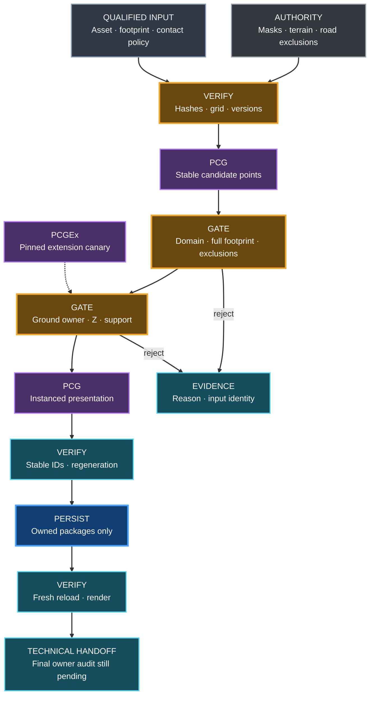

# Sa Calobra world graph — detailed #365 execution plan

**Status: EXECUTION RESUMED by the owner on 2026-10-12 for issue #365.**
The original planning-only instruction of 2026-10-11 is historical. The owner
explicitly requested implementation with subagents and reminded the team to use
Material Forge. Current implementation and evidence are recorded in the
[CPU kickoff](SA_CALOBRA_WORLD_GRAPH.md); proposed stages below remain pending
until implemented and proved. This document does not waive admission gates.

Reuse the [Material Forge ownership contract](MATERIAL_FORGE.md): PCG/PCGEx
owns what and where; Forge owns appearance. Preserve the accepted whole-map
material baseline. Bind validated Forge/material receipts and UV/physical scale
to each qualified mesh without deriving terrain contact, classifications or
Landscape displacement from material-local masks or Height EXR.

**Primary issue:** [#365](https://github.com/karnalooch/YetAnotherCyclingSim/issues/365).
**Milestone:** M3 — Route & World Foundation, world-finishing step 4 of 13.
**Planning date:** 2026-10-11, owner session date, Europe/Warsaw.
**Inspected code:** `8aca8d873f7a9f59e31ecc3b64d50ec5dbe99c7d` on
`codex/365-world-graph`; existing [Draft #474](https://github.com/karnalooch/YetAnotherCyclingSim/pull/474)
had the same remote head. These are baseline identities, not future proof SHAs.
**Domain owner:** `procedural-world`; coordinator is the sole documentation writer.

Read this together with [research and tutorials](SA_CALOBRA_WORLD_GRAPH_RESEARCH.md)
and the [copyable LLM handoff](SA_CALOBRA_WORLD_GRAPH_LLM_HANDOFF.md). The earlier
[CPU kickoff](SA_CALOBRA_WORLD_GRAPH.md) retains its original evidence. The
[Roadmap](../ROADMAP.md), [World Building Bible](../WORLD_BUILDING_BIBLE.md),
[World Authoring Library](../YACS_WORLD_AUTHORING_LIBRARY.md),
[Asset Plan](../ASSET_PLAN.md), [CI tiers](../CI_VALIDATION_TIERS.md) and
[Gumball contract](../ENGINEERING_PLATFORM.md) remain authoritative. Proposed
records, graph stages and test IDs below are a design, not existing interfaces.

## 1. Intended result and strict boundary

Deliver one reproducible authoring graph over the **entire existing 2016.5 m ×
2016.5 m Landscape**. It consumes authenticated masks and qualified assets,
validates ground contact, produces identifiable presentation instances, and can
be regenerated, saved and independently reopened. A 500–1000 m Golden Kilometer
is an extra inspection, never the coverage boundary.

The implementation order is:

1. Reauthenticate dependencies, source identities and actual tool capabilities.
2. Qualify a minimal concrete asset set and its transformed footprints.
3. Admit the terrain/contact input and compatibility with current road exclusions.
4. Prove a bounded stock-PCG consumer; prepare and prove the pinned PCGEx path.
5. Extend the same graph across the full area with bounded regeneration.
6. Prove cleanup, override survival, save, fresh-process reload and real rendering.
7. Complete technical review/protected CI and deliver the pinned #366 handoff.

The minimal asset set exercises the graph; it does not deliver #367 biome
palettes, #368 rock/cliff production, #369 foliage density or #370 roadside props.
Existing hard exclusions must work in #365; the complete corridor safety design
and admission remain #366. Do not disable exclusions to reserve that work for
later. No M4 gameplay, M7 hero dressing, runtime generation platform, terrain
rebuild, road redesign, new backend, engine upgrade or island-scale expansion.

Preserve `Base_DTM`, CRS/grid, canonical route/physics, accepted Landscape and
road packages, BOB ownership and the #363 checkpoint. A contact failure rejects
the placement or enters the separately scoped geometry queue; it does not grant
permission to move the road, smooth terrain, grow a rock over a seam, or add
foliage to hide #459 defects. Bounded repair still needs its own approved scope.

## 2. Verified starting state and unresolved contradictions

| Item | Planning-session evidence | Consequence |
|---|---|---|
| #365 | GitHub readback: open; body specifies M3; milestone field is null; no comments | M3 comes from issue body/Roadmap; do not claim a populated GitHub milestone or change Project metadata |
| Predecessor #364 | GitHub: closed as completed; #470 merged as `4dd792219bfc2eaf7dc216bd60cbde6628bba792` | Predecessor gate is satisfied; owner resumed bounded #365 implementation on 2026-10-12 |
| Predecessor exception | [Owner closeout comment](https://github.com/karnalooch/YetAnotherCyclingSim/pull/470#issuecomment-6113634845) manually accepts remaining route/latest-save gate | Older #470 body says blocked; actual closeout + current Roadmap supersede that historical status only |
| Saved road foundation | Earlier `R2a00f7ebba40` reopened/rendered; latest `Rc6b061b933e6` saved, fresh reopening NOT RUN | Select and authenticate the actual baseline package set before #365; do not call the latest saved scene freshly proved |
| Existing CPU adapter | Source/config/test implementation at inspected SHA; prior kickoff reports 21 passing tests and repeatable input receipt | Prior evidence is retained, not rerun or promoted to native proof by this plan |
| Input receipt | `placement: false`, `qualified_assets: []`, `native_execution: NOT_RUN` | No mesh, Z/contact, graph generation or saving is proved |
| UE | Read-only installed `Build.version`: 5.8.2, CL56702186; stock PCG descriptor Version 8 / VersionName 1.0 | Verify again on execution host; online UE 5.8 docs do not prove patch-level behavior |
| PCGEx | Absent from current session; optional enabled project entry is not installation | Native preparation/build/load/graph/save/reload proof remains required |
| Plugin pin | `39a8f1bdc65b2c4613a1e87b71d93b4576db0a66`, 0.79, descriptor UE 5.8.0 | Never substitute latest release or assume compatibility with 5.8.2 |
| Proof routing | No registered #365 Sa Calobra graph target in `.gumball/proof-broker.json` | Prepare a reviewed existing-framework integration before remote native admission; legacy SP638 proof cannot count |
| Visual/performance | Current Roadmap and M3 policy defer final owner audit and FPS | Technical images/native proof remain mandatory; report `PENDING_FINAL_M3`, `DEFERRED_AFTER_M3`, `performance_pass: false` |

Keep older evidence immutable. The stale intermediate-owner wording in proof
policy or old PR text must not be silently used to fabricate a gate or weaken
one. Before execution, map the actual required check to current authority and
resolve an executable-policy mismatch through its normal reviewed change. The
documented #373/#374 dependency mismatch belongs to later assembly; do not
reorder GitHub dependencies during #365 planning.

## 3. Reuse inventory: avoid rebuilding existing systems

| Existing path / component | Reuse | Limit |
|---|---|---|
| `scripts/assets/prepare_sa_calobra_world_graph_inputs.py` | Authenticated manifests, raster contracts, deterministic relocatable receipt | Does not generate placement or admit assets |
| `worldgen/sa_calobra/world_graph_inputs_v1.json` | Pinned grid, mapping, manifests, seed `36501` | Input schema v1 is strict; do not inject unrecognized asset/contact keys |
| `scripts/assets/read_sa_calobra_pcg_masks.py::evaluate` | Conservative AOI/radius/exclusion lower-bound test | Center semantic eligibility only; no complete semantic/support footprint or Z test |
| `scripts/assets/prepare_sa_calobra_pcg_masks.py` and transition producer | Existing World Authority output contracts and source closure | Do not regenerate or change source masks as an incidental graph operation |
| `worldgen/assets/catalog.json`, `scripts/assets/yacs_asset_library.py`, Julka | Asset discovery, provenance, hash/restore machinery | Alpine approved entries are not automatic Mediterranean palette admission |
| `Source/YetAnotherCyclingSimEditor/Private/PCG/` | Existing PCG creation, native mesh selector and candidate-node patterns | Legacy rectangle masks, flat Z and source-region assumptions need explicit rejection/replacement |
| `scripts/ue/yacs_scene_composer.py` and `scripts/worldgen/yacs_scene_layout.py` | Bounded generated ownership and deterministic patterns | Do not turn generic patch layout into a second biome engine |
| `scripts/worldgen/Bootstrap-YacsPcgEx.ps1` and reviewed patch | Immutable upstream identity and exact patched-file verification | Safe bootstrap correction implemented; retained patched state validated read-only; exact-head native build remains unproved |
| `scripts/ue/sa_calobra_saved_material_consumer.py` | Separate prepare/reload/render process pattern and source conservation | Material proof does not validate PCG managed resources or instance inventories |
| `scripts/runner/Get-YacsUnrealHostState.ps1`, existing native launchers | Host ownership, exact checkout and isolated proof patterns | Do not kill or replace the owner's active Editor |
| Existing Gumball Proof Broker / CI classification | Trusted default-branch execution, exact-SHA requests and artifact admission | A new target name in a document is not a registered executable target |

Future implementation should extend the smallest existing integration seam.
Prefer stock PCG for the graph, metadata and instanced spawning. Add a bounded
YACS adapter only where raster authenticity, conservative footprint/contact
checks or evidence collection cannot be represented by verified native nodes.
PCGEx extends a demonstrated spatial/filter gap; it does not replace the source
contract or become a shipping gameplay dependency.

## 4. Input contract and spatial invariants

### 4.1 Fixed identities

| Input | Pinned SHA-256 |
|---|---|
| PCG manifest `pcg-masks-v1-2026-10-04/pcg-mask-manifest.json` | `465788e5d74cf3eccf59bdddc1480fa4d7dac50d6f22255ca69ac3b9f174b5df` |
| Transition manifest `mask-transitions-v1a-2026-10-04/transition-manifest.json` | `2cb28c018f2ed3562762d8c47976307b64397f06417c5c8efc4221bd92182950` |
| Earlier CPU receipt, both reported runs | `2028657f97977250e0ec479ec6d90bf61ee09b2fc9a1657a30fa2d51e1bc4c2b` |
| PCGEx compatibility patch, LF-normalized | `8182824990670e560d1a1f0d052288cc8a98dc5cdb370bdbf63f2666f9593d89` |
| Expected patched `clipper.triangulation.cpp`, LF-normalized | `68614ae15d6bb03f2e58b0fb1dfa33e8eeebbfd31da08bd94ebfb378aeb63977` |

Hashes authenticate exact inputs, not semantic sufficiency. Confirm all inherited
source manifests, product bytes/logical hashes and actual raster metadata.
Read mask `low/medium/high` as overlapping source classes, not exclusive biomes,
species, physical plant density or measured individual tree positions.

Grid: EPSG:25831, 4033 × 4033, 0.5 m spacing, affine
`[0.5,0,483000,0,-0.5,4409516.5]`. UE XY origin in EPSG metres is
`[483000.25,4409516.25]`; X east, Y south. UE centimetres convert explicitly at
the adapter boundary; all source/contact thresholds use labelled SI units.
Footprint bounds are `[-25,-25,201625,201625]` cm.

For reads, use the existing pixel-center rule
`col=floor(Xcm/50+0.5)`, `row=floor(Ycm/50+0.5)`. Use nearest reads for categorical
and validity data. GPU-filtered RGB/PNG values cannot substitute for categorical
rasters. Never infer elevation from a selector, color, canopy height or density.

### 4.2 Eligibility pipeline

1. Reject malformed/infinite transforms, invalid class or negative clearance.
2. Require the center selector to equal 1; reject 0, 255 and outside AOI.
3. Require the conservative transformed horizontal asset envelope inside AOI.
4. Reuse exclusion-distance lower bound, subtract center-to-cell-center offset,
   then require `lower_bound >= radius_m + clearance_m`.
5. **New planned guard:** every raster cell intersecting the transformed support/
   semantic footprint must be valid and admissible for that asset's declared
   policy. Center acceptance is insufficient at a class edge or NoData hole.
6. Require valid terrain/contact coverage beneath the support footprint, with
   the declared owner and vertical datum; any ambiguous/missing contact rejects.
7. Apply density/transition weights only as further thinning. Never resurrect a
   rejected candidate. Retain every rejection reason and source identity.
8. Select variant/scale before final footprint check. Recheck after rotation,
   contact alignment or any override changes the transformed envelope.

For conservative clearance, use the full transformed geometry/collision envelope,
including off-center pivots and any relevant material displacement bounds. Root
support and canopy extent are different records; neither may be substituted for
the other to fit an exclusion. Defaults may conservatively require the complete
envelope to fit the semantic domain; a looser root-only semantic policy needs
explicit rationale and must still preserve full road/exclusion clearance.

Preserve bit reasons 1 pavement, 2 conservative 0.51 m shoulder, 4 complete BOB
affected rectangles, 8 buildings, 16 water holdback, 32 infrastructure holdback,
64 other LiDAR class and 128 no LiDAR samples. A mapped 5 m line/point holdback
is a conservative decorative restriction, not a measured river width or a
certified safety standard. Unknown rock/bare-soil subtype does not authorize
limestone placement. Do not shrink these masks for higher yield.

### 4.3 Current road-envelope compatibility

Authenticate the frozen pavement/shoulder/BOB source used by the masks against
the chosen saved consumer. Report whether the current road extent is fully
covered, including separately retained #459 corrections. If equivalence is not
proved, block affected placement and preserve the original masks. Prepare a
reviewed additional conservative exclusion only from admitted current geometry;
do not quietly repin a mask or claim all #459 geometry must be repaired before
#365 can proceed elsewhere. Record excluded debt areas and their owner issue.

## 5. Asset qualification before graph placement

Choose the smallest licensed, region-appropriate set that proves the consumer.
Discovery rankings or an Alpine `approved` catalog flag are insufficient. A
simple engine mesh may test mechanics in an isolated fixture, but cannot become
accepted Sa Calobra vegetation or rock evidence. If no real asset qualifies,
keep the native mechanical test separate and block real-scene placement.

For each asset, prepare a qualification record with the fields below. This is a
proposed record, not a schema already accepted by the v1 input adapter.

| Group | Required fields / evidence |
|---|---|
| Identity | stable catalog ID, provider/source URL and ID, acquisition/version, exact source bytes SHA-256/size, Unreal object/package path and hashes of material/texture dependencies |
| Rights | actual license identifier, license evidence, required attribution and repository/redistribution rule; use the existing Asset Plan/Julka policy |
| Regional intent | intended low/medium/high domain, role, reference rationale, decorative/inference label, explicit excluded uses; no automatic species claim from LiDAR |
| Geometry/import | source units and conversion to cm, axis orientation, importer/version and settings hash; native dimensions in metres, pivot/root anchor, local bounds, support footprint, finite normals/transforms, scale and yaw/pitch/roll ranges, maximum transformed clearance envelope |
| Contact | allowed ground-owner IDs/classes, support samples, normal/tilt policy, maximum slope, support residual, floating/penetration limits, allowed embedding, datum/uncertainty budget |
| Rendering | imported materials/slots, LOD/Nanite/instancing choice, culling bounds, texture sizes, displacement bounds, missing dependency/shader status |
| Collision | shape, preset/responses, simple/complex policy, navigation and `simulate_physics`; freeze these settings for the spawner and preserve canonical road/physics separation |
| Lifecycle and qualification | Preserve Asset Plan `lifecycle_status`: candidate → approved → acquired → imported → validated. Add separate scoped #365 `qualification_status` (pending/qualified/rejected), reason, qualifier SHA, hashes and native fixtures; qualified is not full lifecycle/visual/performance validation |

Numerical contact/slope/embedding tolerances are **REQUIRED_UNSET** until measured
for the real mesh and substrate. Qualification is blocked while required values
are unset. Do not import the historical road 8 cm band as a vegetation tolerance.
Freeze the approved values before generating the proof baseline, explain their
physical meaning, and reject rather than increase them to make a test pass.

Qualify at minimum: flat ground; admissible slope; excessive slope; uneven
support; known seam/local-ground boundary; class boundary; NoData hole; near
road/building/water holdback; AOI edge; maximum scale and off-center pivot.
Inspect both the native bounds and the rendered root/contact. Use current
provider policy; no bulk downloads, paid acquisition or new provider automation
is implied. Record asset cost data without claiming measured FPS.

Prefer uniform scale for the first qualification; nonuniform scale needs its own
support/bounds proof. A texture-only catalog entry must fail StaticMesh admission.
Include material WPO extent in relevant bounds. Preserve source imports; any
corrective asset is a separately identified derived package, never an in-place
untracked source edit.

## 6. Terrain and contact contract

The contact record must bind: Terrain Authority source manifest/hash, CRS,
horizontal mapping, vertical datum and UE Z offset, valid-height mask, source
interpolation method, chosen visible ground owner, native package/component
identity, collision settings, sample locations and measured residuals.

Treat source height and visible-surface contact as two checks. Source ground
establishes provenance; the admitted visible surface establishes actual support.
Neither a source DTM value alone nor a hit against arbitrary `WorldStatic`
geometry proves both. A native Landscape facet may differ from an interpolated
raster. If the difference is outside the declared uncertainty/contact policy,
reject the candidate; do not repair source heights or snap road geometry.

Per-candidate procedure:

1. Authenticate the ground owner and its current saved/loaded identity. If local
   derived ground is admitted, designate exactly one owner there. Reject
   coincident surfaces, ambiguous overlap and unresolved cliff/overhang ownership.
2. Resolve source height and surface validity at center and the declared support
   footprint. Use enough coverage to detect edges/gaps; corner-only sampling is
   insufficient for concave support or a hole inside the footprint.
3. Query only the admitted native ground. Exclude previously generated PCG,
   the candidate itself, roads/walls/props/canopies unless explicitly the intended
   support. Record hit object, position, normal and query settings.
4. Preserve XY unless an explicitly allowed deterministic decorative jitter was
   applied before eligibility. Compute Z from the qualified root anchor and
   allowed embedding; no generic `Z += offset` seam concealment.
5. Apply the asset's orientation policy: an upright tree need not inherit the
   complete terrain normal; a support-following ground asset needs bounded tilt.
   Explicitly preserve scale and required source/ID metadata through projection.
6. Recompute the final transformed bounds and all exclusions. Validate sampled
   gaps, penetration, slope and source/native discrepancy against frozen limits.
7. Emit accepted/rejected record. A failed query cannot retain a previous valid
   height, transform, success flag or sampled actor reference.

Installed headers show projection/query defaults that must not be inherited
accidentally: projection rotates by default, does not project scale by default,
and has attribute merge behavior; world queries do not ignore all PCG hits by
default. See the [API ledger](SA_CALOBRA_WORLD_GRAPH_RESEARCH.md#installed-source-ledger).
Header inspection proves available declarations, not runtime correctness.

The contact canary must include a deliberately placed unrelated collider above
ground and existing generated content. The result must hit the authorized ground
or reject, never quietly land on that collider. A successful line trace at the
origin is not continuous support or ride/collision admission.

Call discrete samples a sampled-contact proof. If a continuous base requires
support between samples, compare the relevant triangulation/footprint or reject
that use; a few successful corner traces cannot establish continuous contact.

## 7. Proposed native graph and ownership

The diagram is a logical design. Names below are proposed subgraph responsibilities,
not claimed MCP tools or ready-made UE node classes. Resolve exact node/pin/property
names from installed 5.8.2 headers and live read-only schemas before authoring.

### 7.1 Graph stages and checks

| Stage | Proposed behavior | Output / fail condition |
|---|---|---|
| Authenticated input binding | Resolve receipt, source products, terrain/contact qualification and concrete asset set once; reject hash/version/grid drift | Explicit input identity; no graph execution on unverified files |
| Candidate creation | Stable source-cell/subcell candidates in the full AOI, initially sparse; deterministic per-candidate randomness | Source cell, candidate ID, source class, point seed; no global mutable RNG stream |
| Asset and transform selection | Deterministically select only qualified asset variants and bounded transforms | Actual asset ID/scale/yaw; unknown asset rejects |
| Eligibility | Apply §4 against final footprint; carry exclusion reasons and unknown flags | Accepted subset, rejected inventory and counts per reason |
| Terrain contact | Apply §6 using authenticated source and native ground owner | Supported transform, contact residuals, hit identity; failed/missing support rejects |
| Final checks | Recheck eligibility after alignment; resolve duplicate ownership and overlap deterministically | One owner per accepted point; no streaming/partition-order tie breaking |
| Spawn | Use stock native Static Mesh Spawner and verified selector, preserving metadata mapping | PCG managed resources/instances in an owned derived consumer |
| Collect | Read native outputs after completion, validate asset/path/transform/source linkage | Canonical semantic inventory and coverage report |

Use stock points/attributes, projection and spawning only after proving their
semantics for this pipeline. A Surface Sampler tutorial can teach graph mechanics;
it does not replace mask authentication. Do not create millions of points for
every 0.5 m source cell by default. Decide candidate spacing from the bounded
asset contract, keep source-cell addressing, and record rejected/empty domains.

The initial implementation should use authoring-time generation. No runtime
generation, GPU PCG, recursive biome feedback or custom async scheduler is needed
to prove #365. Introducing one needs a concrete gap and separate review.

### 7.2 Stable identities and deterministic randomness

Separate **candidate identity**, **recipe identity** and **run identity**.

- Candidate identity derives from fixed world/AOI identity, stable source-cell or
  subcell address, semantic slot and identity-schema version. It must not use an
  array index after filtering, actor display name, process ID, current time or
  partition traversal order.
- The generation recipe binds code/native plugin/graph versions, source hashes,
  seed `36501`, asset qualification, contact thresholds and overrides. A recipe
  change creates a new evidence identity but should not renumber every unchanged
  candidate.
- Derive independent random channels from candidate ID + seed + named purpose
  (variant, yaw, scale, thinning). Do not let one rejection shift all later draws.
- Define canonical encoding, hash algorithm, sort order and float comparison
  policy before collecting native evidence. Use a full ID for collision checks;
  truncating to a native point seed does not replace the full identity.
- Carry the ID through the graph and maintain a verified mapping into native
  instances. Counts or identical screenshots alone cannot establish equivalence.

No promise of bit-identical output across engine/plugin upgrades is made. Such an
upgrade changes recipe identity and requires requalification. Compare semantic
inventories across independent generations; compare package bytes to detect drift
of one saved artifact. Unreal serialization bytes need not be identical between
two otherwise equivalent saves.

### 7.3 Full area, partitions and local invalidation

Begin with a bounded non-partitioned mechanical canary in a derived map. Before
full-area rollout, inspect the actual map's World Partition/streaming state.
Do not enable World Partition or alter the world grid as a side effect of PCG.
Reuse native PCG partitioning if supported by that admitted map; otherwise use
explicit disjoint ownership bounds with the existing mechanism. Record the
decision and prove boundaries. Hierarchical generation is optional after a
demonstrated need, not a default architecture expansion.

Choose and pin PCG grid size using supported 5.8 values, source alignment, asset
radius, loaded-map layout and bounded test cost. Grid size is **REQUIRED_UNSET**
until this inspection; copying a tutorial's value would be arbitrary. Source
4033-grid, PCG execution tiles and Landscape components are different concepts.

Each accepted candidate has one owner tile. Read neighboring input through a
halo, but spawn only the owner's points. Compute halo from maximum transformed
asset extent + explicit clearance + contact/interpolation neighborhood + any
filter radius. On a reviewed local fixture/source edit, invalidate intersecting
tiles plus this dependency halo. Compare inventories outside it for equality.
Do not hash the entire changed global source manifest into every candidate ID.

Test generation in both tile orders, boundary points, AOI edges, unload/reload
and overlapping source classes. Deduplicate overlapping classes with a recorded
deterministic semantic-slot policy; never silently count one point as three plants.
Document zero-output areas as validly empty, excluded, unknown or blocked.
Whole-area processing cannot mean only whatever cells the current camera loaded.

### 7.4 Manual override and cleanup policy

Store intentional suppression/replacement/transform overrides separately from
generated instances, keyed by stable candidate ID and versioned with the recipe.
Re-run source eligibility/contact on overrides; they cannot bypass a hard mask.
Keep manual actors outside the graph's ownership set. Unsupported overrides fail
visibly rather than silently reverting after regeneration.

Cleanup may remove only recorded resources owned by this graph instance and
generation. It must not use a broad name-prefix deletion over the world. Repeated
Generate must not accumulate duplicate instances; repeated Cleanup must not
delete source/manual actors. Test interruption and partial generation: retain
failure diagnostics and restore the last admitted derived consumer. Do not save
a half-generated scene as accepted.

## 8. PCGEx native preparation — explicit unfinished work

PCGEx is absent from the canonical project. Authenticated retained binaries load
in the isolated diagnostic session; an exact-head source build remains unproved.
Implementation has resumed, but **stock success cannot close the PCGEx portion of
#365**. Minimum PCGEx delivery is exact source/patch authentication, compatible
build/module load, one source-audited bounded extension canary and its actual
generation/save/reopen evidence. If no extension is justified for the production
graph, document that decision and obtain explicit scope resolution before claiming
the issue complete. Never add a meaningless node solely to claim PCGEx usage.

Preparation sequence (consult implementation evidence for completed steps):

1. Inspect the existing retained plugin source without modifying it. Authenticate
   Git origin, exact commit, complete tracked/untracked diff and expected patch.
   If Git metadata cannot be read, source excerpts remain unverified local
   evidence; do not call them exact-pin proof.
2. The bootstrap safety correction is implemented: existing checkouts are never
   destructively reset, and exact-patched retained state is accepted by read-only
   validation. Recheck the current source and receipt before a new installation.
3. Preserve retained bytes. Install only into an explicitly inspected fresh
   isolated target; reject unexpected changes and authenticate the exact patched
   state again. Safe validation does not prove compilation or regional admission.
4. Verify MIT license, descriptor, upstream pin, exact patch and patched target
   hashes. Never accept descriptor `5.8.0` as proof of a 5.8.2 build.
5. Serialize with the existing host resource arbiter. Preserve unsaved owner work;
   announce any required restart. Native plugin load is not a Live Coding promise.
   Do not obtain an idle host by terminating another Editor or CI process.
6. Build/load the plugin on the exact 5.8.2 host using established launch/build
   contracts. Capture the actually loaded module/path/version, not just a file
   on disk or `.uproject` flag. Record compiler/target/exit and diagnostics.
7. Select the smallest useful extension after API audit. Candidate: bounded
   nearest-surface sampling if stock projection cannot express the required
   query/metadata. Its primary operation uses finite overlap/closest-point
   sampling, not an inherently downward ray. Freeze query radius, allowed
   actor/primitive set, collision/owner filters, failure pruning, result outputs
   and transform policy. Audit any optional refinement trace separately; stock
   downward ray direction/length settings must not be invented for this node.
8. Prove success, no-hit, wrong-owner hit, self/generated-hit exclusion, maximum
   trace distance, failure output clearing and metadata preservation. Compare
   against independent native ground observations, not against the same node.
9. Save a derived graph/consumer, restart only the owned proof process, reopen,
   render and compare inventories. Prove missing/wrong plugin fails closed, with
   no silent stock substitution or removed nodes reported as PASS.
10. Audit module/target dependencies and hard/soft asset, cook and packaged-runtime
    references. Authoring-time generation alone does not prove an authoring-only
    plugin dependency. Keep PCGEx classes/graphs out of shipping references by
    default and claim `shipping_runtime_dependency: false` only with evidence.
11. Roll back by returning to the preserved original consumer/plugin configuration
    and verifying hashes/scene inventory; do not delete shared asset caches.

Public PCGEx documentation is rolling. A reported documentation/source disagreement
about nearest-surface failure output must be resolved at the authenticated pin
before use. Design the consumer to reject explicit failure and never rely on an
unverified default `Success` value. Path smoothing/resampling and Clipper geometry
operations are unnecessary for this scatter/contact task; preserve the approved
patch without activating unrelated road/terrain paths.

## 9. Native lifecycle, persistence and rollback

Submitting generation only schedules work. Record the request and expected
components/tiles, observe installed completion/cancellation state, then verify
native managed resources and inventory. Explicit timeout, cancellation, empty
unexpected output and missing cell completion are failures. Sleeping for a fixed
duration or receiving an MCP success response is not completion proof.

Bind completion/cancellation/cleanup observers before submission. On timeout,
cancel only owned work, observe quiescence and cleanup, and preserve diagnostics.
Use the established commandlet tick mechanism only in its own process; never
block or manually tick the owner's live Editor with an ad-hoc busy loop.

Prefer official Epic MCP for supported generic PCG operations. First discover
the installed tool schemas and the installed `Skill_PCGGraphGeneration`; read
that skill before graph authoring. A previously proved fixed BOB inspection tool
does not admit generic PCG mutation. If required PCG tools/skill are absent,
record the exact capability gap and reuse the existing bounded native integration
path after review; do not invent tool names or expand MCP infrastructure.

Future persistence proof must use three genuinely separate phases:

1. **Prepare and save:** generate to an owned derived consumer under
   `/Game/Generated/YACS/**`; identify every graph/map/asset/partition or external
   actor package and material/mesh dependency. Wait for generation and asset
   readiness; compare protected source before/after. Save the explicit owned
   inventory only, to a new destination. Preserve original packages and existing
   owner unsaved state. Global Save All/SaveDirtyPackages is unsuitable.
2. **Fresh reload, no repair:** launch a separate owned process only when host
   arbitration allows. Load precisely the saved map/graph and dependencies.
   Do not rerun the producer, rebind meshes/materials, repair metadata, or silently
   regenerate before validating stored state. Record loaded package/object IDs,
   graph settings and seeds, managed output counts and canonical instance
   inventory. Missing assets, unexpected dirty packages, late regeneration or
   source mismatch fails this phase.
3. **Fresh rendering:** use a rendered process, real GPU output, explicit camera
   transforms/FOV/light, required streaming cells, shader/texture warmup and
   screenshot completion. Inspect full-area coverage plus rider-close cases.
   NullRHI/readback is useful technical evidence but not a rendered scene.

Determine the native persistence model early: if the chosen PCG configuration
reconstructs outputs automatically on load, record that explicitly. A regenerated
view must not be presented as durable saved-instance proof. Select and prove the
supported authoring persistence behavior that meets #365; keep a separate test
for deliberate regeneration after stored-state verification. PCG graph object,
component, managed resources and physical instances are separate evidence items.

Save failure must leave the accepted source/checkpoint intact and return an
unambiguous failed result. Rollback is demonstrated by hashes and loaded native
state, not by a claim that Undo succeeded. No full hidden pavement backup meshes,
global world save, cache purge, or package overwrite as a shortcut.

## 10. Proof matrix and exact-SHA evidence

These are proposed test cases to implement with the relevant packet. No new test
suite or native proof has run during this documentation task.

| ID | Experiment | Required observation |
|---|---|---|
| INPUT | Missing/duplicate product, unexpected hash/grid/CRS/NoData drift, malformed seed or mismatch with the run's pinned recipe, transition parent drift | Fail before generation; original source and output receipt preserved; an explicitly repinned valid seed is the separate SEED experiment |
| FOOTPRINT | Off-center pivot, max scale/rotation, AOI edge, center-valid but support over unknown/exclusion | Reject all prohibited intersections; existing conservative distance rule retained |
| CONTACT | Flat/slope/rough/seam cases plus unsupported/wrong-owner/generated collider | Qualified residuals and owner only; no stale success/height/transform on failure |
| OVERLAP | Overlapping selector bands, repeated tile boundary data | Stable semantic choice and exactly one owned instance per accepted ID |
| SAME | Two independent generations A/B with same complete recipe and cleaned owned outputs | Same sorted semantic inventory, rejection reasons and source bindings, within frozen float policy |
| FRESH | New process with same inputs; no cached-output dependence | Same inventory; actual generation completion independently witnessed |
| SEED | Change only seed on an isolated fixture, then restore | Expected decorative changes; masks/ground/source IDs invariant; original output restored |
| LOCAL | One reviewed local fixture/source change within AOI | Only declared affected domain + halo changes; outside inventory/overrides unchanged; source baseline not mutated |
| ORDER | Reverse tile evaluation / reload order | Same IDs, transforms and ownership; no duplicate seams or order-dependent spacing |
| CLEANUP | Generate twice, Cleanup twice, cancellation during generation | No accumulation; only graph-owned outputs removed; unrelated/manual actors preserved |
| OVERRIDE | Suppress one ID, override one transform, leave one manual actor | Survive regenerate/reload; invalid override cannot bypass eligibility/contact |
| PLUGIN | Pinned PCGEx success and wrong/missing version/no-hit cases | Exact loaded identity; explicit failure rather than skipped-node success |
| SAVE | Save explicit graph/map/output package inventory | Nonempty real package bytes, per-file hash/size, source conservation, save result checked |
| REOPEN | Fresh process loads saved output without producer/repair | Stored graph/settings/resources/inventory match; missing/stale references fail |
| RENDER | Fresh real renderer, full-area coverage and additional Golden Kilometer | All expected views exist and are inspected; no white/black frames, unrendered/partial cells or hidden contact defects |
| ROLLBACK | Return to preserved baseline after canary or injected save failure | Exact protected source hashes and native ownership/content restored |
| FAILURES | Stale receipt/graph/package bytes, LFS pointer, missing dependency, late async callback, cleanup/save failure, wrong map/plugin/seed or cache identity | No reusable success artifact; preserve failure evidence and protected sources; a valid compile-cache hit never substitutes current-head generation/render |
| DELIVERY | Current-head required CI/review and complete evidence closure | No old-SHA/native claim; no automatic owner visual or performance PASS |

Numeric float tolerance is a predeclared measurement/serialization policy, not
a way to excuse visible drift. Compare IDs/assets exactly, retain raw transforms,
report maxima and distribution for any numeric residual. Instance counts alone
never satisfy SAME, FRESH, LOCAL or REOPEN.

Evidence should bind `issue`, exact code SHA, dirty-tree status, producer LF hash,
engine/changelist, actual loaded plugin revision/patch, input graph/config/asset/
terrain hashes, seeds, overrides, AOI and tile inventory, generation events,
canonical instance and rejection inventories, package list/hash/size, process
identity, commands/logs/exit codes and camera/image hashes. Keep large receipts
in existing ignored proof/workspace/artifact storage and link immutable evidence
from docs. No new independent PASS framework or self-issued proof admission.

Use existing Gumball integration. Before remote native work, verify that a suitable
trusted default-branch workflow and allow-listed target actually exist. If none
does, prepare a narrowly reviewed routing extension with exact-SHA/request-ID,
host arbitration, source retention and existing admission gates; that changes
tooling/CI and must be reviewed separately from this docs-only plan. Do not run
`world-authoring-sp638` or `m3-terrain` and call it #365 Sa Calobra proof. Manual
dispatch is only the existing documented fallback against a verified target.

Full-area technical review must inventory every processing tile, exclusions and
unknown domains, then retain planned overview/edge/interior/transition and
both-direction road-adjacent rider views. Add representative slope/contact,
partition-boundary and known #459 debt views, with generated content unable to
hide the defect. Choose cameras against actual geometry rather than fabricated
coordinates. Keep final owner audit `PENDING_FINAL_M3` and performance
`DEFERRED_AFTER_M3` / `performance_pass: false`; no FPS benchmark now.

## 11. Work packets, ownership and exit gates

These labels are work packets inside #365, not new milestones or permission to
execute today. The owner must first resume implementation. Each packet has one
writer; read-only review can run in parallel. Never let two writers modify the
same asset/source path or run competing UE/GPU jobs.

| Packet | Owner / independent review | Work and expected artifact | Exit gate |
|---|---|---|---|
| Baseline and APIs | procedural-world / proof-qa | Reverified issue/PR/dependency and source/host/tool inventory, API ledger | No unresolved authority/input ambiguity for selected canary |
| Assets and support | visual-dcc / world-data | Minimal concrete asset qualification and terrain/contact policy | Real hashes/license/bounds and all required numeric settings fixed |
| CPU/native contract | procedural-world / proof-qa | Bounded adapter design, stable ID/recipe schema, eligibility/contact fixtures | Source semantics preserved; negative cases fail closed |
| Stock graph canary | procedural-world / unreal-integration | Derived graph, explicit inputs, qualified sparse native placement and inventory | Actual generation complete; no protected source changes |
| PCGEx readiness | unreal-integration / procedural-world | Safe bootstrap behavior, pinned source/patch, build/load and useful extension canary | Native failure/success/save/reopen proved; no inferred compatibility |
| Full-area regeneration | procedural-world / proof-qa | Pinned partition decision, tile/halo coverage, SAME/LOCAL/ORDER/OVERRIDE evidence | Whole AOI accounted for and unchanged areas preserved |
| Persistence and technical review | unreal-integration / proof-qa + visual-dcc | Saved package closure, fresh readback/render, contact/coverage review, rollback | No repaired-on-load or camera-only proof; documented defect limits |
| Protected delivery | coordinator / docs-governor + technical review | SSOT updates, docs guards, exact-head CI and #366 handoff | All #365 DoD items evidenced; Draft until complete; no final owner/FPS PASS |

Prepare broker routing in time for native evidence; it may proceed independently
only with separate path ownership and approved scope. Do not merge incomplete
implementation just to make a workflow trusted. At most two unmerged implementation
branches; docs-only branches are excluded by project policy.

The analysis behind this plan actually used three read-only subagents:
`asset_contact_plan` (asset/contact), `pcg_graph_research` (graph/plugin/tutorials),
and `proof_handoff_plan` (verification/delivery). They made no file edits and ran
no Editor/build/GPU work. Their findings are integrated here and in the research
ledger; role cards alone are not evidence that an agent ran.

## 12. Issue DoD and downstream handoff

| #365 issue criterion | Evidence required to mark complete |
|---|---|
| Version-matched API/tool audit | Installed 5.8.2 ledger + exact authenticated PCGEx pin/patch + live tool schemas and native canary |
| Inputs/seeds/versions/identities pinned | Existing authenticated inputs plus qualified asset/contact/graph/override recipe and stable native inventory |
| Regeneration/reload respects unknowns/buildings/exclusions | FOOTPRINT, CONTACT, SAME, LOCAL, ORDER, CLEANUP, OVERRIDE, REOPEN cases across full area |
| Tests/docs/native/asset/license proof and limits | Exact-head required tests/CI, four docs guards, source conservation, real save/reopen/render and reviewed sources |
| Next-stage pinned handoff | Output recipe/package/graph hashes, restoration location, consumer contract, debt map and allowed #366 next action |

Handoff must state what #366 may consume, which fields are immutable, who owns
regeneration, how overrides survive, how to verify/save/reload, and where original
sources and evidence can be restored. List local-only assets and remote backup
availability truthfully. Pin unresolved contact/geometry debt, unknown domains,
unqualified assets, final owner audit and benchmark status. Never auto-close #365
or activate #366 from documentation, a CPU-only receipt or a Draft PR.

## 13. Validation of this documentation deliverable

This planning change modifies documentation only. No asset qualification, source
preparation, plugin installation, Editor operation, build, native graph, GPU proof
or benchmark was run. Prior CPU results remain attached to their original SHA.
Roadmap/Bible/authoring-library/index links were updated in the same change.

| Check performed for this plan | Result / limit |
|---|---|
| `scripts/ci/check_docs_index.py` | PASS: i18n, structure, links and freshness; entrypoint/index scope |
| `scripts/ci/agent_contracts.py` | PASS: references, ownership, privilege and policy markers |
| New world-graph document inspection | PASS: UTF-8, local file targets and balanced fenced blocks; manual source/contract review |
| `git diff --check` | PASS; docs text follows repository LF policy |
| Three specialist read-only reviews | Completed; corrected canonical asset lifecycle vs scoped qualification, import/collision details, nearest-surface query semantics, shipping-dependency proof and seed/failure test wording |
| Native / asset / save-reload / render / performance | NOT RUN for this planning task |
| Protected CI and remote delivery | Separate commit/PR evidence; local documentation checks are not a claim of protected CI success |

No reusable platform implementation was introduced, so no new Gumball promotion
candidate is needed for this YACS-specific plan. Potential bootstrap and proof
routing improvements remain future reviewed work, not changes shipped here.
