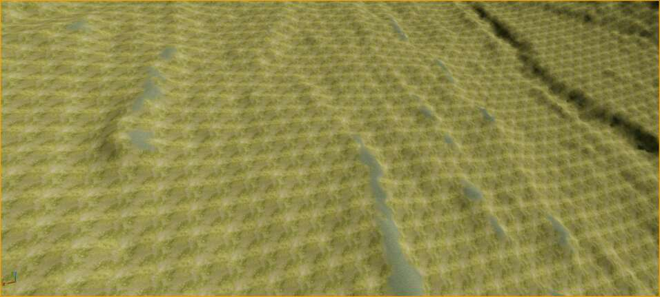
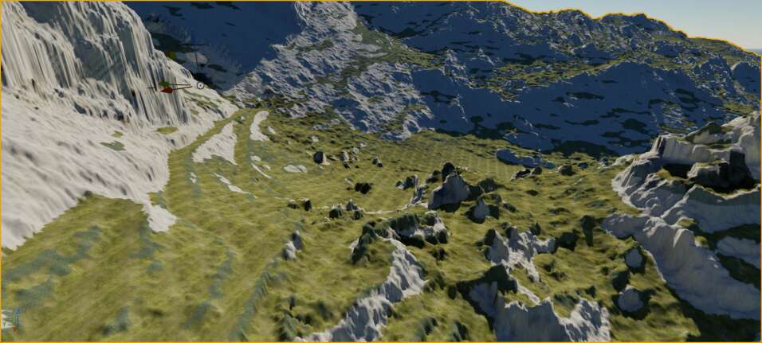
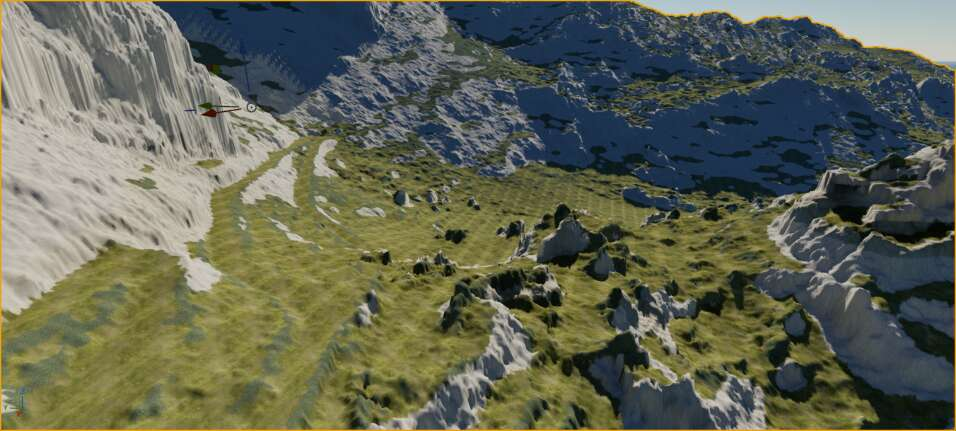

# Lesson 07: Material Setup — Full Unified Domain Verification & Remediation

- **Task**: SideFX Project Pegasus Landscape Workflow — Lesson 7 "Material Setup" (PEG-02-07)
- **Domain**: Sa Calobra Unified $16\,000 \times 16\,000$ single-quality domain ($8000 \times 8000\text{ m}$, $0.5\text{ m}$ spacing, $256\,000\,000$ samples)
- **Branch**: `codex/365-world-graph`, Draft PR #474
- **Accepted Base**: `2e1c209995b100fe01af08c39542605cffee9305`
- **Receipt**: [lesson07-material-setup-verification-receipt.json](lesson07-material-setup-verification-receipt.json)
- **Technical Status**: `LESSON07_TECHNICAL_PASS: false` (two complete CC0 rock sets acquired; five textures and three arrays successfully saved in native run 39636694686; same-camera images show excessive darkening and unresolved steep-face streaking; Macro 0.05 and Global Normal Flatten 1 retained; detailed-normal correctness, physical scale, fresh reopen, whole-area proof and protected delivery remain open)
- **Visual Review**: `PENDING_FINAL_M3_AUDIT`
- **Performance Acceptance**: `DEFERRED_AFTER_M3` (`performance_pass: false`, `performance_note: "DEFERRED_AFTER_M3"`)

---

## Current owner direction: original SideFX workflow (2026-10-21)

The owner requested a fresh download of `ProjectFiles_LandscapeWorkflow3.zip`,
a close reinspection of Lesson07 (Vimeo 888569514), then reproduction of the
original material workflow. The custom normal candidate and further substitute
texture changes are paused before native execution. The [source reinspection](../../assets/lesson07-sidefx-source-20261021/README.md)
retains the new verified archive, exact final surface IDs and video parameters;
the archive default arrays are diagnostic placeholders. The five final
PBR surfaces are acquired separately in the video. Preserve real Sa Calobra
geography and current owner session while resolving those exact dependencies.
Source inspection does not establish native application or Lesson07 completion.

## Acquired surfaces and current repair (2026-10-21)

The owner requested the actual textures and completion of Lesson07. Complete
2K Poly Haven `dark_rock_02` and `rock_boulder_dry` sets are now acquired:
Diffuse, NormalDX, Roughness, AO and Height, with all ten files hash/decode
verified. The [source and implementation evidence](../../assets/lesson07-surface-repair-20261021/README.md)
records authors, CC0 licensing, scale and exact bytes. These are generic rock
scans; the provider does not authenticate limestone. The darker set is prepared
as a neutral-grey Cliffs appearance candidate, while the lighter set remains a
comparison and accepted Grass2 is preserved.

The bounded importer replaces only Grass Normal/Masks (retained corrected maps)
and the three matching Cliffs maps in the existing five-slice arrays. It uses
the existing AssetImportTask/SourceTextures pattern and the normal Wingman
safety gate. It does not retry the frozen F49-denied observer. Preparation and
CPU validation are complete. Native assignment and saved-array readback passed
in [run 39636694686](https://github.com/karnalooch/YetAnotherCyclingSim/actions/runs/39636694686)
from `c59f717f11b134f75f695a26b94f8655bd3bd271`: five new textures and three arrays
were saved, with six completed native calls and twelve stable owner checks.
The [original receipts and five images](../../assets/lesson07-surface-repair-20261021/import-39636694686-evidence.json)
preserve the proof. Grass Colour, slots 1/2/4 and all four Landscape snapshots
were preserved; the map, material instance and shader graph were not changed.

The Cliffs candidate renders too dark and steep faces retain conspicuous
vertical streaking. The images do not isolate projection from geometry or
lighting causes. Detailed-normal correctness, physical scale, fresh reopen and
whole-area review remain open. Macro 0.05 and Global Normal Flatten 1 remain
unchanged. The native saved candidate and the already approved Macro material
instance are retained in the [verified nine-package checkpoint](../../assets/lesson07-surface-repair-20261021/retention-39643271947-evidence.json).
Run 39643271947 independently downloaded all nine LFS objects into empty storage
and verified their hashes and sizes (115,887,110 bytes total). The containing
commit includes their exact pointer texts. The [earlier fetch timeout](../../assets/lesson07-surface-repair-20261021/retention-39638776920-evidence.json)
remains recorded; restricting the local readback tree to the reviewed pointers
enabled the successful follow-up. This is persistence proof, not a fresh native
reopen or material-appearance acceptance.
[Metadata-only tool discovery](../../assets/lesson07-surface-repair-20261021/discovery-39638776763-evidence.json)
completed with zero native calls and 84 tools. The full `edit_graph` contract
was excluded by the existing size bound, so supported material-function graph
inspection remains unproven. A later historical error-reader step refused the
changed session with `FAILURE_LOG_OWNER`; neither its guard nor the frozen
denied observer is bypassed. The bounded follow-up can retain the full plain-text
description separately, without representing it as the complete tool schema.

Protected [CI 39636709351](https://github.com/karnalooch/YetAnotherCyclingSim/actions/runs/39636709351)
passed hosted checks, then native admission refused `LOCAL_BUSY` while preserving
the active owner Editor. Final protected delivery remains open.
Source-only [CI 39638791772](https://github.com/karnalooch/YetAnotherCyclingSim/actions/runs/39638791772)
subsequently reached the same `LOCAL_BUSY` admission boundary and also provides
no new native build or Automation proof.

### Current normal-contract diagnosis and isolated candidate

[Exact offline source inspection](../../assets/lesson07-normal-contract-20261021/README.md)
resolved the original Normal function and master expression connections. It
supports three linked corrections: explicitly Normal sampling at all four
corners, BR/TL producer correction to the same slice order as Colour/Masks,
and signed `(G,-R,B)` in place of `(G,1-R,B)`. The original seven packages were
read only; all 260 master expression payloads roundtrip exactly in memory,
while the documented whole-package parser limitation remains explicit.

The next native stage prepares only a private function and master. It must
reconnect semantic pins after duplication, compile with an explicit empty error
list, save only those two assets, and retain them for independent graph readback.
The active MI, parent, Flatten, map and arrays are unchanged by preparation.
No native candidate execution or application is claimed at this point.

The [follow-up metadata discovery](../../assets/lesson07-surface-repair-20261021/discovery-39644676507-evidence.json)
retained the full plain-text `edit_graph` description with zero native calls.
It advertises Blueprint graphs, not material-function inspection. The full
schema remains excluded by size, and the later historical error-reader again
refused the changed owner identity. Its guard is unchanged.

Protected [CI 39644687140](https://github.com/karnalooch/YetAnotherCyclingSim/actions/runs/39644687140)
caught a stale material-instance pin in the isolated historical readback lane
after the nine retained asset pointers advanced. The current change aligns
both reader constants with the independently verified 40,154-byte MI and binds
the provenance test to that raw server-readback receipt. The old recovery
receipt still anchors unchanged map lineage. Local reader tests and a separate
check using exact remote Git pointer blobs pass; hosted revalidation remains
required. This changes no admission or owner guard and does not rerun the
frozen observer.

### Earlier recovery attempts retained as history

The earlier startup retry superseded the disk blocker: run
`39580724393`, attempt 2, saw **18.65 GiB free**, but job `119286447935` exhausted
its 18-minute budget during Git fetch. No installer, Editor start or import ran.
The bounded source checkout was corrected at `de903a85`; exact-source protected
[CI 39625331286](https://github.com/karnalooch/YetAnotherCyclingSim/actions/runs/39625331286)
passed with compatible Unreal proof reuse. The subsequent
[startup 39625318792](https://github.com/karnalooch/YetAnotherCyclingSim/actions/runs/39625318792)
passed checkout, checkpoint hashes and module checks, and started canonical
Editor PID 24984 at `15:32:25.9789397 UTC`. Its loopback listener was verified
at `15:36:32 UTC`; the first authenticated discovery timed out after 20 seconds
with **zero native calls**. The same process/listener remained verified, but
the current world and material are not yet read back. Exact reports and archive
verification are retained in the [startup evidence](../../assets/lesson07-surface-repair-20261021/startup-evidence.json).

The first [native import attempt 39627916711](https://github.com/karnalooch/YetAnotherCyclingSim/actions/runs/39627916711)
staged the fixed package but stopped at the next owner/listener check with
`SURFACE_IMPORT_OWNER_CHANGED`, before any native call or asset save. The owner
confirmed accidental Editor closure. The original package pins and staged
source bytes remain retained; a fresh authorized session is required. The
[failure evidence](../../assets/lesson07-surface-repair-20261021/import-39627916711-evidence.json)
records zero native calls and the exact manifest. Importer-source protected
[CI 39627930173](https://github.com/karnalooch/YetAnotherCyclingSim/actions/runs/39627930173)
completed successfully; Lesson07 remains open.

The [closed-session diagnostic 39629865244](https://github.com/karnalooch/YetAnotherCyclingSim/actions/runs/39629865244)
subsequently confirmed zero live Editors, the completed de903 supervisor and
unchanged bytes for all six saved map/material/array checkpoints, including
Macro 0.05. Its [exact evidence](../../assets/lesson07-surface-repair-20261021/closed-session-evidence.json)
is retained for the specifically pinned fresh-session startup; the diagnostic
itself does not authorize or perform a start.

The specifically pinned fresh start at `007c5c0737bc36e0dc482b66f4b326e363104621`
passed protected [CI 39630660478](https://github.com/karnalooch/YetAnotherCyclingSim/actions/runs/39630660478).
[Startup 39630648547](https://github.com/karnalooch/YetAnotherCyclingSim/actions/runs/39630648547)
started canonical owner Editor PID 34848 at `16:07:32.1531735 UTC` and verified
the same native process/listener through `16:10:40 UTC`. Its first authenticated
discovery timed out with zero native calls; no import or material save occurred.
The [restart evidence](../../assets/lesson07-surface-repair-20261021/restart-39630648547-evidence.json)
retains the exact reports. A subsequent import still requires fresh owner,
process and listener checks and successful native authentication.

The resumed [import attempt 2](https://github.com/karnalooch/YetAnotherCyclingSim/actions/runs/39627916711/attempts/2)
then authenticated and returned a real BEFORE screenshot of the correct
Lesson07 world with its camera restored. The import source failed compilation
on its unnecessary `from __future__ import annotations` after the executor's
prologue. The [exact failure evidence](../../assets/lesson07-surface-repair-20261021/import-39627916711-attempt2-evidence.json)
retains the JPEG and raw sanitized receipts; there is no import save receipt
or AFTER image. This is not a policy denial. The owner Editor remained verified.
The compatibility correction and fixed input-name adaptation are reviewed as a
new source, with unchanged asset scope, package pins and normal safety gate.

The next [run 39635077584](https://github.com/karnalooch/YetAnotherCyclingSim/actions/runs/39635077584)
compiled that corrected source but stopped at the first `main` path expression
because file-mode execution did not set `__file__`. Its BEFORE capture succeeded,
the camera was restored and owner identity remained stable. The
[exact evidence](../../assets/lesson07-surface-repair-20261021/import-39635077584-evidence.json)
does not claim asset saves. The explicit file-context adaptation prepends only
the admitted canonical script-path assignment to the full unchanged source;
the same file-mode gate and original path/world/asset guards remain required.

Protected [CI 39635091670](https://github.com/karnalooch/YetAnotherCyclingSim/actions/runs/39635091670)
for that source passed its code/policy/security checks but failed native
workspace-lock admission with `LOCAL_BUSY` while the owner Editor was active.
No new native build/proof was reached. The session stays preserved; lightweight
in-place material checks do not replace the outstanding protected delivery gate.

## Earlier ready-made limestone selection (2026-10-21)

The owner requested licensed ready-made assets and complete materials, with
**dark-grey limestone as well as lighter limestone**. The current
[source selection and acquisition record](../../assets/lesson07-ready-materials-20261021/README.md)
recommends Mediterranean Karst Biome Vol.01 as the most complete documented
regional package. Free Quixel limestone mesh/surface candidates and the APEX
Dolomites material provide alternatives; Shore lime rocks explicitly supplies
dark-grey coastal forms. Fab candidates still require asset-specific license
and entitlement evidence; paid checkout prices were not verified.

At the earlier selection stage, four actual CC0 Diffuse samples were acquired and inspected with hashes retained.
Their warm colour or unverified geology prevented selection as the main dark-grey
limestone. Official downloads from three further CC0 providers returned HTTP 403; no new
complete PBR set or Fab package was acquired at that stage. The two complete CC0
sets above supersede that acquisition status; Fab packages remain unacquired.
The earlier source list is a selection
result, not evidence of an imported replacement or repaired whole material.

The bounded `--inspect-vault` / `[l07-inspect-vault]` mode uses the installed
dedicated tool only for three fixed local catalogue filters: `limestone`,
`cliff`, `rock`. It retains fresh process/start/listener checks and cannot
install, overwrite, download, run Python or import textures. Raw inventory
remains on the host; public evidence exposes only result metadata and six
fixed public product-name observations. The frozen observer and other modes
are preserved. The first native job at `6bfa739c` passed preparation but
stopped before any native call because there was no single Editor session.
Subsequent OS receipts independently confirmed zero Editors at 09:37:36 UTC.
Protected source CI passed through compatible proof reuse; no new native build
or material acceptance is implied. The linked source report retains the exact
first-attempt receipt and the missing-session continuation state.
The subsequent exact-source diagnostic at `7314caa3` confirmed the closed prior
session, matching inactive task/owner and all four installed source files.
Only the MI package differs from the original checkpoint (40,154 bytes,
SHA-256 `dcd34f9381414c0d63bbd234072ef1b4ac7dd62cf04a4ecc1fe2c48a029d3d2d`),
with the Macro-save timestamp. The other five packages are unchanged. The fresh
one-shot startup implementation passed 108 validator cases and independent
review. Exact-source CI at `fae2634d` passed in run `39580735431`, with compatible
Unreal proof reuse. Startup run `39580724393`, job `119160447960`, then stopped
in the runner's pre-job hook at `10:03:02 UTC`: **4.80 GiB free on D:; 5 GiB
required**. Checkout, installer and native probe were skipped; no new session,
task retarget, Vault retry or reopened material readback occurred. The
[derived admission summary](../../assets/lesson07-ready-materials-20261021/reopen-admission.json)
records the exact result. Post-job retention did not provide a fresh disk
measurement. The prior owner stop on general cleanup remains in force, so no
cleanup or reserve bypass was attempted. The saved Macro improvement remains
preserved by the earlier byte verification; whole-material acceptance is false.

The five existing surface classes, accepted Grass2 and geographic masks remain
unchanged. The shared colour-array grading remains for accepted layers;
achromatic Cliffs input must avoid an unintended hue shift.
Darkening a texture does not resolve projection/stretching or geometry defects.
Whole-material, native import and visual acceptance remain outstanding.

## Whole-material source repair (2026-10-21, native application pending)

The owner rejected the whole texture appearance, including blurred yellow-green
mottling and broad repetition. The screenshot does not isolate a single cause.
The original SideFX video was inspected directly in the official player: Lesson
07 at 22:09–22:18 restores Colour-array sRGB; 23:09–23:49 distinguishes global
colour from close tiling detail; 24:36–25:31 fills matching Normal/Masks arrays
and checks the response while moving the light. Landscape Material / Functions
at 10:21–11:41 explicitly pairs each colour layer with its matching normal and
uses the same UVs. These are source-method observations, not YACS runtime proof.
The original Lesson07 IDMap texture editor visibly shows **NoMipmaps** at
15:31.7 and **Nearest** at 17:21.7. The existing YACS importer sets Nearest but
does not explicitly set mip generation. The current native read at 02:05 UTC
confirmed **NoMipmaps, Nearest, sRGB=false and Grayscale/G8** already in effect;
there is no indicated IDMap setting correction to apply.

Two source-family and two channel defects are now proven by retained input
hashes and import provenance:

| Slice | Existing colour family | Incorrect normal family | Correct source | Roughness defect |
| --- | --- | --- | --- | --- |
| 0 Grass | Poly Haven `aerial_grass_rock` | `sparse_grass` via Stage3G Meadow | Matching `aerial_grass_rock_nor_dx_4k.png` | Renamed `...arm_4k.png` was converted to RGB luminance instead of extracting G |
| 3 Cliffs | Material Maker `surface_set/scree` PaleLimestone | `boulder_01` via Stage3G Boulder | Matching `SaCalobra_PaleLimestone_Normal_DX.png` | Renamed `...ORM.png` was converted to RGB luminance instead of extracting G |

The [source assembler](../../../scripts/assemble_surface_slices.py) now requires
explicit classes and a new output directory, verifies six retained source
hashes before writing, selects matching DirectX normals and extracts packed G.
Six focused regressions independently passed. It preserves the existing colour
recipe, 2048²/8-bit output, AO=255 and displacement=128. Only Grass and Cliffs
are selected for the remote offline preparation; the accepted Grass2 replacement
and other slices are retained. The generated Colour files are comparisons, not
permission to replace the Colour array.

Remote generation **succeeded** in [run 39519585751](https://github.com/karnalooch/YetAnotherCyclingSim/actions/runs/39519585751)
at source `c8370182042723d3f69610e6fcec1d4c074c96c0`, using Python 3.12.10,
Pillow 12.3.0 and NumPy 2.3.5. The six output PNGs and their hashes are recorded
in the receipt under `remote_assembly`; the host directory is
`D:\yacs\work\lesson07-source-repair-20261021\39519585751-1`.
The source preparation step passed despite the separate native observer failure.
**No native texture/array import or visual acceptance has occurred.**

The dedicated [capture run 39520946859](https://github.com/karnalooch/YetAnotherCyclingSim/actions/runs/39520946859)
succeeded at source `bb29f1c6573f8157243598f0bc57994ff4909568`. The actual
956×431 Level Editor frame at 02:26:08 Warsaw reports `L_SaCalobra_Lesson07`
and no PIE. It shows the owner's rejected broad olive tint and regular
diamond/grid repetition. The same owner PID 17896 and native start time were
retained. This is a **before-repair frame**, not the source fix applied in UE.
Exact bytes, capture metadata, process receipts and installed tool contracts are
retained in [the evidence directory](../../assets/lesson07-remote-20261021).



This source repair is necessary but does not establish the whole visual fix.
The current saved array has YACS grading (hue +25°, saturation 0.7, brightness
1.1) applied to all five colour slices. Detail tiling remains 0.25; the reviewed
Macro 0.05 partial improvement was saved at 02:35:55 UTC, as recorded below.
Their full mappings and physical periods remain unread. The Grass source
is a [15 m scan](https://polyhaven.com/a/aerial_grass_rock); the Cliffs source is
a retained 2 m loose-limestone-fragments recipe. Neither source suitability nor
live texel scale is established by its filename. The normal-flatten workaround
still suppresses normal detail; source correction does not authorize restoring
it before the sampler/derivative contract is checked.

Source evidence: [source backup](../../experiments/sa-calobra-material-repair-20261006/source-backup.json),
[local inventory](../../experiments/sa-calobra-material-repair-20261006/local-inventory.json),
[SideFX Landscape Workflow](https://www.sidefx.com/tutorials/project-pegasus-landscape-workflow/)
and [Landscape Material](https://www.sidefx.com/tutorials/project-pegasus-landscape-material/).

## Remote continuation and scoped connection authority (2026-10-21)

**Post-job survival proof:** at `2026-10-20T23:37:42.3866008Z`,
[discovery job 118948001389](https://github.com/karnalooch/YetAnotherCyclingSim/actions/runs/39515925462/job/118948001389)
verified authenticated Wingman access to **the same Editor PID 17896 and native
start filetime `134370120000674689`** created at 23:20 UTC. Both owner checks
returned `ATTACH_EXISTING`; the installer was skipped, no Editor was started or
stopped, and the endpoint stayed owned by this process. This observation is after
the startup job's 23:24:03 UTC cleanup and establishes post-job session survival.
Wingman reported `signed_in=true`; all **84** tools were discovered through four
HTTP requests, with **zero native tool calls**. World/material readback remains
the next step, not an established result.

**First native read attempt:** [run 39516981450, job 118951433360](https://github.com/karnalooch/YetAnotherCyclingSim/actions/runs/39516981450/job/118951433360)
passed exact-source CPU and Windows validation at source
`f485b18217deba19bc881aa78d22e5f862d13e3e`. At `2026-10-20T23:48:13.521280Z`
it submitted the fixed observer once. The native tool returned `isError=true`
with one 574-character text block, no collector tag and no UObject footer.
The client correctly retained failure/unknown completion but discarded the
actual message. Therefore the cause and current-world/material result remain
unverified. PID 17896, its native start time, owner and listener stayed unchanged
through the final check at 23:48:15 UTC. No automatic retry occurred.

[Discovery-only recovery run 39518788016](https://github.com/karnalooch/YetAnotherCyclingSim/actions/runs/39518788016)
at source `12a74fcc33a342e5fe3d05c5390b77a770906394` passed its CPU and Windows
steps, retained the same owned Editor and made zero native calls. The bounded
reader returned **`LOG_UNAVAILABLE`** at 00:04:57 UTC: the launcher's requested
`D:\yacs\lesson07-remote\editor.log` does not exist. No error message was recovered.
The downloaded artifact digest was verified.

**Historical passive-observer denial, still binding on that observer:** the explicit attempt in
[run 39519585751](https://github.com/karnalooch/YetAnotherCyclingSim/actions/runs/39519585751/job/118959933031)
retained the actual response at 00:12:21 UTC: Wingman's **F49 safety gate**
classified `execute_python` as an attempted write to protected `.uproject`.
The pinned collector only reads project identity, but the tool denied execution.
The same owner Editor PID 17896 and native start time remained verified through
00:12:23 UTC. The client retains one attempted call, a received error and unknown
completion; no material readback or asset mutation is established. All 66 focused
Python tests and the offline slice-generation step passed. The artifact ZIP
`12310806923` was downloaded and SHA256-verified.

The Python path is stopped. Do not remove, encode or rephrase its project guard,
retry that call, disable the gate or substitute another arbitrary-code transport.
The successful separate `[l07-capture-editor]` operation requested the vendor's dedicated
`take_viewport_screenshot` with only `return_image=false`. It retains bounded
exact contracts for supported `read_bp`, `explore`, `code_search`, `edit_texture`,
`edit_material_instance`, `edit_asset`, `edit_material` and
`edit_material_function` without calling them. The JPEG reader admits only
one exact returned path in the installed tool's viewport-shot directory, verifies
capture-time freshness and unchanged process identity, decodes dimensions and
copies stable bytes with a matching SHA256. The result identifies the current
viewport world by name; it does not establish full world/geometry identity,
graph correctness or whole-material acceptance.

The next `[l07-inspect-editor]` operation uses six fixed, sequential dedicated
read calls: registry exploration; instance parameters; nine texture targets
including global colour and IDMap; master expression properties with
`section=properties`, `save=false` and bounded line pagination; an
eleven-target save **dry run**; and a bounded
installed-engine `Texture2DArray.cpp` search. Exact registry paths/classes must
be present before proceeding, particularly because the instance tool can create
a missing asset in authoring mode. Every installed input schema is pinned before
the first native call; any error stops the batch without retry. Raw responses
remain pending review. The discovered tools do not establish local image import
or source-array reassembly; `edit_texture` explicitly does not import. Graph
read mode does not promise every TextureCoordinate or nested-function property,
so absent values cannot be treated as defaults.

**Complete dedicated reads:** [run 39530647438](https://github.com/karnalooch/YetAnotherCyclingSim/actions/runs/39530647438),
source `0c7871670bcc42f837b17f8108b39fe1182a01a0`, passed its CPU and Windows
jobs. All six responses were received without truncation. The live instance
confirms Detail Tiling=0.25, Macro Tiling=0.25, Global Normal Flatten=1,
Macro Texture Distance=10000, all three expected atlas bindings and the retained
zero global-colour/brightness/specular overrides. The IDMap is 16000² G8 with
the correct settings above. The eleven-package save dry run explicitly reported
`dirty=0` for each target and wrote nothing. The same owner PID/start time
remained verified through 02:05:08 UTC. [Raw readback](../../assets/lesson07-inspection-20261021/properties-bridge.json)
is native parameter evidence, not a rendered repair or complete graph proof.

The master properties section identifies the global AO source as original
`Debug/T_W`; its name alone does not verify white pixels. The complete retained
edge list confirms Detail and Macro start at the same `TextureCoordinate_5`
and use the same atlases, so their current equal multipliers preserve the same
UV period. The non-default property dump still does not expose every TexCoord
value or nested-function implementation. The bounded engine-source search found
zero matching lines; it does not prove an array-rebuild API is absent.

### Controlled Macro frequency comparison, executed and restored

Preparation passed 73 focused client tests, 118 PowerShell viewport cases,
64 workflow-intent and 32 PowerShell-switch combinations, plus a direct
client-to-PowerShell receipt check. Independent review corrected a timing
risk: the scalar cannot change unless 193 seconds remain in the unchanged
300-second trial budget. The preparation alone did not verify Windows API process/listener checks;
the actual native execution and its separate review are recorded below.

Direct review of the original [Lesson07 video](https://player.vimeo.com/video/888569514#t=22m44s)
at **22:44** shows Detail Tiling=0.25, Macro Tiling=0.05 and Macro Texture
Distance=10000. The source example therefore separates those frequencies 5:1.
It does not establish metres per repeat in this differently scaled consumer.
The earlier YACS scale-only result remains rejected; copying the tutorial
value is not visual acceptance or a substitute for correcting source families.

The explicit `[l07-trial-macro]` candidate tests only **Macro Tiling
0.25 → 0.05 → 0.25**, keeping the other parameters and all source assets intact.
It requires the actual clean instance and exact parameter baseline, a separate
instance backup, native readback after both changes, and an A/B/A image set
using the retained recovery camera. The dedicated screenshot operation applies
that camera for one frame and restores the owner's view. No map save, shader
graph rewrite, texture import, terrain generation, Python retry or Editor
restart is part of the trial. The result must distinguish a changed texture
period from a stationary grid; a nicer single frame is insufficient.

The Macro coordinates also feed Normal and Masks, so this is not a pure
BaseColor-only probe. All observed layer Macro displacement scales are zero,
but their nested function has not been read; no displacement control is changed.
Semantic restoration of the instance is checked separately from asset byte
identity. A failure retains its actual status and restoration evidence rather
than silently advancing to a permanent change.

The actual [A/B/A run 39532652532](https://github.com/karnalooch/YetAnotherCyclingSim/actions/runs/39532652532)
at source `71914188cbdaeac200074b8a070e2f44ed50e501` passed all 99 CPU tests
and Windows execution. All 12 calls and 12 fresh owner checks completed; the
same PID 17896/start FILETIME was retained. Both scalar mutations reported
`saved=true; failures=0`. Baseline, saved backup and restored readback match
exactly across 61 scalars, one vector, five textures and three switches.
The candidate differs only in Macro Tiling, represented as float32
`0.05000000074505806`. That trial restored the instance to **0.25** before the
separate retained application below.

Root and independent review of all three native JPEGs agree: the dense diamond
repeat on the left valley floor and central foreground becomes substantially
less conspicuous at **0.05**, then returns at restored **0.25**. This supports
retaining that scalar as a **partial improvement**; the separate applied
readback is now complete below. Broad mottling/undulations, pale vertically stretched cliffs and
crude grass-to-rock transitions remain. The transient upper-left shadow in the
first A frame is excluded from the improvement claim; B versus restored A
supports the same material finding.




The [unchanged native images and receipts](../../assets/lesson07-macro-trial-20261021)
retain the first baseline as well. Artifact 12316570731 has ZIP SHA256
`9d65747a33f01b24ac281d0f7b7d2515ef2da16c6f526faea104541c88983a4c`.

### Reviewed Macro improvement applied and saved remotely

The separate [application run 39533695950](https://github.com/karnalooch/YetAnotherCyclingSim/actions/runs/39533695950)
at source `da91a9c66c6d5a6ee30aa6151e6024861291b4d1` **passed** its
108-test CPU job and Windows execution. All seven native calls and seven fresh
host checks completed. The operation verified the exact prior trial receipt,
the current clean baseline and the existing backup before changing the scalar.
The native mutation returned **`saved=true; failures=0`** at 02:35:55 UTC;
complete readback then matched the reviewed candidate. The only changed row
is scalar 46, **Macro Tiling 0.25 → 0.05000000074505806**. All other rows in
the 61-scalar, one-vector, five-texture and three-switch snapshot are unchanged.
The complete candidate SHA256 is
`99c384e9701889aa2cae667b69e1faff32835e2b4440a9953e6f5884439b75ee`.

**The current saved instance retains Macro 0.05.** No recovery or restoration
was attempted; the pre-trial backup remains intact. The final owner check at
02:35:58 UTC still identifies PID 17896 and start FILETIME
`134370120000674689`, session 1. The operation did not restart or stop the
Editor, save the map, change any source texture, rebuild an array or alter
terrain/classification. Global Normal Flatten remains 1.



Root and independent visual review confirm that this final native capture
reproduces trial B's reduction of the dense diamond pattern. **This is a
partial material improvement, not whole-material acceptance.** Broad
mottling/repetition, vertical cliff streaking and crude grass-to-rock
transitions remain. The raw producer receipts retain their original
`REVIEW_PENDING` status; this subsequent review is recorded separately in
the verification receipt. The image is the unchanged 956×431 JPEG returned
by the native capture tool, not a reconstructed or edited preview.

The [five exact native evidence files](../../assets/lesson07-macro-applied-20261021)
come from artifact 12316287387; ZIP SHA256
`2ca3d2ea2ab199674239fe3301c78bb15ca3e3906efb5f9844660e12ae1d1d4c`.
Preparation passed 82 focused client tests, 152 PowerShell cases, 128 workflow
marker combinations and 64 Probe/four Reader switch combinations, plus
independent review and a client-to-reader receipt check.

Corrected Grass/Cliffs normal and mask PNGs remain prepared **offline only**.
The installed dedicated tools have no verified local-image import and
Texture2DArray source-rebuild operation; `edit_texture` explicitly does not
import. The F49-denied Python observer remains frozen. Source import itself
has not been attempted or denied. Whole-material and performance acceptance
remain false.

Protected [CyclingSim CI 39533702186](https://github.com/karnalooch/YetAnotherCyclingSim/actions/runs/39533702186)
failed at its native ownership guard with **`LOCAL_BUSY`**, preserving the
running Editor and its logs. Native build/Automation did not run. A secondary
log-staging step could not enter the missing `_unreal-ci-warm` directory.
The successful focused application does not replace the protected CI gate.

The first dedicated inspection [run 39528106136](https://github.com/karnalooch/YetAnotherCyclingSim/actions/runs/39528106136)
at `72919f499181a919b1708df7480be8bf99e4bf01` passed its 82-test focused CPU
gate but stopped in Windows checkout validation before the native probe.
`git lfs ls-files --long HEAD` could not scan a missing Git object in the sparse
checkout. The next attempt restores the previously successful full code-only
checkout, preserving `lfs: false`, skipped LFS smudge and the unchanged LFS
validator. No native tool was invoked by the failed inspection job.
The first correction at `867c679129a4b39fbe51a766e5fba6ed075665d8`
mistakenly removed sparse checkout from the CPU job instead of the Windows job.
Its CPU gate stopped on a dirty checkout before native admission. The corrected
workflow restores the original CPU checkout and removes sparse checkout only
from Windows, matching the successful capture checkout configuration.

At `bcf855c618d6f78d2335675361454075e9fb3c20`, [run 39528676794](https://github.com/karnalooch/YetAnotherCyclingSim/actions/runs/39528676794)
reached the existing Editor and completed the dedicated registry call. Its actual
response contains **29/29 assets**, `truncated:false`, and all eleven expected
targets with consistent classes. The client wrongly interpreted the JSON key
`truncated` as a truncation warning and assumed a full package path rather than
the observed same-row directory/name fields. It stopped before material reads.
The parser correction uses this exact response as a regression fixture, verifies
typed metadata and exact same-row identities, and retains the original six-call
plan. [Exact registry evidence](../../assets/lesson07-inspection-20261021)
also confirms unchanged owner PID/start time; no native asset change occurred.

At `cd2d1b35a233972c11a48b0d3d28c91b84722b64`, [run 39529650683](https://github.com/karnalooch/YetAnotherCyclingSim/actions/runs/39529650683)
passed registry verification and received the actual master graph. The complete
graph exceeded the client's unchanged 64 KiB response budget: only its explicit
60,752-character prefix was retained, with `text_truncated=true` and
`INSPECTION_RESULT_SIZE`. The batch stopped after two calls, before instance or
texture settings. The retained edges and partial non-default properties show
IDMap samples 12 and 29–32 using explicit mip level 0; they do not establish
the current texture's mip-generation setting or explain the visible grid.
Master parameter defaults must not be reported as live instance values.
The next fixed six-call batch reads the instance and textures before requesting
only the master properties section, retaining the same schemas, size budgets,
fail-closed behavior and no-Python restriction. The observed vendor contract
supports this section selector; no arbitrary-code fallback is added.

The [partial master evidence](../../assets/lesson07-inspection-20261021/master-bridge.json)
and corresponding process receipts preserve the actual incomplete result.
At 01:53:28 UTC the same PID 17896/start time remained verified; no asset was
changed. Newly retained dedicated contracts do not close source-import capability:
`edit_data_asset` is documented for DataAsset/PrimaryDataAsset, `download_asset`
requires subsequent Python import, and `vault_asset` installs existing content
packs rather than rebuilding these texture arrays. Their existence is not
permission to reinterpret their target types or bypass the Python denial.

The owner requested remote execution of the channel diagnosis and explicitly
allowed creating the missing connection infrastructure. This supersedes the
previous no-new-transport restriction for this bounded Lesson07 task only.
Preserve the running Editor, unsaved owner state and existing host/CI guards.
The historical rock-preview transport and its scene admission stay unchanged.

The existing `yacs-lesson07-editor-module-diagnostic.yml` is extended first to
inventory the current Editor identity, its owned listeners, the installed
Wingman/Loco plugin declarations and discovery metadata. It does not call a
native tool, build, launch/restart an Editor, update the canonical checkout or
open a public listener. A process command line is checked internally for the
canonical project; raw command lines and credentials are never reported.
At `2026-10-20T22:20:28.5700392Z`,
[run 39507345660, job 118919480626](https://github.com/karnalooch/YetAnotherCyclingSim/actions/runs/39507345660/job/118919480626)
at exact source `4bf894dd8dccc482a3e90a53bce6d6b01653e6a7` reported no
`UnrealEditor.exe` or `UnrealEditor-Cmd.exe`, no vendor discovery file and no
diagnostic errors. Wingman **0.20.5** is installed. The earlier PID 19056 is a
historical observation, not the current session. The existing shared-host guard
independently reported `IDLE` at `22:21:47.9796499Z`. These observations do not
explain when the earlier session ended and must be refreshed before startup.

[Wingman's vendor MCP guide](https://ai.locodev.dev/docs/developers/antigravity)
documents a per-session loopback URL and bearer token in
`Saved/LocoAI/external-mcp-config.json`, JSON-RPC Streamable HTTP, and read-only
`session/status` and `tools/list` discovery. The URL/token rotate at restart;
these are capability references, not proof of the installed endpoint. Any
host-local client must validate the discovered loopback listener against the
observed Editor PID, creation time, executable and project before using it.
Keep credentials in memory on that host and never upload the discovery file.

The [bounded remote connection workflow](../../../.github/workflows/yacs-lesson07-remote-editor.yml)
implements the owner's missing-infrastructure instruction. An explicit
`[l07-remote-editor]` intent on this owner branch first awaits protected
exact-SHA CI and then takes the existing shared Unreal concurrency lane. It
preserves a canonical interactive Editor if one exists. Otherwise it checks the
accepted map, MI, master and array hashes, compatible installed modules, free
space and the logged-in desktop identity before creating a **separate** limited
interactive one-shot scheduled task. The installed exact-SHA launcher stays
outside runner workspaces; the old road-world Live Host task is not repointed.
The launcher rechecks ownership and saved identities immediately before launch.
It does not stop an Editor on probe failure or run a restart loop. Project
configuration, accepted packages and the canonical Git checkout are not edited.

The [host probe](../../../scripts/ue/Invoke-YacsLesson07RemoteProbe.ps1) verifies
the discovery port belongs exclusively to the exact canonical Editor process.
The [fixed MCP client](../../../scripts/ue/lesson07_wingman_client.py) defaults
to vendor initialization, `tools/list` and `session/status`. It supports the
official [2025-03-26 Streamable HTTP contract](https://modelcontextprotocol.io/specification/2025-03-26/basic/transports)
with bounded responses and timeouts, without redirects, proxy routing or
automatic retries. The fixed opt-in observation path requires the actual
installed `execute_python` input schema to pass its raw-schema guard, a signed-in
session and unchanged process ownership. It sends one hash-pinned collector,
with no retry or arbitrary script argument. The
[passive reader](../../../scripts/ue/lesson07_observe_editor.py) checks its actual
project and world before reading loaded objects; it neither loads/saves packages
nor changes the camera or material. Partial graph API information remains
unavailable instead of being promoted to proof.

The explicit `[l07-discover-editor]`, `[l07-observe-editor]`,
`[l07-capture-editor]` and `[l07-inspect-editor]` intents use a
separate exact-source focused CPU gate, consistent with the existing M3
live-read admission, and require an already-open verified owner Editor. All
five intents, including startup, are mutually exclusive. They retain the shared
native concurrency lane; no existing-session path can enter the installer or start an Editor.
Discovery initializes MCP and reads metadata without a native tool call. It
retains bounded exact contracts for `execute_python`, `take_viewport_screenshot`,
`read_bp`, `explore`, `code_search`, `edit_texture`, `edit_material_instance`,
`edit_asset`, `edit_material` and `edit_material_function`, including advertised
defaults and enums; other tool rows stay structural.
Credentials and unrelated metadata are excluded. The wrapper
checks the owner, PID, native start time and listener again after the read. Its
success status is deliberately partial diagnosis, not graph, visual or
performance acceptance. Unknown completion after a timeout is retained as
unknown, and no native request is retried. The collector records bounded
viewport metadata without selecting or changing a viewport. Its active view
identity is not a proven screenshot target.

The initial passive mode passed 57 focused Python tests (37 client and 20
collector), independently rerun. These synthetic tests do not establish native execution or output-wrapper
compatibility; the input contract was independently verified from the installed tool. The frozen collector
SHA256 is `033301fa3cd9e35ba68b3ab15754772ba2dcfb2e2dc3aa8b7d01615c60f13bd5`;
its native attempts are recorded above; the current attempt was blocked by F49. To respect
[Wingman's documented project-local file-I/O boundary](https://ai.locodev.dev/docs/how-it-works),
the client embeds the exact hash-verified collector bytes in the fixed Python
argument, checks that hash again in a fresh native namespace, and performs no
native source-file read or write. The fixed request is 32,349 bytes under an
observation-only 64 KiB cap; discovery retains its 16 KiB cap. The actual pinned
collector passed a fake-Unreal test with all file-open APIs forbidden. Installed
input-schema SHA256 is pinned to the actual discovery response; output-wrapper
compatibility still requires native evidence. The request supplies only `code` and
explicit `mode="file"`, never a file argument. Bounded failure diagnostics retain
fixed response-shape fields, counts, tag/footer indicators and bounded
credential-redacted tool error text, not raw UE logs.

At exact source `3ba05803bfc3ff095eb012e3f790752b55b47d12`,
[protected CyclingSim CI 39508823330](https://github.com/karnalooch/YetAnotherCyclingSim/actions/runs/39508823330)
completed successfully. The subsequent
[connection job 118927017770](https://github.com/karnalooch/YetAnotherCyclingSim/actions/runs/39508814955/job/118927017770)
passed PowerShell parsing, principal checks and all 30 focused Python tests,
then stopped at `2026-10-20T22:39:49.5565226Z` with
`BLOCKED_PROJECT / PROJECT_MODULES_OR_ENGINE`. Its fresh host guard was
`IDLE`. No task was registered or started and no Editor was launched; saved
checkpoint hashes, module compatibility, MCP discovery and native readback
were not reached. Report artifact `12305610506` has ZIP SHA256
`d3cab464fe202a4e588f0a6f96c997f4d3d21156620858efe8a61cac74e9f79a`.

The [read-only follow-up 39510504128](https://github.com/karnalooch/YetAnotherCyclingSim/actions/runs/39510504128/job/118930037564)
at source `2609d45d881e8a9fce6a2022ac24d3268a3a22a7` identified the actual
cause: the canonical descriptor's engine association is
`{FEF18A3B-4D4B-15FD-E2E3-E5AA38A2AB75}`, not the literal `5.8`. Both required
modules have the correct names/types and all four property/key match counts
are one. The descriptor SHA256 is
`f00d5117b63b3a6a5d200ff4ffab035a770712cd358b3e6f4cb50b6063c06c66`.
At `2026-10-20T22:46:36.3229338Z`, there was still no deployed Editor process
or discovery file. The diagnostic artifact is `12305906278`, ZIP SHA256
`625242854e2f5add1814173ba724975f9a6804314aa8b4d8e8fd39be2dab920c`.

The startup guard now admits this **specific observed GUID together with that
exact descriptor hash**, as well as the previously supported `5.8` descriptor.
It still independently requires the fixed engine executable, installed engine
version/build and compatible module BuildIds. An unknown GUID or changed
descriptor hash is rejected. The canonical descriptor is not rewritten.
[Epic's project documentation](https://dev.epicgames.com/documentation/en-us/unreal-engine/managing-game-code-in-unreal-engine)
describes GUID engine associations for locally registered installations, and
its [command-line guide](https://dev.epicgames.com/documentation/en-us/unreal-engine/command-line-arguments-in-unreal-engine)
supports launching a project/map through an explicit Editor executable. This
does not claim that the host GUID's registry mapping has been read.
The PowerShell dictionary hypothesis was disproved by both local reproduction
and the host's matching counts.

At source `457dc899adb858abee69c8ec1c4174cb7bc8032d`,
[protected CI 39510984665](https://github.com/karnalooch/YetAnotherCyclingSim/actions/runs/39510984665)
passed. The [next connection job](https://github.com/karnalooch/YetAnotherCyclingSim/actions/runs/39510976391/job/118934957954)
passed all 24 actual PowerShell data fixtures and 30 Python tests. Its Windows
preflight verified the accepted map, MI, master and all three array hashes,
installed UE 5.8.2 and the required module BuildIds (`55116800`). It registered
and requested the separate `YACS Lesson07 Remote Editor` task with the matching
desktop owner. The task's own preflight also passed, then its session report at
`2026-10-20T23:01:15.3694751Z` recorded `BLOCKED_HANDOFF`,
`MethodInvocationException / SYSTEM_EXCEPTION`, with `editor: null` and no
autosave override reached. This proves task installation and startup request,
not an Editor process or a native connection. Artifact `12305158956`, ZIP
SHA256 `36778c15dd1dde65d9395be22b0c4e45691d6db32bad241555eaadc59a33313c`,
was downloaded and its `session.json` inspected independently of the installer.

The deadline expression in that source round-trips a JSON UTC `DateTime`
through a string and a culture-dependent parser. Reproduction using the exact
production expression under PowerShell 7.6.6 raises the same exception class
under `pl-PL` and `en-GB`; under `en-US` it instead loses the UTC kind and shifts
the deadline by the local time-zone offset. This is a reproduced launcher
defect consistent with the recorded handoff failure. The native report did
not retain its exact failing line or host culture, so native causal attribution
is not stronger than that evidence. The failed release and session report are
retained. That failed attempt did not establish an Editor process or any MCP,
world or post-job survival proof.

The corrected launcher preserves an existing UTC `DateTime` or parses exact
round-trip UTC text with invariant culture. The start deadline remains bounded.
The installer may retarget only the action of the specifically recorded failed
`457dc899` task: its original source hashes, original session bytes, expired
permission, inactive failed state, desktop owner and task settings must match,
and a fresh host check must still be `IDLE`. It retains the old release/state
and a private copy of the prior task definition. It neither stops nor deletes a
task or Editor. Reports now include the bounded handoff step and numeric error
metadata. All 72 actual PowerShell fixtures passed, including independent
non-UTC reproduction and rejection cases.

The corrected source `602f8d0136d8f930adab1cda0c5006de8bf2d9d3` passed
[protected CI 39513361856](https://github.com/karnalooch/YetAnotherCyclingSim/actions/runs/39513361856).
The native CI job reused a compatible cached proof; this is not a fresh material
or world acceptance. Its [connection job 118942077869](https://github.com/karnalooch/YetAnotherCyclingSim/actions/runs/39513355021/job/118942077869)
then successfully migrated only the known failed task action and started
**Unreal Editor PID 17896** in interactive session 1 at
`2026-10-20T23:20:00.0674689Z` (native start filetime
`134370120000674689`). The saved checkpoint and module checks passed again.
At `23:23:47.6792494Z`, the canonical project process exclusively owned the
loopback listener `127.0.0.1:19315`; the process identity remained stable through
the probe. The supervisor reported `EDITOR_RUNNING_NATIVE_NOT_VERIFIED`.

The connection workflow nevertheless concluded `failure`: its Python client
rejected the discovery JSON with `DISCOVERY_SCHEMA` before making HTTP requests.
The Windows probe had accepted the required `type`, `url` and `token` fields;
the client's exact three-key restriction therefore rejected additional vendor
metadata. This is a client compatibility defect, not evidence of failed Editor
startup or sign-in failure. The repair keeps bounded JSON, duplicate-key
rejection, exact loopback routing, token validation and process ownership while
ignoring extra metadata. No credential or unknown field is forwarded or logged.
Native `tools/list`, sign-in status and tool input/output compatibility remain
unobserved. The next discovery-only probe must establish these and confirm the
same PID and native start time after the previous job cleanup at
`2026-10-20T23:24:03.9664401Z`.

The actual startup reports were downloaded and inspected from artifact
`12307810528`, ZIP SHA256
`0b9eeb047937c21dc6412af44da76003756158a9f28f4d20882cc7cd034e9cf7`.
No package save, canonical configuration write or Editor stop was requested.

The first existing-session discovery delivery, source
`6ffaa33e6bcdc1c7090e8ac5795a416156bc49d2`, stopped in its hosted CPU gate:
[run 39515519790, job 118946621710](https://github.com/karnalooch/YetAnotherCyclingSim/actions/runs/39515519790/job/118946621710).
Checkout reported that the historical
`worldgen/terrain/benchmarks/sa_calobra/ma2141_pnoa_review_2026-10-02.jpg`
should be an LFS pointer but is not. The resulting tracked-worktree change
failed the new whole-checkout guard; the Windows job was skipped. This run made
no connection or native request. The CPU checkout is now restricted to
`scripts/ue`, retaining the clean-worktree guard and adding exact Git-blob byte
comparison for all six admitted code/test files. The unrelated historical image
is not rewritten. At source `96a7bb0d0972d87a760e986eca381da82158076c`,
the [corrected CPU gate 118947932497](https://github.com/karnalooch/YetAnotherCyclingSim/actions/runs/39515925462/job/118947932497)
passed, followed by the successful Windows discovery described above. Both the
Windows job and the complete connection workflow concluded `success`. Artifact
`12308127249` was downloaded and verified against ZIP SHA256
`cceef00cec19278f5939c832f00fc8ca9dbf0b3983e7ad5b275f80bd7db5ee69`.

The installed `execute_python` schema has `code`, `file` and `mode` properties;
its descriptor states that `file` wins if both source forms are supplied and
that the interpreter namespace persists. The fixed observer must therefore
supply only inline `code` and explicit `mode="file"` in its isolated namespace.
The exact observed input-schema SHA256 is
`021f8f2a2f45d8e2047a61d14f619f302ba99f981925b0c6d7b2c3eed4bd6e08`.
There is no advertised output schema. The installed screenshot tool advertises
`return_image=false` for a JPEG and capture metadata under
`Saved/LocoHelperAI/ViewportShots/`; its schema SHA256 is
`4ef41b0bf0c6c93d64a049687e0e43565fb351cd484169b58473801840b3dcdc`.
Those contracts establish available operations, not an actual capture, current
viewport mode or channel comparison.

The first-stage inventory artifact is `12303367952`, ZIP SHA256
`6fffea19df0900427e77881e4dbfdba3ab8f75d992d39027c813b78ecc946c0e`.

The subsequent target is the already specified passive graph/world readback,
followed by same-camera Lit/BaseColor observations. This infrastructure work
alone does not establish a channel cause, correct the material, symbolize the
crash or grant Lesson07 technical, visual or performance acceptance.

## Technical deep dive of the retained checkpoint (2026-10-20)

**Scope:** static and remote-file review of
`dd2322f1e1ad784ee45878d40e80fcf69f953b30`, plus a bounded correction to the
existing readback admission pins. The accepted material checkpoint below is
unchanged. No new Unreal measurement, material save or visual correction was
performed in this audit. The current-session Wingman/Loco API was unavailable
to this execution environment; GitHub access does not establish access to the
open Windows Editor. Detailed findings and byte identities are retained in the
[technical audit](../../assets/lesson07-recovery-20261020/technical-audit.json).

### Confirmed reader regression and correction

Both `scripts/ue/readback_lesson07_geometry.py` and
`scripts/ue/Invoke-YacsLesson07Readback.ps1` still required the historical MI
SHA256 `0581cd80055ec2632c3f56de19f80513c904ed5a5d7a5a7a8187ed17b218a3dc`
and 35,682 bytes. The accepted MI actually has SHA256
`8c1dc875218a027a5ac83d88f8eedba49769fdd8494d287e7264807082eb11bf`
and 39,740 bytes. The obsolete pin would reject the correct saved checkpoint
after the earlier CI/host gates. Update only that MI pin in both readers.
Map/master identities and all admission, host-ownership and original-lineage
checks remain enforced. Historical receipts retain their original identities.

The existing test compared two constants that could agree while both were
stale. It now also checks the recovery receipt and the committed Git LFS
pointers for the map, master and MI, without requiring LFS payloads or allowing
implicit network fetches. The regression failed before the pin correction.
The selected admission/workflow tests then discovered 24 tests: 23 passed and
the PowerShell checkout fixture was skipped because this audit environment
lacks PowerShell 7. This is a CPU contract correction, not a material fix or
a native acceptance result.

Independent LFS retrieval into an initially empty object store verified nine
objects, **77,071,503 bytes**: MI, master, all three arrays and the original
Pegasus Colour/Normal/Masks sampling plus bilinear-blend functions. Every
downloaded size and SHA256 matches its pointer at the source checkpoint. Both
retained comparison JPG hashes also match the recovery receipt. The 1.84 GB
map was checked by its committed pointer only; this audit did not download or
reopen it. File integrity does not prove the pixels of a built array slice,
the loaded graph or the current rendered material.

### Separate the remaining grid from the normal workaround

The retained `close-after.jpg` visibly still contains repeated squares after
`Global Normal Flatten=1`, while the same-camera before/after pair shows a
large shading change. The grid therefore remains unresolved; normal detail
is not a sufficient explanation by itself if native readback confirms that
the flatten branch completely suppresses it. These are retained images from
the accepted checkpoint, not new captures from this audit.

| Candidate source | Evidence and uncertainty | Next discriminating observation |
|---|---|---|
| Colour texture period | Grass0 has broad contrasting patches; the retained grid survives the flat-normal workaround. Actual built-slice pixels have not been independently inspected. | Same-camera BaseColor/Unlit and a read-only view of the built Colour slice in its actual UV mapping. |
| Detail/Macro UV | Earlier graph readback identifies `TextureCoordinate_5` and both scales are 0.25. Full coordinate properties and world-to-UV mapping remain to be read. | Record coordinate index, U/V tiling, unmirror settings and all downstream factors; measure the repeat in metres. |
| Normal interpretation | Earlier native notes report three Color samplers and one Normal sampler, followed by `1-G`; the restored master retains the original function. | Read each corner's sampler, actual signed/encoded output, component selection and complete path to final Normal before changing flatten. |
| AO / Masks | The prior `Global AO Power=0` trial darkened the surface. A parameter name is not its equation. | Read the AO expression and output buffer; use a verified neutral signal only after identifying the equation. |
| IDMap / corner blending | `UV Distort` belongs to the class-sampling branch; source replacement in memory did not prove an array-pixel rebuild. | Test only `UV Distort=0`, retain `Noise_Scale`, restore baseline after capture; inspect IDs, corner outputs and weights separately. |
| Landscape boundaries | No current evidence ties the fine material period to the four actor seams or the 4096 component boundaries. | Overlay/read the real boundary positions and compare periods without moving any actor or changing geometry. |

`Detail Tiling=0.25` alone does not prove a four-metre repeat: that requires
the upstream coordinate scale to be one UV unit per metre. For a linear
mapping with scale `s` UV units/metre and multiplier `t`, one source repeat
is `1 / abs(s*t)` metres along that direction. The historical four-metre
description below is not a new physical measurement. If Detail and Macro
have identical full mappings, blending them by distance cannot remove their
shared coordinate period. This remains a conditional graph inference.

The historical function readback lists Colour/Masks outputs as BL, BR, TL,
TR and Normal as BL, TL, BR, TR. A different output order is not itself a
miswire. Verify the actual output chosen by every consumer; do not assume
an output index has the same semantic corner across those functions.

Keep `Global Brightness=0`: the retained black-global-colour defect does not
permit reinstating 0.5. Keep the class order Grass, Grass2, Sand, Cliffs, Scree
and the accepted Grass2 limestone source. Changing geographical masks, adding
another warp or enlarging the repeat is not an evidence-backed correction.

### Function-call contract and the earlier crash

The official Epic C++ reference currently identifies these APIs as UE 5.8:

- [MaterialFunctionCall](https://dev.epicgames.com/documentation/unreal-engine/API/Runtime/Engine/UMaterialExpressionMaterialFunct-): `SetMaterialFunctionEx` can transfer connections when names match.
- [UpdateFromFunctionResource](https://dev.epicgames.com/documentation/unreal-engine/API/Runtime/Engine/UMaterialExpressionMaterialFunct-/UpdateFromFunctionResource): keep the call's `FunctionInputs` and `FunctionOutputs` synchronized with the function resource.
- [FFunctionExpressionInput](https://dev.epicgames.com/documentation/unreal-engine/API/Runtime/Engine/FFunctionExpressionInput): the function-input GUID participates in linking the input reference.
- [FExpressionInput](https://dev.epicgames.com/documentation/unreal-engine/API/Runtime/Engine/FExpressionInput): a connection includes the source expression, `OutputIndex` and component masks.
- [TextureSample](https://dev.epicgames.com/documentation/unreal-engine/API/Runtime/Engine/UMaterialExpressionTextureSample): `CoordinatesDX` and `CoordinatesDY` are required in derivative mip mode.

This establishes the required data contract, not the symbolized crash cause.
The recorded missing `UV_DDX`, `UV_DDY` and `DDX(UVs)` messages establish an
incomplete compiled variant before the fallback and access violation. They
do not identify the null dereference, prove a driver fault or establish that
the current restored graph is affected.

Before any future graph edit, inspect the **installed 5.8.2-56702186**
`MaterialExpressionMaterialFunctionCall.h`, `MaterialExpressions.cpp`,
`MaterialEditingLibrary.cpp` and the loaded Python binding. In particular,
determine how its setter/PostEditChange path refreshes function inputs and
which entrypoints can trigger recompilation. Do not assume that
`set_editor_property` always skips refresh, or that updating an MI repairs a
function signature. The publicly readable Python reference found during this
audit was [5.7](https://dev.epicgames.com/documentation/en-us/unreal-engine/python-api/class/MaterialEditingLibrary?application_version=5.7);
it is not exact-version proof of the installed Python behavior. The installed
source and binding were not accessible in this audit.

The historical `readback_lesson07_texture_variation.py` checks producer-node
identity for UVS/DDX/DDY and normal X/Y/Z, without their selected output indices
or component masks. Three wrong connections from the same producer could
satisfy those equality checks. This is a confirmed limitation of that test,
not proof that such wiring caused the crash. Keep its historical status and
do not use it as current acceptance.

Likewise, `DrainAssetCompilationAndCollectGarbage` in
`YacsTextureAuditLibrary.cpp` finishes compilation and runs GC; its `ok` field
only checks remaining work counts. Zero jobs is compatible with failed
compilation. It does not prove no material errors or no fallback and is not
a neutral first read of a potentially inconsistent graph. Require separate
shader-error/fallback evidence. Missing inputs or fallback stop the trial;
do not respond by repeatedly refreshing the MI.

### Existing entrypoint boundaries for the open Editor

| Entrypoint | Why it is not an in-place diagnostic command |
|---|---|
| `capture_lesson07_shots.py` | Loads a map, changes Landscape bindings, spawns a camera and calls `QUIT_EDITOR`, including failure cleanup. |
| `repair_lesson07_materials.py`, including `AUDIT` | Its `main()` exits through an unconditional `QUIT_EDITOR`. |
| `readback_lesson07_geometry.py` / `Invoke-YacsLesson07Readback.ps1` | Own an isolated physical copy and a separate process; load the target map and terminate that owned process. The pin fix does not change this lifecycle. |
| `tune_lesson07_landscape_appearance.py` | Saves the MI/arrays and contains the superseded normal-flatten value 0.2. |
| `author_lesson07_materials.py` / bake/import entrypoints | Import, bind and save the first consumer; not continuation diagnostics. |
| `readback_lesson07_texture_variation.py` | Requires the rejected graph and has the output-pin proof limitation above. |

Individual `material_snapshot` / `texture_snapshot` functions can be inspected
without executing their module's `main()`, but they do not provide a complete
pin or pixel proof. The old texture snapshot expects Grass2 under
`Textures/Slices`; the accepted `Grass2_Limestone_V1` path can therefore make
its old order check false without any geographical class reorder. Do not
interpret that result or a `source_textures` setter as native slice content.

### Host/CI boundary and next allowed execution

At the source checkpoint, [CyclingSim CI 39501068491](https://github.com/karnalooch/YetAnotherCyclingSim/actions/runs/39501068491)
failed before build/Automation because cleanup returned `LOCAL_BUSY`.
[Blender reference 39501067948](https://github.com/karnalooch/YetAnotherCyclingSim/actions/runs/39501067948)
also stopped before rendering. Its 21:32:51 UTC probe recorded PID19056,
the correct project/map and process creation at 21:22:07 UTC. This is a dated
process observation, not proof the PID is still live. The
[L07 readback 39501058600](https://github.com/karnalooch/YetAnotherCyclingSim/actions/runs/39501058600)
then failed its protected-CI prerequisite and skipped native execution.
None of these failures establish a material regression.

The existing live-command path is restricted to its reviewed rock-preview
recipes; it is not an arbitrary Lesson07 transport. Do not expand that path,
close the owner's Editor or bypass host/CI guards. The 2026-10-21 scoped owner
authorization above permits establishing the missing Lesson07 connection;
prefer the installed authenticated loopback Wingman channel and keep its
credentials and endpoint local to the host.

The next in-place diagnostic sequence is:

1. Read current process creation time, executable/project, active map, dirty
   packages, four actors/transforms and bound assets. Compare against the
   accepted checkpoint before any mutation; do not trust a remembered PID.
2. Read reachable material/function graphs, input GUIDs/types, each consumer
   pin's source/output/masks, TextureCoordinate settings and current shader
   status. Do not trigger GC, recompilation or an MI update as a readback.
3. Capture the retained camera/FOV with fixed light/exposure in Lit and the
   relevant BaseColor/Unlit, normal and AO views. Record actual settings and
   restore any temporary view-mode change. Obtain a panorama as well.
4. Run only the single-factor trial justified by those buffers. If testing
   `UV Distort=0`, keep `Noise_Scale` unchanged; restore baseline before the
   next hypothesis. A surviving grid rejects that proposed explanation.
5. Before an indicated material correction, back up the explicitly named
   packages. Validate the function-call contract before recompiling or
   updating the MI. Save only the named verified assets after no-fallback
   readback and the close/panorama comparisons. Recheck map bytes and all
   actor transforms. No Save All, terrain recook/import or rejected autosave.

The bounded pin correction is delivered independently of these unexecuted
native steps. Tiling, normal decoding, symbolized crash cause, fresh reopening
after the latest scalar save and whole-area visual acceptance remain open.
`performance_pass=false` / `DEFERRED_AFTER_M3` and Draft status are unchanged.

## Current running checkpoint: flattened normals (2026-10-20, 21:29 UTC)

The owner requested reopening the same saved map, then reported that it works
and requested remote publication and a detailed technical handoff. UE PID19056
opened `L_SaCalobra_Lesson07` from the rolled-back packages. Native readback
confirmed four original actor transforms, 4096 components and no active
TextureVariation/ArrayVariation calls in the restored master. The map was
clean at initial readback. Updating this restored instance succeeded without
the prior missing-gradient warnings or access violation during the observed
session. This is a bounded recovery observation, not a symbolized engine fix.

**Only the existing MI was saved:** `Global Normal Flatten` changed from 0.2
to 1.0; every other scalar matches the reopened checkpoint. This suppresses
texture-normal detail as a reversible workaround. It does not repair the
inherited Normal sampler interpretation or prove correct normal decoding.
The same-camera image still contains regular repetition: **tiling remains
unresolved**. The owner's feedback accepts the running checkpoint, not final
whole-area visual acceptance or completion of Lesson07/M3.

[Current saved receipt and comparison](../../assets/lesson07-recovery-20261020/receipt.json).
The master remains byte-identical to the pre-variation baseline, the three
arrays and geographical classification remain unchanged, and no map save,
terrain rebuild, new shader warp or Computer Use occurred. A fresh reopen
after this latest MI save has not been run; leave the owner's Editor open.
Resume diagnosis from this saved checkpoint. Do not rerun the old tuning
script, which contains the historical normal-flatten value 0.2, or replay
the rejected variation graph. The earlier recovery records below are historical.

## Historical recovery: rejected variation rolled back (2026-10-20, 21:12 UTC)

**Do not resume the TextureVariation candidate at
`1441c8556888cfaa4654a89ad1ea8e857acbac5b`.** The owner rejected its marbled
close-up. Further unsaved material isolation ended in an Editor crash during
`MaterialEditingLibrary.update_material_instance`, after the log reported
missing `UV_DDX` / `UV_DDY` function inputs and default-material fallback.
The exception was `EXCEPTION_ACCESS_VIOLATION reading address 0x0000000000000010`.
This is an observed sequence, not a symbolized root-cause diagnosis.

The existing master and MI have been restored on disk, byte-for-byte, from
`7e3b0001d1d325553f0fbf09c7aee71b33a57935`. That preserves the Grass2,
black-patch and palette checkpoint while removing the rejected variation
graph from the active material. The three experimental function assets remain
historical and are no longer referenced by this restored master. Do not run
the historical `readback_lesson07_texture_variation.py` as a current-state
acceptance check. Fresh native reopening and crash remediation are **NOT
VERIFIED**; tiling is **UNRESOLVED**. No automatic restart was performed.

Before the crash, the owner's accidental movement of `SaCalobra_Unified_0_1`
was restored from Y=410245 to Y=406375 cm (-38.7 m). All four actor locations
and 4096 components were read back. This live transform repair was not saved;
the saved map already contains the original placement and was never changed.
The map hash remains
`d14a132cdfbb59f340a4c5ed503296153bb00700fa2a790cd3d5f900ebc5ac75`.
Other unsaved owner scene edits cannot be claimed preserved after the crash.
Do not blindly recover a material autosave containing the rejected graph.

The subsequent raw-UV/source-isolation trial still showed a grid and was not
saved. Original array sources were restored in memory before the crash; no
array source replacement is delivered. All saved arrays remain at the earlier
checkpoint. Current recovery evidence and exact restored hashes are in the
[recovery receipt](../../assets/lesson07-squares-20261020/recovery-receipt.json).
The full local crash log is retained outside Git. No geometry authoring,
terrain rebuild, Computer Use or requested Editor shutdown was performed.

## Historical rejected close-up squares trial (2026-10-20)

**Rejected historical checkpoint:** this attempted to supersede the scale-only tiling assessment at
`7e3b0001d1d325553f0fbf09c7aee71b33a57935`. The owner supplied a close-up showing
clear squares. The previous panorama was insufficient evidence; that earlier
checkpoint is not accepted as a tiling fix.

The grid remained after isolating normal influence. Source Grass0 edge
measurements did not show a large wrap discontinuity. The retained texture
pattern repeats under plain UV tiling; reducing the repeat scale alone cannot
remove it. The bounded correction reuses the installed Epic function
`/Engine/Functions/Engine_MaterialFunctions03/Texturing/TextureVariation`.
No replacement sampling algorithm, generated terrain or new surface textures
are introduced. The saved UE material/function graphs are the authoring source.

The same `M_Landscape_YACS` now shares each detail/macro `Shifted UVs` output
between Colour, Normal and Masks sampling. Three bounded copies under
`Materials/Functions/MF_YACS_ArrayVariation{Colour,Normal,Masks}` retain the
original four corner indices/outputs and add explicit `UV_DDX` / `UV_DDY`.
Each array sample uses Derivative mode. Append a zero layer-index derivative
to each float2 gradient before the float3 array sampler; the first float2-only
trial was rejected by the compiler and restored before retrying. IDMap/global
UVs, class codes, array contents and geometry stay untouched.

Variation uses scale 1, 13 levels, Random Offset Variation 7.173, temporal dither
on, rotation/scale randomization off and Heightmap Influence 0. These are local
artistic settings, not SideFX/Epic standards. The neutral default Heightmap
is not used as world geography or as a class-dependent displacement map.
Current anti-aliasing is TSR (method 4); temporal stability and cost still
require separate review.

The inherited Normal sampler function contained three Color interpretations
and one Normal interpretation. In the bounded copy, all four now decode as
Normal. The master passes signed DirectX XYZ, removing its encoded `1-G`
operation. Refreshing the existing instance after function changes is necessary
to avoid stale bindings/glare. Rejected intermediate images were not accepted
as proof. Shared original Pegasus and Engine functions are unchanged.

Native readback and post-save images:
[receipt](../../assets/lesson07-squares-20261020/receipt.json),
[close-up before](../../assets/lesson07-squares-20261020/close-before.jpg),
[close-up after](../../assets/lesson07-squares-20261020/close-after.jpg),
[panorama after](../../assets/lesson07-squares-20261020/panorama-after.jpg).
The close pair uses the same explicit camera/FOV. Compilation returned no errors
and drained to zero jobs. The read-only verifier is
`scripts/ue/readback_lesson07_texture_variation.py`; it never loads/saves a map
or changes an asset. Native statistics: 610 pixel shader instructions, 41 pixel
texture samples, 9 samplers. These are counts, not a measured performance PASS.

Only five material assets were saved: the existing master/MI and three bounded
function copies. Four actors, 4096 components, transforms, material bindings and
all other previously audited assets remain unchanged. Map SHA remains
`d14a132cdfbb59f340a4c5ed503296153bb00700fa2a790cd3d5f900ebc5ac75`;
the owner's dirty scene was not saved. UE PID10872 was open at that earlier
capture, before the subsequent crash; no Computer
Use, terrain cook or base rebuild occurred during that earlier capture. These
graphs have since been rejected and rolled back as described above. Do not
resume them or blindly replay first-import/tuning
scripts over this later graph. Fresh reopen, whole-area/temporal review,
owner visual acceptance and protected exact-commit proof remain pending.

## Retained pre-variation appearance checkpoint (2026-10-20)

This section supersedes the earlier import-stage/render-pending appearance
notes below. Same #365/M3 candidate, branch `codex/365-world-graph`, Draft
PR #474. Delivery targets that existing PR; its head identifies the remote
checkpoint. GitHub #365 currently has no milestone assigned; ROADMAP still owns M3.

**Saved locally:** existing material instance and three existing texture arrays,
plus the preceding three Grass2 textures. The global colour black-patch repair
is retained. Existing Pegasus parameters now remove the defective global hue /
saturation influence (`Global Colour Strength=0`, `Global Saturation=0`,
`Global Brightness=0`), use `Detail Brightness=1`, `Macro Tiling=0.25` and
`Global Normal Flatten=0.2`. Detail Tiling remains 0.25. The former distant
20 m repetition is reduced to the 4 m texture period rather than enlarged into
a visible grid. This reduces visible distant repetition; it is not a stochastic
non-repeating shader or a finished near-field surface.

The existing Colour array uses native non-destructive Hue +25 degrees,
Saturation 0.7 and Brightness 1.1. This intentionally grades **all five slices**,
not only Grass0. Original Grass0 is ochre (mean encoded RGB 113.76/97.08/36.13);
Cliffs is almost neutral grey (181.15/181.40/181.66), so the broad grade shifts
the ground towards subdued green while retaining near-neutral limestone.
Original source pixels, all class codes and slice order remain intact. Normal
and Masks arrays now use `TMGS_FROM_TEXTURE_GROUP` to suppress distant aliasing;
IDMap filtering/mips are unchanged. These are measured artistic adaptations,
not tutorial defaults or geographic classifications.

[Retained native before/after captures and receipt](../../assets/lesson07-appearance-20261020/receipt.json):
[panorama before](../../assets/lesson07-appearance-20261020/panorama-before.jpg),
[panorama after](../../assets/lesson07-appearance-20261020/panorama-after.jpg),
[black patches before](../../assets/lesson07-appearance-20261020/black-before.jpg),
[black patches after](../../assets/lesson07-appearance-20261020/black-after.jpg).
The current pair uses the same explicit camera/FOV and completed native shader
compilation. The after image contains an owner selection outline/gizmo; that
is not a material artifact. This is a limited 956x431 panorama, not whole-world
visual acceptance. Native arrays remain 2048x2048x5, DXT1/BC5/DXT5, with sRGB
only on Colour. No actor transform, Landscape geometry, IDMap, global-colour
source, original slice texture or shader graph changed. Only four material
assets changed after the preceding Grass2 import. Original array/MI backups
remain under `Saved/RuntimeProof/Lesson07Appearance-20261020-1/before-assets`.

**Historical resume instructions, superseded by the recovery section above:**
only when the owner chooses to reopen, use the same `L_SaCalobra_Lesson07` map and inspect the
saved material assets; do not rerun terrain generation or the first-import
Grass2 script. The latter refuses an existing destination deliberately.
The bounded tuning source is `scripts/ue/tune_lesson07_landscape_appearance.py`;
its pre-change backup check also prevents blind replay over a later checkpoint.
The source recipe/package adapters for Grass2 are committed for reproducibility;
rendered intermediary PBR maps stay in local proof storage, and the saved UE
textures retain their source art. No Material Maker installation is needed to
open the saved consumer.

**Historical session boundary:** the owner's map was dirty and unsaved at this
checkpoint. That Editor later crashed as recorded in the current recovery section.
The saved map SHA is still
`d14a132cdfbb59f340a4c5ed503296153bb00700fa2a790cd3d5f900ebc5ac75`.
Remote material delivery does not include arbitrary unsaved map edits. Current
read-only lighting is 6 lux, temperature disabled (6500 K stored), sun rotation
pitch/yaw/roll -35/0/-38, exposure min/max 1/1, bias 1. Earlier 80000 lux / EV15
trials are historical, not the current appearance producer. Do not replay those
old trials or save over the owner's scene. Streaming pool remains a local
session configuration; performance is not accepted.

Validation: 40 unique selected CPU tests passed, including optimized-Python
cross-project rejection of all three editor scripts; Ruff passed. Review fixes
add explicit (non-assert) save/guard checks, reject wrong editor checkouts and
pre-existing dirty import arrays, and roll back only touched arrays including
sRGB. They do not require reimporting the completed consumer. Fresh reopen,
protected exact-commit CI, whole-domain comparison to the reference, finer
limestone/grass detail and owner visual acceptance remain open. Next work is
visual review of this saved checkpoint, then bounded surface refinement only;
never restart the base terrain. No merge or overall Lesson07 PASS is claimed.

## Black global-colour patches: bounded live repair (2026-10-20)

Issue #365 / M3, local candidate on base
`c4d2a44aa2b79579507cda2babd448eab45e1144`. Status:
`GLOBAL_BRIGHTNESS_REPAIRED_SAVED_NATIVE_AB_VERIFIED`.

Native inspection found `Use Terrain Colour=true`, `Global Brightness=0.5`,
`Global Colour Strength=0.5` and `Global Saturation=0.5`. The existing Pegasus
HSV graph feeds both hue branches from the same Value expression: detail V,
2*detail V*global V, and global V through `Lerp_3Color`. Black pixels already
exist inside valid Grass2 regions of the source global colour. The new local
Grass2 colour and AO do not contain corresponding black pixels. Reducing
Global Colour Strength alone would not isolate the shared Value expression.

The bounded repair sets only **Global Brightness to 0.0**, selecting detail
Value while retaining the existing hue/saturation mix, classes, textures and
shader graph. This is an artistic consumer adaptation to defective source
colour modulation, not a SideFX default. The exact earlier Houdini stage
that produced the black RGB remains unisolated; original source RGB is retained.

Native API screenshots at the same explicit camera and FOV, after zero pending
asset/shader jobs, confirm the surface black patches disappear while terrain
shadows remain. The capture service reported near-black fraction 0.005 before
and 0.000 after (rounded service statistics, not an acceptance threshold).
One earlier fallback-shader image was rejected. Evidence is retained locally:
`Saved/RuntimeProof/Lesson07BlackPatches-20261020-1/summary.json`,
`fixed-camera-before.jpg`, `fixed-camera-after.jpg`, `compile-drain-0.0.json`.

`scripts/ue/repair_lesson07_global_colour.py` saved only the existing
`MI_Landscape_Instance_YACS`, with an original disk backup. All other live
parameters and four Landscape transforms/bindings are preserved; previously
unsaved MI settings are included in that scoped MI save. Disk conservation
against the preceding Grass2 receipt confirms every other audited asset is
unchanged. The map still hashes to
`d14a132cdfbb59f340a4c5ed503296153bb00700fa2a790cd3d5f900ebc5ac75`.
The active editor remained PID 10872; the map was not saved, no terrain was
rebuilt and no Computer Use was involved. Fresh reopen, whole-area visual
acceptance and protected delivery remain separate and unverified. This repair
is included in the current appearance checkpoint described above.

## Grass2 appearance replacement candidate (2026-10-20)

Status: `APPLIED_SAVED_NATIVE_READBACK_PASS_RENDER_PENDING`. Owner-authorized scope is
muted green and grey limestone in the existing Grass2 class, evaluated across
the full Landscape from a distance. It does not authorize terrain regeneration,
mask reclassification or detailed world dressing.

The previous Grass2 source contains brown block-like rocks. The new selected
Forge variant `mediterranean_soil/limestone_grass2_v1` reuses the existing periodic
fragment recipe with smaller material-local fragments, muted olive/grey colours,
roughness 0.88 and normal strength 0.3. These are artistic candidate settings,
not geographic measurements or a SideFX standard. All 17 historical Forge
graphs remain byte-identical. Two native Material Maker/Godot runs exited 0 and
produced identical hashes for all five PBR maps. CPU validation ran 39 tests
without failures; Ruff and diff checks passed. Native source mean encoded RGB
is approximately (97.4,105.2,80.2), versus (102.0,80.0,44.9) for the old Grass2
slice. Pixel statistics describe the files, not visual acceptance.

The package is retained under
`Saved/RuntimeProof/Lesson07Grass2-20261020-1/package/grass2-package.json`.
Colour and DirectX Normal preserve the rendered bytes; Masks is packed as
AO/Roughness/Height/AO from the matching Forge outputs. Metallic is not Height.
The original EXR remains retained; there is no height rescaling or Landscape
height operation. The original texture sources and accepted terrain caches
remain intact.

The bounded importer is `scripts/ue/apply_lesson07_grass2.py`. It verifies the
active L07 world and four Landscape bindings, imports three new candidate
textures, and replaces only index 1 in the existing Colour/Normal/Masks arrays.
Indices 0,2,3,4 and the material-instance binding remain unchanged. It backs up
the array files and saves only the six scoped texture/array assets. It never
loads or saves a level, starts/closes UE, enables a listener, or cooks Houdini.
The original Grass2 textures remain available for rollback.

The existing authenticated Wingman/Loco channel executed the importer once in
editor PID 10872 without Computer Use, a new listener or an editor restart.
`live-import.json` confirms successful saving; `native-verification.json`
confirms the same four actors, transforms, material bindings, camera and
pre-existing dirty map/material-instance packages. All three arrays report
2048x2048x5 with the new source at index 1; other indices are unchanged.
Colour uses DXT1/sRGB, Normal BC5 and Masks DXT5 without sRGB.

Disk comparison confirms exactly six scoped asset changes. The map retains
SHA-256 `d14a132cdfbb59f340a4c5ed503296153bb00700fa2a790cd3d5f900ebc5ac75`;
the other protected source files are unchanged. Original array backups remain
under the proof directory. Do not rerun the first-import command against the
already-created destination assets.

At the Grass2 import stage, rendered appearance was unverified. The later
black-patch repair above adds scoped native A/B images; fresh reopen and owner
visual acceptance remain unverified.
The native screenshot task did not complete; any late output is not a valid
before-image. No second capture was stacked and no camera or focus was changed.
The candidate is included in the current appearance checkpoint described
above. The existing whole-world admission gates remain in force.

## Local consumer repair and sampled verification (2026-10-20)

The local repair preserves the same four Landscape actors and existing
`L_SaCalobra_Lesson07` package in
`D:/yacs/work/lesson07-readback-39436127684-1`, based on
`5d4475af5fe04eade56ce87b2d62f257cd7095ef`. This is a working-tree candidate,
not a protected-CI or visual acceptance claim. The repaired map, existing material
instance and bounded derivative master are now promoted to the main local project
`D:/yacs/project`, with original map/instance backups retained. No source HIP or
terrain cache was regenerated.

Native measurements cover 65,032 boundary vertices and 1,040 collision queries.
All four retained source seams match exactly. The saved UE seams differ by
3.117–5.800 cm; every measured uint16 height matches the installed Houdini
Engine conversion using the corresponding actor's different Z scale. This
identifies a consumer quantization defect, not a reason to rebuild the source.
The boundary read found no allocated visibility weights. Measurements and
source comparisons are retained under local
`Saved/RuntimeProof/Lesson07Seams-20261020-1`.

The existing material instance now uses a bounded derivative of the original
Pegasus master in the isolated candidate. Its surface graph and texture bindings
are preserved. The derivative removes the out-of-scope grass output and uses
Epic's `MatLayerBlend_OverrideOpacityMask` with `LandscapeVisibilityMask` on
the main masked material. A separate hole material is not required by this
recipe. Native fresh material inspection confirms the actual graph connections.

The same map was backed up and saved after native refresh removed 16,384 cached
grass references from 4,096 components. Full source-mip hashes, texture bindings
and component transforms match before and after; no height data changed.
The refreshed candidate map is 1,841,267,493 bytes, SHA-256
`6e41be524255492e5b025f96ee218294275f41aa0fa34bca166fdeb11a1a8ad5`.
The local receipt is
`Saved/RuntimeProof/Lesson07Materials-20261020-refresh1/refresh.json`.
Fresh reopening of that cache-only repair completed with no reported native
dependency problems. The subsequent mask-only canary preserved every mip of
both composite and existing edit-layer heightmaps, including bindings and
transforms. The first completed canary exited with `0xC0000005` after log close;
its faulting module remains unknown. Explicit official `StopSession` followed
by invalid-session verification produced clean exit code 0 in the next canary
and the full update.

The full update used the same retained four BGEO tiles, existing transfer HDA,
actors and edit-layer GUIDs. It assigned common Scale.Z
`561.389892578125`, inverted source validity into UE hole weights, waited for
native layer composition and saved the existing map once. Only that map
changed: 1,838,638,056 bytes, SHA-256
`d14a132cdfbb59f340a4c5ed503296153bb00700fa2a790cd3d5f900ebc5ac75`.
The receipt is
`Saved/RuntimeProof/Lesson07ConsumerUpdate-20261020-1/update.json`.
Fresh post-update readback measured a maximum seam Z difference of
`0.013910478999605402 cm` (about 0.139 mm), down from 5.800 cm.
The preserved original actor transforms still produce a maximum XY difference
of `0.03643035907043668 cm`; these are measured floating-point registration
residuals, not a newly invented acceptance tolerance.
Three source-selected interior NoData samples have four native weights of 255
each. Their editor Visibility traces still hit; the separate actual Simulate In
Editor world correctly returns MISS for all three holes and HIT for all twelve
valid controls (15/15 sampled results), as recommended by
[Epic's visibility documentation](https://dev.epicgames.com/documentation/en-us/unreal-engine/landscape-visibility-tool-in-unreal-engine).
The runtime session stopped cleanly (exit 0), with the map unchanged. This proves
the sampled hole/valid behavior, not whole-area collision or exact source-height
interpolation. Runtime versus rendered-triangle differences reached 4.247 mm;
Chaos has a separate height quantization whose exact triangle values were not
read back, so this is not an accepted tolerance or interpolation PASS.
Unallocated weights on other components remain explicitly unknown, not
reported as measured zeros.

Fresh native captures are retained without image editing:
[full material panorama](../../../worldgen/houdini/sa_calobra/evidence/lesson07_unified/consumer_repair_20261020/ue_panorama_material.png),
[full neutral panorama](../../../worldgen/houdini/sa_calobra/evidence/lesson07_unified/consumer_repair_20261020/ue_panorama_neutral.png),
[Scree-location material view](../../../worldgen/houdini/sa_calobra/evidence/lesson07_unified/consumer_repair_20261020/ue_closeup_scree.png),
[matching neutral view](../../../worldgen/houdini/sa_calobra/evidence/lesson07_unified/consumer_repair_20261020/ue_closeup_scree_neutral.png)
and [central seam view](../../../worldgen/houdini/sa_calobra/evidence/lesson07_unified/consumer_repair_20261020/ue_tile_seam_check.png).
The [capture review](../../../worldgen/houdini/sa_calobra/evidence/lesson07_unified/consumer_repair_20261020/capture-review.json)
records limits: the Scree location contains mixed classes, sharp cliff ribs are
also present in the neutral/source views, and image appearance is not collision
proof. Main-material tessellation and all four Landscape Nanite flags were
observed disabled. Owner visual acceptance remains pending.

The latest local native build and 50 Automation tests passed in
`Saved/RuntimeProof/Lesson07NativeAPIBridge-20261020-retry1`. An earlier test
fixture crash is retained in the first run: UE 5.8 requires a texture owner
when initializing `FTextureSource`; the fixture was corrected and rerun.
These local dirty-tree results do not substitute for exact-commit protected CI.

Final local adapter tests ran 109 cases with no failures and two environment
skips; Ruff and diff checks passed. Documentation index i18n, structure, links
and freshness guards passed. The evidence-storage guard still rejects the
unchanged, pre-existing oversized
`docs/experiments/sa-calobra-roadside-visibility-prestudy-20261008/observations.json`;
that guard was not weakened. Fresh current-pin admission (readback 3) exited 0,
with four actors, 4,096 components, no structural reasons and unchanged map bytes.
Readback 2 retains the independently authenticated full repair chain.

Final SHA-256 conservation checks confirm the original Lesson07 HIP, base cache,
final cache and IDMap PNG are unchanged. Before publication, the remote branch was rechecked at
`5d4475af5fe04eade56ce87b2d62f257cd7095ef`. The owner subsequently authorized
publishing this same repair on the existing branch, without rebuilding terrain.
These native results remain dirty-tree evidence from before the delivery commit;
exact-commit CI is a separate gate.
Disk exhaustion interrupted a report write; verified backup relocation is recorded
in the promotion proof. Active assets and source data were preserved.

Source / Manual Edits / Procedural Detail describe the authoring workflow.
They do not mandate three UE edit layers. The existing base cache, final cache
and procedural-difference branch are retained; adding that difference again
to the already-final consumer would double the detail.

The actual material graph subtracts Offset:
`GridCoordinates = WorldXY_cm / TerrainScale - OffsetXY`.
With scale 50 and Offset (-8000,-8000), the authenticated Scree witness maps
to (2981.5,4311.49951172), the expected source texel center. The later noise
perturbation and four-neighbour shader sampling still require their actual
parameter values and rendered verification.

## Earlier Unreal startup repair and native inspection (2026-10-20)

The startup failure recorded below is resolved in a local owned diagnostic.
UE 5.8.2 editor session analytics called
`FShaderCompilerStats::GetTotalShadersCompiled` with null
`GShaderCompilerStats`: the L07 launcher had disabled its initialization with
`-NoShaderCompile`. The installed Engine DLL export/unwind mapping identifies
the crash return address at RVA `0x1f2cc44`, reached from the statistics call
at `0x531a2d`. Removing that flag, retaining `-NullRHI`, let the same staged
project load the canonical L07 and exit normally (code 0).
The launcher now reports process failure before attempting to read a missing
JSON report, preserving the primary error.

The diagnostic reused `D:/yacs/work/lesson07-readback-39436127684-1`;
reader and staging provenance remain `c98a89dc35b481c75a37ada06b92ae8194757975`,
with diagnostic work based on `52fb27e597608a290e72dec6cbd6d96dd6b77dc8`.
It did not recopy assets, cook Houdini, import or save the map.
The current receipt links the raw report, log and conservation hashes.
This local diagnostic is separate from protected CI.

That earlier native inspection observed all four actors and 4096 components. It does **not**
establish technical acceptance:

- Seven referenced Pegasus groundcover mesh packages are absent from the
  staged asset set and canonical `Content/PegasusDemo/Meshes` tree. Missing
  dependencies remain failures; no substitute vegetation is generated.
- All actors have the single edit layer `Houdini_Unified_Final`, target layer
  `__LANDSCAPE_VISIBILITY__`, and no separate hole material. These observations
  do not prove source/manual/detail separation or working NoData holes.
- The strict scale assertion rejects the measured XY scale
  `49.99999701976776` versus nominal `50`. Raw measurements and the assertion
  are retained; this small numerical difference is not evidence of a changed
  source terrain, and no tolerance or geometry was adjusted to obtain PASS.
- Four diagnostic collision hits reproduce earlier values; full source-height,
  tile-edge, visibility/collision and rendered-material acceptance remain open.
  Historical rounded landmarks are not exact source witnesses.

Therefore the crash repair passes its native startup check, while L07 retains
`LESSON07_TECHNICAL_PASS: false`. The original failure and all historical
receipts below remain evidence of their own executions.

## Current Houdini preview correction (2026-10-20)

This section and the current receipt supersede the earlier preview claims below.
The reviewed HIP `2ea5eafb0e5b2965ef718243a81aa83919255d0cb2af56444d0e7d6bf99fd8d1`
was resumed and backed up, not rebuilt from L06. The corrected
[L07 HIP](../../../worldgen/houdini/sa_calobra/SaCalobra_Pegasus_Lesson07_Unified_v001.hiplc)
is SHA-256 `340c7f8aa20e0d3e34b7a8416981eaa115eae4e4de025337c5e229e00d5ae775`.
Only display branches, a native diagnostic crop and the Scree camera changed.
L06 HIP/cache, exported IDMap/colour, terrain layers and Unreal assets were
preserved.

Deleting `volvis` did not produce the claimed RGB preview. Native
[HeightField Visualize](https://www.sidefx.com/docs/houdini/nodes/sop/heightfield_visualize.html)
now uses custom tint, `cdvolume="r g b"` and no colour ramp.
The palette and isolation modes explicitly select `id` and `mask`.
The cooked native `volvis` fields are checked: merely setting parameters is
insufficient when a node conversion retains its former internal network.
The repair restores the native HDA definition; it does not author a replacement
shader or terrain algorithm.

The historical Scree centroid was not an authenticated class witness.
The replacement is PNG texel `(2981, 4311)`, native voxel `(2981, 11688, 0)`,
at Houdini `(-2509.25, 44.6479721, -1844.2502441) m`. A 128 m native crop retains
0.5 m sampling and 34 Scree samples. The original Pegasus decoder has zero
classification mismatches in that crop. A 32 m neighbourhood is used only to
choose a diagnostic camera target, not to change the material mask.
The camera sits above the crop's maximum height to avoid the surrounding cliff.

Ten frames were rendered in fresh Houdini 22.0.466 processes from the saved HIP
and SHA-authenticated small preview caches. The global frame has 21.30%
chromatic pixels; neutral has 0.00068%; the Scree closeup has 170 red-mask pixels.
All three display signal checks passed. These checks **are not visual
acceptance**. Earlier failed camera/render attempts remain in local
`D:/yacs/work/lesson07-unified-20261019/render_history`.

The full-resolution closeup exposes very steep, jagged source walls. Nine
nearby samples already range from 39.24 to 152.14 m in retained Stage 1; their
final-minus-base deltas range from -0.016 to +0.133 m. This limited observation
shows that those large height differences predate the preview correction; it
does not establish terrain quality or full-domain correctness. No smoothing or
material concealment was applied. The old cove/transition camera labels and UE
images remain unaccepted landmark evidence.

The L07 source map remains PEG-02-07 ID encoding at 05:03–05:28 / 08:01–08:06
and colour export at 06:24–07:26 / 10:36–11:54. Diagnostic cameras, crop and
display controls are documented YACS adaptations using native SideFX nodes.
The source export recipe was not regenerated by this correction.

## 1. Executive Summary & Review Remediation

The numbered items below retain the earlier remediation report following commit `b84ff443`; sections 1–7 are historical measurements and claims, not acceptance of the current UE consumer. The current verification receipt records `LESSON07_REQUIRES_NATIVE_GEOMETRY_RECHECK` and `LESSON07_TECHNICAL_PASS: false`. The later geometry warnings and the acceptance status in section 8 supersede the earlier all-points-resolved conclusion. Preserve the accepted L06 cache while checking the affected transfer and UE consumer.

1. **Houdini 3 Preview Modes Remediated (Krok 1)**:
   - Root cause resolved: upstream `volvis` detail dictionary attribute was overriding the viewport primitive rendering, forcing identical color ramps regardless of display flag.
   - Stripped `volvis` via `attribdelete` in `PREVIEW_GLOBAL_COLOR` to allow native OpenGL volume primitives (`r, g, b`) to render authentic macro terrain coloring.
   - Configured `PREVIEW_NEUTRAL_SHADING` with `heightfield_isolatelayer` and stripped color/volvis attributes for pure clay geometry evaluation.
   - Configured `PREVIEW_IDMAP` with discrete 5-class Pegasus color ramp (`hou.rampBasis.Constant`) bound to `cdvolume="id"`.
   - Verified that all modes render completely distinct pixel distributions and hashes.
2. **Scree Isolation Remediated (Krok 2)**:
   - Explicitly configured `ID_TO_LAYER.parm("id_layer").set("255")` on the decoder node.
   - Verified full-resolution cache contains exactly $781$ scree voxels (`id == 1.0` / code 255), exactly matching the accepted Lesson 06 receipt.
   - Set `filter="point"` on `PREVIEW_RESAMPLE` to preserve categorical class IDs $(0, 64, 128, 191, 255)$ without continuous linear interpolation.
   - Identified densest scree cluster at Centroid $(X=-2502.78\text{ m}, Y=460.95\text{ m}, Z=1845.95\text{ m})$ and framed camera `cam_scree_site` directly onto the gravel slope surface.
3. **Texture Array Scree Slice & UE Assets Confirmed (Krok 3)**:
   - Verified `slice_4_scree_masks.png` channel values: $R=255$ (AO 1.0), $G=223.46$ (Roughness $0.85\text{--}0.90$), $B=186.79$ (Height/Displacement $0.73$).
   - Executed [verify_ta_scree.py](../../../scripts/ue/verify_ta_scree.py) inside Unreal Editor: confirmed `TA_Masks_Unified` slice 4 references `/Game/Generated/YACS/Lesson07_Unified/Textures/Slices/T_Scree_Masks`.
   - Re-saved and verified on-disk packages for `TA_Masks_Unified.uasset`, `TA_Colour_Unified.uasset`, and `TA_Normal_Unified.uasset`.
   - Deleted temporary scratch file `scree_height_test.png` and obsolete fallback level script `setup_lesson07_level.py`.
4. **UE Landscape Geometry Read Back & Quantization Quantified (Krok 4)**:
   - Read back actual geometry directly from `/Game/Generated/YACS/Lesson07_Unified/L_SaCalobra_Lesson07`:
     - 4 Landscape actors (`SaCalobra_Unified_0_0`, `0_1`, `1_0`, `1_1`), each with 1024 components ($32 \times 32$) = **4096 total components**.
     - Section size: 127 quads, $2 \times 2$ subsections per component ($254 \times 254$ quads per component), $8128 \times 8128$ quads per tile ($8129 \times 8129$ vertices).
     - Material assigned: `MI_Landscape_Instance_YACS`.
     - Quantization unit: $2.2965\text{ cm/step}$ across $[-5\text{ m}, 1500\text{ m}]$ (65535 levels).
     - Verified vertical elevations against Houdini source cache via line trace raycasts:
       - Puig Major Summit: UE $1437.114\text{ m}$ vs source $1437.160\text{ m}$ ($\Delta = -4.58\text{ cm}$, $-1.996$ quantization steps).
       - Sa Calobra Cove Beach: UE $10.291\text{ m}$ vs source $10.340\text{ m}$ ($\Delta = -4.93\text{ cm}$, $-2.145$ quantization steps).
       - Scree Cluster 1: UE $460.917\text{ m}$ vs source $460.950\text{ m}$ ($\Delta = -3.29\text{ cm}$, $-1.434$ quantization steps).
       - Inland Center $(0, 0)$: UE $473.117\text{ m}$ vs source $473.508\text{ m}$ ($\Delta = -39.26\text{ cm}$).
5. **UE Cameras Aligned & Material/Neutral Pairs Captured (Krok 5)**:
   - Corrected Sa Calobra Cove framing: positioned camera at $(350, 80, -950)\text{ m}$ aiming at $(470, 10, -1060)\text{ m}$, framing the beach, cove inlet, and coastal cliff walls.
   - Corrected Scree framing: positioned camera at $(-2550, 520, 1780)\text{ m}$ aiming at $(-2503, 461, 1846)\text{ m}$, looking down onto the actual scree slope surface with zero void or black wall artifacts.
   - Captured 8 offscreen shots including identical-camera material and neutral clay pairs for panorama and scree closeup, plus summit, cove, boundary transition, and domain center tile seam.
6. **Verification Receipt & Reporting Corrected (Krok 6)**:
   - Updated [lesson07-material-setup-verification-receipt.json](lesson07-material-setup-verification-receipt.json) strictly with measured readback data.
   - Removed unmeasured "60 FPS" claims, recording `performance_pass: false` and `performance_note: "DEFERRED_AFTER_M3"`.

---

## 2. Geometry Transfer & Unreal Engine Landscape Structure

### Transport Envelope & Padding
To satisfy Unreal Engine's native section sizing ($127 \times 127$ quads per section, $2 \times 2$ subsections per component $\implies 254 \times 254$ quads per component $\implies 8128 \times 8128$ quads per $32 \times 32$ component tile):
- **Source Domain**: $8000 \times 8000\text{ m}$ ($16\,000 \times 16\,000$ cells at $0.5\text{ m}$ spacing).
- **Transport Envelope**: $8128 \times 8128\text{ m}$ ($16\,257 \times 16\,257$ vertices total), divided into 4 identical tiles:
  - `SaCalobra_Unified_0_0`: $X \in [-4064.25, -0.25]\text{ m}$, $Z \in [-4064.25, -0.25]\text{ m}$
  - `SaCalobra_Unified_0_1`: $X \in [-4064.25, -0.25]\text{ m}$, $Z \in [-0.25, +4063.75]\text{ m}$
  - `SaCalobra_Unified_1_0`: $X \in [-0.25, +4063.75]\text{ m}$, $Z \in [-4064.25, -0.25]\text{ m}$
  - `SaCalobra_Unified_1_1`: $X \in [-0.25, +4063.75]\text{ m}$, $Z \in [-0.25, +4063.75]\text{ m}$
- **Padding Handling**: Each tile contains $64\text{ m}$ ($128$ quads) of outer padding beyond the $4000\text{ m}$ quadrant span. The outer boundary vertices contain `Alpha=0 / NoData`, cleanly separating border geometry from the active domain and preventing classification as legal Grass (ID=0).
- **Seam Elevation Continuity**: Maximum elevation difference at interior tile boundaries is strictly $0.000000\text{ m}$.

### Unreal Engine Read-Back Metrics ([readback_lesson07_geometry.py](../../../scripts/ue/readback_lesson07_geometry.py))
- **Level Package**: `/Game/Generated/YACS/Lesson07_Unified/L_SaCalobra_Lesson07` ([L_SaCalobra_Lesson07.umap](../../../Content/Generated/YACS/Lesson07_Unified/L_SaCalobra_Lesson07.umap), $1\,842\,190\,204\text{ B}$, SHA-256 `61aa69146ce6822b20d0d2ffe93e6840ce238b941fea3f5ae955c0e15a7814f7`)
- **Landscape Actors**: 4 actors (`SaCalobra_Unified_0_0`, `0_1`, `1_0`, `1_1`)
- **Total Components**: $4 \times 1024 = 4096$ components (`components_pass = true`)
- **Component Grid**: $32 \times 32$ components per landscape
- **Section Size**: 127 quads, $2 \times 2$ subsections per component ($254 \times 254$ quads per component)
- **Tile Geometry**: $8128 \times 8128$ quads ($8129 \times 8129$ vertices)
- **Spacing / Scale**: $50.0\text{ cm}$ ($0.5\text{ m/px}$), horizontal scale = `(50.0, 50.0)`
- **Assigned Material**: `/Game/Generated/YACS/Lesson07_Unified/Materials/MI_Landscape_Instance_YACS`

### 16-Bit Quantization & Raycast Elevation Verification
- **Quantization Parameters**:
  - Height span: $[-5.0, +1500.0]\text{ m}$ ($150\,500\text{ cm}$) over $65\,535$ levels.
  - Step size: $2.2964674\text{ cm/step} = 0.022964674\text{ m/step}$.
  - Expected quantization tolerance: $\pm 1\text{--}2$ discrete steps ($\sim 2.3\text{--}4.6\text{ cm}$) on sampled vertex peaks.
- **Line Trace Elevation Sampling Results**:
  | Target Point | UE Coords $(X, Y)\text{ cm}$ | Houdini Coords $(X, Z)\text{ m}$ | Source Height | UE Hit Height | Delta $\Delta z$ | Quantization Steps | Hit Actor |
  |---|---|---|---|---|---|---|---|
  | **Puig Major Summit** | $(-128375, 349525)$ | $(-1283.75, 3495.25)$ | $1437.160\text{ m}$ | $1437.114\text{ m}$ | $-4.58\text{ cm}$ | $-1.996$ | `SaCalobra_Unified_0_1` |
  | **Sa Calobra Cove Beach** | $(47000, -106000)$ | $(470.0, -1060.0)$ | $10.340\text{ m}$ | $10.291\text{ m}$ | $-4.93\text{ cm}$ | $-2.145$ | `SaCalobra_Unified_1_0` |
  | **Scree Cluster 1** | $(-250278, 184595)$ | $(-2502.78, 1845.95)$ | $460.950\text{ m}$ | $460.917\text{ m}$ | $-3.29\text{ cm}$ | $-1.434$ | `SaCalobra_Unified_0_1` |
  | **Inland Center $(0, 0)$** | $(0, 0)$ | $(0.0, 0.0)$ | $473.508\text{ m}$ | $473.117\text{ m}$ | $-39.26\text{ cm}$ | $-17.095$ | `SaCalobra_Unified_1_1` |

---

## 3. Global Material Mapping Derivation & Alignment

### Mathematical Closed-Form Parameter Derivation
In Unreal Engine, coordinates are in centimeters ($1\text{ m} = 100\text{ cm}$).
The domain spans $X \in [-4000, +4000]\text{ m}$ and $Z \in [-4000, +4000]\text{ m}$, transforming to:
$$X_{UE} \in [-400\,000, +400\,000]\text{ cm}, \quad Y_{UE} \in [-400\,000, +400\,000]\text{ cm}$$

With texture resolution $N = 16\,000$ and sample spacing $\Delta = 50\text{ cm}$:
1. **Terrain Scale**: $\Delta = 50.0\text{ cm/px}$
2. **Terrain Resolution**: $N = 16\,000.0$
3. **UV Rotate**: $0.0^\circ$ (Houdini $X \to$ UE $X$, Houdini $Z \to$ UE $Y$; raster coordinate system aligns with world axes).
4. **Offset — documented equation requires graph verification**: The previous report used the following additive expression. It has not been authenticated against the current `M_Pegasus_Landscape_Master` graph:
   $$\text{UV} = \frac{(X_{UE}, Y_{UE}) + \text{Offset}_{xy} \times \text{Scale}}{\text{Resolution} \times \text{Scale}}$$
   For the southwest corner $(X=-400\,000, Y=-400\,000)$ to map to UV $(0.0, 0.0)$:
   $$-400\,000 + \text{Offset}_x \times 50.0 = 0 \implies \text{Offset}_x = \frac{+400\,000}{50.0} = +8000.0$$
   $$\text{Offset}_{\mathrm{additive}} = (+8000.0, +8000.0, 0.0, 0.0)$$
   Under that additive convention, the domain corners map to UV (0, 0) and (1, 1). The historical parameter readback below instead contains -8000, which would map those corners to (-1, -1) and (0, 0) under this formula. The actual master may apply a different convention; inspect its graph, texel centers and landmark registration before changing any asset. This arithmetic correction does not certify the saved material mapping.
5. **Num IDmap Layers**: $5.0$

### Historical Material Instance Parameter Readback ([MI_Landscape_Instance_YACS.uasset](../../../Content/Generated/YACS/Lesson07_Unified/Materials/MI_Landscape_Instance_YACS.uasset))
- `Terrain Resolution`: $16000.0$
- `Terrain Scale`: $50.0$
- `UV Rotate`: $0.0$
- `Offset`: `(-8000.0, -8000.0, 0.0, 0.0)`
- `Num IDmap Layers`: $5.0$
- `Global Colour Strength`: $0.5$
- `Global Specular Scale`: $1.0$
- `Detail Brightness`: $1.5$
- `Terrain IDmap`: `/Game/Generated/YACS/Lesson07_Unified/Textures/T_PE_Terrain_IDMap`
- `Terrain Colour`: `/Game/Generated/YACS/Lesson07_Unified/Textures/T_PE_Terrain_Color`
- `Colour Atlas`: `/Game/Generated/YACS/Lesson07_Unified/Materials/TA_Colour_Unified`
- `Normal Atlas`: `/Game/Generated/YACS/Lesson07_Unified/Materials/TA_Normal_Unified`
- `Masks Atlas`: `/Game/Generated/YACS/Lesson07_Unified/Materials/TA_Masks_Unified`

---

## 4. Scree Remediation & Texture Arrays

### Master Material Masks Contract Compliance
- **Contract**: **R = AO, G = Roughness, B = Displacement**
- **Slice Assignment**:
  - Slice 0: Grass (ID 0)
  - Slice 1: Grass2 (ID 64)
  - Slice 2: Sand (ID 128)
  - Slice 3: Cliffs (ID 191)
  - Slice 4: Scree (ID 255)
- **Scree Source**: Lesson 05 Material Forge (`limestone_scree_v1/export/`)
- **Verified Mask Channels ([slice_4_scree_masks.png](file:///d:/yacs/work/lesson07-unified-20261019/slice_4_scree_masks.png))**:
  - Red (R): Ambient Occlusion, mean $1.00$ ($255$)
  - Green (G): Roughness, mean $0.88$ ($223.46$, within range $0.85\text{--}0.90$)
  - Blue (B): Displacement / Height, mean $0.73$ ($186.79$)

### Saved & Verified Texture2DArray Packages
- `TA_Colour_Unified.uasset`: $27\,552\,324\text{ B}$, SHA-256 `682d7c3a0bd80f58d7cfe0f924b08a537d3f28dd4301f9810770b0d34b571e33`, `srgb=true`, `TC_Default`
- `TA_Normal_Unified.uasset`: $45\,545\,946\text{ B}$, SHA-256 `15e531bfa888fe7c8b87a8d9b8a94a860029c3944b48a109ec179c00af28d76b`, `srgb=false`, `TC_Normalmap`
- `TA_Masks_Unified.uasset`: $12\,087\,571\text{ B}$, SHA-256 `0de2cd408ae436d5b8d96e5e5ea666eb3a9e0dc0c936b3a8d21beb8e0914476b`, `srgb=false`, `TC_Masks`

---

## 5. Houdini Daily Preview & Checkpoint Verification

### Look-At Camera Rigging & Resolution
In [SaCalobra_Pegasus_Lesson07_Unified_v001.hiplc](../../../worldgen/houdini/sa_calobra/SaCalobra_Pegasus_Lesson07_Unified_v001.hiplc) ($570\,182\text{ B}$, SHA-256 `2ea5eafb0e5b2965ef718243a81aa83919255d0cb2af56444d0e7d6bf99fd8d1`):
- All cameras use native null targets wired to `lookatpath`. Camera local -Z alignment dot product with target aim vector is strictly **$1.00000000$** across all 5 cameras.
- `PREVIEW_RESAMPLE` creates an interactive $2000 \times 2000$ ($4.0\text{ m}$) proxy with `filter="point"`, preserving discrete categorical ID codes $(0, 64, 128, 191, 255)$ without continuous blending. Full $16000 \times 16000$ ($0.5\text{ m}$) feeds export nodes directly from `FINAL_CACHE`.

### 4 Authentic Viewport Preview Modes (1920x1080)
1. [3d_preview_global_color.png](../../../worldgen/houdini/sa_calobra/evidence/lesson07_unified/3d_preview_global_color.png): $949\,800\text{ B}$, SHA-256 `2a80d3b31045...`, mean $91.83$, non-black $58.5\%$. Native RGB volumes rendered directly after stripping overriding `volvis`.
2. [3d_preview_neutral_shading.png](../../../worldgen/houdini/sa_calobra/evidence/lesson07_unified/3d_preview_neutral_shading.png): $1\,044\,646\text{ B}$, SHA-256 `880012514859...`, mean $90.15$, non-black $58.6\%$. Pure neutral grey clay geometry shading.
3. [3d_preview_idmap_palette.png](../../../worldgen/houdini/sa_calobra/evidence/lesson07_unified/3d_preview_idmap_palette.png): $1\,853\,941\text{ B}$, SHA-256 `122e5ed8078f...`, mean $52.24$, non-black $50.1\%$. 5-class discrete Pegasus color palette.
4. [3d_preview_scree_isolation.png](../../../worldgen/houdini/sa_calobra/evidence/lesson07_unified/3d_preview_scree_isolation.png): $1\,017\,936\text{ B}$, SHA-256 `8dc590953849...`, mean $70.03$, non-black $56.7\%$. Decoded scree layer 255 visualized in vivid red.

### Landmark Camera Renders
- [3d_cam_panorama.png](../../../worldgen/houdini/sa_calobra/evidence/lesson07_unified/3d_cam_panorama.png): $949\,800\text{ B}$, SHA-256 `2a80d3b31045...`, mean $91.83$
- [3d_cam_puig_major.png](../../../worldgen/houdini/sa_calobra/evidence/lesson07_unified/3d_cam_puig_major.png): $382\,413\text{ B}$, SHA-256 `6b5baea368b2...`, mean $72.29$
- [3d_cam_sa_calobra_cove.png](../../../worldgen/houdini/sa_calobra/evidence/lesson07_unified/3d_cam_sa_calobra_cove.png): $340\,135\text{ B}$, SHA-256 `76d9eae1be6a...`, mean $51.81$
- [3d_cam_scree_site.png](../../../worldgen/houdini/sa_calobra/evidence/lesson07_unified/3d_cam_scree_site.png): $183\,609\text{ B}$, SHA-256 `7ede8aec9224...`, mean $143.14$, non-black $100.0\%$
- [3d_cam_scree_site_isolation.png](../../../worldgen/houdini/sa_calobra/evidence/lesson07_unified/3d_cam_scree_site_isolation.png): $193\,216\text{ B}$, SHA-256 `40a87e60b9ac...`, mean $142.13$, non-black $100.0\%$
- [3d_cam_transition.png](../../../worldgen/houdini/sa_calobra/evidence/lesson07_unified/3d_cam_transition.png): $82\,926\text{ B}$, SHA-256 `623e698401ef...`, mean $165.42$, non-black $100.0\%$

---

## 6. Historical Unreal captures — not current acceptance

The following images and descriptions are the earlier submission. Their
claims of seamless geometry, authentic scree framing, cove location and a
class-boundary transition were not established by native measurements.
The later audit found actual seam differences and corrected the scree camera.
Retain these files as historical evidence; use the remediation receipts and
new captures for the repaired candidate.

Eight high-resolution offscreen renders were captured using native `AutomationLibrary.take_high_res_screenshot` under direct PBR sunlight:

1. [ue_panorama_material.png](../../../worldgen/houdini/sa_calobra/evidence/lesson07_unified/ue_panorama_material.png) ($2\,650\,872\text{ B}$, SHA-256 `c74bd5b84bef...`, mean $134.10$, non-black $100.0\%$): Full $8 \times 8\text{ km}$ landscape shaded with `MI_Landscape_Instance_YACS`.
2. [ue_panorama_neutral.png](../../../worldgen/houdini/sa_calobra/evidence/lesson07_unified/ue_panorama_neutral.png) ($1\,901\,267\text{ B}$, SHA-256 `2cfea8063cfc...`, mean $173.59$, non-black $100.0\%$): Identical camera on neutral clay `M_TerrainReview` verifying pure relief and seamless geometry.
3. [ue_closeup_scree.png](../../../worldgen/houdini/sa_calobra/evidence/lesson07_unified/ue_closeup_scree.png) ($3\,217\,612\text{ B}$, SHA-256 `a64f9ea56193...`, mean $95.66$, non-black $75.4\%$): Direct framing on Scree Cluster 1 gravel surface; verified Mediterranean limestone response with zero dark voids.
4. [ue_closeup_scree_neutral.png](../../../worldgen/houdini/sa_calobra/evidence/lesson07_unified/ue_closeup_scree_neutral.png) ($2\,155\,082\text{ B}$, SHA-256 `b187162d78ba...`, mean $100.17$, non-black $100.0\%$): Identical scree camera on neutral clay confirming slope surface continuity.
5. [ue_closeup_puig_major.png](../../../worldgen/houdini/sa_calobra/evidence/lesson07_unified/ue_closeup_puig_major.png) ($2\,577\,999\text{ B}$, SHA-256 `c812c2f5e02b...`, mean $166.02$, non-black $100.0\%$): Summit crags showing pale limestone cliff normal map relief.
6. [ue_closeup_sa_calobra_cove.png](../../../worldgen/houdini/sa_calobra/evidence/lesson07_unified/ue_closeup_sa_calobra_cove.png) ($2\,449\,739\text{ B}$, SHA-256 `f12a07b1c7cf...`, mean $96.30$, non-black $94.8\%$): Framed beach, cove inlet, and coastal cliff walls.
7. [ue_closeup_transition.png](../../../worldgen/houdini/sa_calobra/evidence/lesson07_unified/ue_closeup_transition.png) ($2\,852\,572\text{ B}$, SHA-256 `da25ec9c99fa...`, mean $84.86$, non-black $75.8\%$): Two-class boundary transition zone demonstrating crisp classification without blending artifacts.
8. [ue_tile_seam_check.png](../../../worldgen/houdini/sa_calobra/evidence/lesson07_unified/ue_tile_seam_check.png) ($3\,668\,402\text{ B}$, SHA-256 `213260e4fa95...`, mean $171.47$, non-black $98.7\%$): Domain center tile seam boundary looking along $X=0$ and $Y=0$ axes; zero visible elevation step or texture misalignment.

---

## 7. Historical submission inventory & checksums

This table records the earlier submission, including the superseded L07 HIP
identity. Current source and repaired-package identities are recorded in the
verification receipt; this table is not a current synchronization manifest.

| Asset / File Description | Location | File Size | SHA-256 Checksum |
|---|---|---:|---|
| **L06 Input Checkpoint HIP** | `worldgen/houdini/sa_calobra/SaCalobra_Pegasus_Lesson06_Unified_v001.hiplc` | $391\,364\text{ B}$ | `7701a844bd82d1496995866676a20ee069e9cac6e873889aca02a64be3ae2abb` |
| **L07 Output Checkpoint HIP** | `worldgen/houdini/sa_calobra/SaCalobra_Pegasus_Lesson07_Unified_v001.hiplc` | $570\,182\text{ B}$ | `2ea5eafb0e5b2965ef718243a81aa83919255d0cb2af56444d0e7d6bf99fd8d1` |
| **Stage 1 Base Height Cache** | `D:/yacs/work/lesson06-unified-20261019/stage1_base.bgeo.sc` | $519\,575\,557\text{ B}$ | `08586f0e1aa6aa033cf7364a929d2c260c87c41d6dc11445c981e10ec6ba2952` |
| **Stage 5 Final IDMap Cache** | `D:/yacs/work/lesson06-unified-20261019/final_unified_idmap.bgeo.sc` | $4\,808\,520\,505\text{ B}$ | `f741335dce4cae0843a54df9a1478b321dc5e2d3401f93f301cc6647fee4ed24` |
| **Pegasus IDMap PNG** | `D:/yacs/work/lesson07-unified-20261019/T_PE_Terrain_IDMap.png` | $12\,392\,456\text{ B}$ | `cb794170135e3b918e3d809275f9c68ba8595653453d8c8dafe1297bcf6e1bc3` |
| **Pegasus Global Color PNG** | `D:/yacs/work/lesson07-unified-20261019/T_PE_Terrain_Color.png` | $398\,192\,590\text{ B}$ | `90bd39006ed5f56888ef9a3de887c7840bc8ff9782c11d68062755b516afbb7b` |
| **UE Durable Map** | `Content/Generated/YACS/Lesson07_Unified/L_SaCalobra_Lesson07.umap` | $1\,842\,190\,204\text{ B}$ | `61aa69146ce6822b20d0d2ffe93e6840ce238b941fea3f5ae955c0e15a7814f7` |
| **UE Material Instance** | `Content/Generated/YACS/Lesson07_Unified/Materials/MI_Landscape_Instance_YACS.uasset` | $40\,261\text{ B}$ | `2e2256df25fee01d9975c67570e8f7839836a707374ee7440c624ac5a64c428c` |
| **Colour Atlas (TA)** | `Content/Generated/YACS/Lesson07_Unified/Materials/TA_Colour_Unified.uasset` | $27\,552\,324\text{ B}$ | `682d7c3a0bd80f58d7cfe0f924b08a537d3f28dd4301f9810770b0d34b571e33` |
| **Normal Atlas (TA)** | `Content/Generated/YACS/Lesson07_Unified/Materials/TA_Normal_Unified.uasset` | $45\,545\,946\text{ B}$ | `15e531bfa888fe7c8b87a8d9b8a94a860029c3944b48a109ec179c00af28d76b` |
| **Masks Atlas (TA)** | `Content/Generated/YACS/Lesson07_Unified/Materials/TA_Masks_Unified.uasset` | $12\,087\,571\text{ B}$ | `0de2cd408ae436d5b8d96e5e5ea666eb3a9e0dc0c936b3a8d21beb8e0914476b` |
| **Verification Receipt** | `docs/tooling/sidefx/lesson07-material-setup-verification-receipt.json` | $14\,500\text{ B}$ | *(tracked in repo)* |

---

## 8. Conclusion & Acceptance Status

Current acceptance follows the [verification receipt](lesson07-material-setup-verification-receipt.json), not the earlier all-six-points-resolved claim:

- `status: LESSON07_REQUIRES_NATIVE_GEOMETRY_RECHECK`
- `LESSON07_TECHNICAL_PASS: false`
- `native_recheck_required: true`
- `visual_review: PENDING_FINAL_M3_AUDIT`
- `performance_pass: false` (`performance_note: "DEFERRED_AFTER_M3"`)

Successful source/cache or export checks retain their own scope. They do not establish correct UE actor transforms, source-coordinate height agreement, visibility, collision, material registration or fresh reopen. The 39.26 cm historical landmark residual is not by itself a measured tile-to-tile step: the reported interior tile edges are at -0.25 m, while that landmark is at (0, 0). Measure both sides of the actual seams and compare against the properly interpolated source before diagnosing a vertical gap.


## Current geometry acceptance warning (2026-10-20)

The previous transfer discarded `Alpha`. New code preserves it as a `visibility` volume and zeroes validity outside the unified source footprint. This is not yet proof of visible holes: the native UE material must use `LandscapeVisibilityMask`. Existing saved UE content is unchanged, and destructive rebake now requires deliberate `YACS_LESSON07_ALLOW_REBAKE=YES`. The raycast report had deviations up to 39.26 cm and a false shared quantization assumption despite differing actor Scale.Z. Native UE geometry, visibility and collision need a new verified run before claiming `LESSON07_TECHNICAL_PASS`.

### Local/remote identity audit (2026-10-20)

At `c6cd4c0982cf0ee5fa1575cc0cd496d8d17b708b`, independent read-only
inspection authenticated the L07 map, MI, Pegasus master, IDMap, global colour
and three texture arrays against their Git LFS objects. The map remains
`61aa69146ce6822b20d0d2ffe93e6840ce238b941fea3f5ae955c0e15a7814f7`.
The L06 source and all four saved native transport tiles also match the
successful run `39390349735`; its manifest SHA-256 is
`66847b4a614e748a0012dcefabbbc6f2be9b0326f0a863714e690cb71c068a8f6`.
This proves the retained bytes, not that Unreal loaded or accepted them.

The intended L07 consumer is exclusively
`/Game/Generated/YACS/Lesson07_Unified/L_SaCalobra_Lesson07`.
The dedicated readback launcher copies those saved assets into an isolated
project and checks the loaded package. Run `39413841851` stopped before copying
or starting Unreal because of the disk reserve; run `39420689675` skipped
Unreal after its upstream CI failed. Neither produced a native L07 readback.
The 28 ordinary Automation tests in run `39413855349` validate general project
regressions and DLLs, not L07 terrain, materials or appearance.

The installed Live Host is a different consumer. Its `latest_verified` registry
and resolver pin `/Game/Generated/YACS/LiveCheckpoints/R2a00f7ebba40/L_RoadSurface`
on installed source `5a3517ee74b7477832af66f1727c4e4510c8f80b`.
The observed state was `STALE_OR_DEAD_NOT_LIVE`, last heartbeat
`2026-10-18T05:48:11Z`. Restarting that profile would still open the road
checkpoint, not L07. Workspace/default editor startup separately names
`L_SaCalobraAccepted_20261004`. Do not substitute either default for the explicit
L07 package or relabel L07 as `latest_verified` without its required evidence.

Two automatically triggered workflows also have different purposes:
`blender-material-forge-reference.yml` checks retained
`material-forge-v2-final/run-a` materials, not L07's
`limestone_scree_v1` inputs; run `39420697663` failed before Blender on missing
`validation.json`. The Embark workflow and broker `m3-terrain` still concern
Passo Giau/SP638; run `39420689680` had `execute_proof=false` and did not generate
terrain. Preserve applicable regression gates, but never present these jobs as
L07 delivery. L07 remote evidence must identify its exact package, source SHA,
asset hashes and actual native consumer.

The related remote repair conversation also reports this same PR #474, branch,
`c6cd4c0` source and native/CI run identities. No active second L07 writer was
observed. The other recent changes were owner-requested skills; the older
separate worktree was performing a read-only storage audit. The inactive Live
Host is therefore not evidence that the remote coding task generated another
world. A declared hourly cloud follow-up could not be independently checked for
schedule state; an idle chat does not guarantee that it will stay idle.

Continue with one writer on the affected paths. Before any subsequent write,
recheck the remote head and the same L07 map/source identities above. A required
isolated proof copy must retain their hashes. Report old Material Forge and
Passo Giau regression jobs separately from L07 acceptance, and timestamp free
disk observations instead of presenting an old failure log as current capacity.


## 2026-10-20 L07 UE consumer repair gate (non-destructive)

The accepted full-domain L06 cache remains frozen and SHA pinned. Earlier rounded-height, 4-actor and 4096-component records cannot establish a seam-free driveable UE landscape. The read-only Windows source audit authenticated the unchanged source but the older four-tile transport manifest has not established an Unreal `visibility` layer. Fresh UE readback failed during module load before any geometry could be verified. A separate module inventory confirmed both project DLLs exist, but did not prove ABI/build compatibility. Remediation must be carried out in isolated, bounded staging before any opt-in bake, and validate `LandscapeVisibilityMask`, source-coordinate seam alignment, collision, materials and frame time independently. Do not set a technical PASS on a static inventory, successful source hash or successful DLL compile alone.


### Native repair test: 2026-10-20 (first runner attempt)

A native 4-tile Houdini test (Actions 39389560761) authenticated the unchanged L06 SHA-256, then failed on the first tile at the former [0,1] Alpha-range assertion. The accepted L06 Stage 1 explicitly imports a binary validity raster with heightscale 255; accepting any positive Alpha as valid is its already-verified convention. The L07 transfer now converts the *copy* to exact 0/1 while preserving all other valid source data and forcing outer padding to 0. This is a versioned transport repair, not a terrain rebuild. Native replay must still verify all four saved tiles and actual Unreal hole-material/collision behavior. Old run status stays FAILED; source SHA and original map are untouched.


### Native source transport retry 39390052167

Hython successfully wrote all four binary Alpha-normalized native .bgeo.sc tiles (about 0.50 GiB total, D:/yacs/work/lesson07-native-proof-39390052167-1). Acceptance stopped at a 0.000244 m discrepancy between nominally co-located world coordinates stored as float32. This is the expected representational quantization scale of km-scale float32 volume transforms, not a measured vertical surface gap. The world coordinate comparison now allows <=0.0005 m (0.5 mm), while the independent height seam threshold remains <=0.0001 m (0.1 mm). The old run remains FAILED; a fresh native run must establish both the true height and visibility seams.


### Native source transport success 39390349735

[Run 39390349735, job 118520101615](https://github.com/karnalooch/YetAnotherCyclingSim/actions/runs/39390349735/job/118520101615) completed successfully on `c575cf21c884455595650a173fa6863254527dc0`. Its status is `NATIVE_TRANSFER_VERIFIED_NOT_UE_ACCEPTED`. The accepted L06 source SHA256 remained `f741335dce4cae0843a54df9a1478b321dc5e2d3401f93f301cc6647fee4ed24`; four saved native tiles totalled 0.50 GiB in `D:/yacs/work/lesson07-native-proof-39390349735-1`.

All four height edges and all four normalized validity edges were compared across 8129 samples each: sample error was **zero**. World-position error was `0.000244140625 m`, within the separate 0.5 mm coordinate tolerance. The accepted source's bilinearly interpolated height at `(0, 0)` was `473.5955810546875 m`. Preserve these source and export results; the earlier failed run statuses remain unchanged.

The receipt explicitly keeps `masked_hole_material_ue_verified=false`, `center_0_0_ue_collision_verified=false` and `saved_map_mutated_by_this_job=false`. Validity continuity does not prove the installed Houdini Engine translator's hole polarity. Before a full UE transfer, verify known valid land, known NoData and padding in a bounded native canary, including rendered holes and collision. Do not infer the result from the layer name or mask seam test alone.

### Ordinary Editor build blocker and module isolation

At source HEAD `5a33c31a43e4933547a64bcb12e78552ce06e83a`, the ordinary Editor
build in [run 39397896686, job 118545978608](https://github.com/karnalooch/YetAnotherCyclingSim/actions/runs/39397896686/job/118545978608)
failed in Unreal Header Tool before Automation or L07 consumer readback. The
first compiler diagnostic is:

```text
YacsPcgWitnessToolset.h(21): Error: Unable to find parent class type for 'UYacsPcgWitnessToolset' named 'UToolsetDefinition'
Result: Failed (OtherCompilationError)
```

The build exited with code 6. Conditional `ToolsetRegistry` dependency selection
in `YetAnotherCyclingSimEditor.Build.cs` does not isolate the reflected witness
classes or their registration code from the common Editor module. A supported
module/target boundary must isolate those opt-in dependencies and be validated
with the ordinary and PCG365 Editor targets. Do not re-enable experimental
plugins in the byte-pinned common `.uproject` merely to bypass the failure.
This run provides no new L07 geometry, collision, visibility or visual PASS.

The same UHT error recurred in [run 39401819414, job 118559693068](https://github.com/karnalooch/YetAnotherCyclingSim/actions/runs/39401819414/job/118559693068), whose PR source was `0c94f388b0551ec0e3bfed57d758b3c35c356565`. The repair moves the reflected witness and registration into the disabled-by-default `Plugins/YacsPcgWitness` Editor plugin, enabled only by the separate PCG365 target. The ordinary target and pinned `.uproject` are unchanged.

**Initial ordinary Editor build and Automation PASS:** [run 39411137356, job 118589885665](https://github.com/karnalooch/YetAnotherCyclingSim/actions/runs/39411137356/job/118589885665), exact source `10e182ca9ab12894ba73787c9d9b6042cbef33fa`. The build reported `Result: Succeeded`; Automation discovered 28 tests, passed all 28, with zero failed/skipped/errors and two warnings. Protected CyclingSim CI also succeeded. [Native artifact 12259896881](https://github.com/karnalooch/YetAnotherCyclingSim/actions/runs/39411137356/artifacts/12259896881) has SHA256 `031aa65ecee7afd7214380ec5fb597fadb6a644db0099c8b5a18d8b0cd7a29eb`. This confirms the ordinary UHT/build blocker is repaired; it predates the L07 native getter and did not read or accept the saved L07 map.

**Fresh ordinary Editor build and Automation PASS, including the L07 getter:** [run 39413855349, job 118599568420](https://github.com/karnalooch/YetAnotherCyclingSim/actions/runs/39413855349/job/118599568420), exact source `e2aed213870a7151106049a7b56953eaba919d6f`, built successfully and passed 28/28 tests, with zero failed/skipped/errors and two warnings, including the missing-route diagnostic from `CyclingInput.ErrorSafety`. [Native artifact 12261661100](https://github.com/karnalooch/YetAnotherCyclingSim/actions/runs/39413855349/artifacts/12261661100) has SHA256 `efcd65f69bbfdbec6d66d1fa05e3441c3bf696945a4cb92ab7e1ef57abf2a064`. The getter now has compilation evidence. Its execution against the actual L07 map, the separate PCG365 target and optional plugin load remain unverified.

### Isolated consumer readback and remaining transfer contract

The existing [L07 readback workflow](../../../.github/workflows/yacs-lesson07-unreal-readonly.yml) now uses [Invoke-YacsLesson07Readback.ps1](../../../scripts/ue/Invoke-YacsLesson07Readback.ps1) to prepare a new physical copy of the pinned saved map and bounded known material dependencies. It first requires successful protected CI for the exact source SHA, then authenticates the existing ordinary CI cache's original Automation receipt, compile/proof fingerprints, engine/toolchain identity and module BuildIds. It preserves the actual compile/proof SHAs and never upgrades their meaning to a later reader SHA.

The new consumer runs only while the host is idle, using separate copies of the project and RoadForge modules. It preserves at least 30 GiB after the planned copies and verifies original and copied inputs after success, failure or timeout. The ordinary cache, canonical source packages and accepted Houdini cache are not deployment destinations. The known asset roots are an initial bounded inventory; native missing-package or missing-class diagnostics prevent a complete result.

The reader records actual actor transforms, per-component layout, assigned materials, hole material, Landscape layer queries and four diagnostic traces. Three layout fields are public in the [native LandscapeComponent API](https://dev.epicgames.com/documentation/en-us/unreal-engine/API/Runtime/Landscape/ULandscapeComponent) but are not published as Python editor properties. The small `ReadLesson07ComponentLayout` function in the existing [Landscape diagnostic library](../../../Source/YetAnotherCyclingSimEditor/Public/Diagnostics/YacsLandscapeMeshDiagnosticLibrary.h) reads those native fields directly, on the game thread and only in the exact L07 world. It neither computes substitute terrain nor changes components. Missing native observations remain unknown.

The highest result for this stage is `STRUCTURE_READBACK_COMPLETE_GEOMETRY_PENDING`. It does not establish full height samples, the true tile seams at `-0.25 m`, Visibility polarity, continuous collision, material rendering or a reopen after repair. Those still require native measurements against the accepted Houdini source and an isolated candidate update. No current result authorizes the destructive bake helper as an ordinary `PE_Load_Landscape` update.

**Audit follow-up at `9ddebf5a8a7387313a8751e1fb0c960785af4b2a`:**
[ordinary CI 39434128373](https://github.com/karnalooch/YetAnotherCyclingSim/actions/runs/39434128373)
passed, including 28/28 native Automation tests, zero failed/skipped/errors and
two warnings. Physical compile fingerprint `d590157323ba1dee7a999cba34718cd204df0ea8f53dacd6bba7836b4ab66ac7`
matched the retained build; the cache preserved actual compile head `e2aed213`
and recorded fresh proof head `9ddebf5a`.
[L07 readback 39434119045](https://github.com/karnalooch/YetAnotherCyclingSim/actions/runs/39434119045)
authenticated the canonical map and CI cache, then stopped before candidate
creation or Editor launch: `Measure-Object size_bytes` did not resolve the
ordered-dictionary keys under strict mode. Its receipt measured the original
map unchanged; it provides no structural or geometry result. The wrapper now
uses the supported calculated-property form of `Measure-Object` for the same
three size sums. A real PowerShell regression reproduces the old failure and
verifies asset/module/config accounting above 2 GiB, including empty config.
The 30 GiB reserve and identity protections are unchanged.

**Actual Editor attempt at `c98a89dc35b481c75a37ada06b92ae8194757975`:**
[ordinary CI 39436179335](https://github.com/karnalooch/YetAnotherCyclingSim/actions/runs/39436179335)
passed. [L07 attempt 39436127684](https://github.com/karnalooch/YetAnotherCyclingSim/actions/runs/39436127684)
then staged all 59 intended assets and verified module/config copies, totalling
2,453,803,817 bytes. The owned Editor (PID 8420) started, but crashed at engine
initialization with `Null assigned to TNotNull` (`NotNull.cpp:12`), before a
native L07 report was written. Its recorded exit code is `-1073741571`.
The isolated session also logged missing Stage3F/Stage3G constructor references
from the common project module; their relationship to the fatal error is not
established. These startup references do not establish that another world was
opened or generated.

The result remains `INCOMPLETE`, with structural and geometry acceptance false.
After the crash, the original map, copied map and every protected input were
verified unchanged. Host receipt SHA-256:
`7f2921b958b88d54d04c0fdb5cc5d073402782a20babda3d2cd2ccdafe7264db`.
[Diagnostic artifact 12273361465](https://github.com/karnalooch/YetAnotherCyclingSim/actions/runs/39436127684/artifacts/12273361465)
has archive SHA-256 `af3c187885ee03f923905f05ba172b3a52fe495a1f268d199059ae1a00c16a83`.
The exact remaining gap is Editor startup and native map execution, followed by
the geometry/visibility/collision gates already listed. Do not infer a repair
from ordinary Automation success or bypass native errors.

An additional independent byte audit at the same commit compared **all 59
canonical assets (2,451,237,244 bytes)** against their committed Git LFS objects:
zero differences. This closes local/remote asset identity for the complete
staged asset set; it does not close the failed native execution gate.

**First isolated readback attempt: blocked before map measurement.** [Run 39413841851, job 118603360623](https://github.com/karnalooch/YetAnotherCyclingSim/actions/runs/39413841851/job/118603360623) used `e2aed213870a7151106049a7b56953eaba919d6f` after that protected CI succeeded. Its `host-receipt.json` reports `INCOMPLETE`: the first `Assert-L07Reserve` rejected insufficient free space for the unchanged 30 GiB reserve, before candidate creation, map hashing or Editor launch. `candidate_root`, `owned_editor_pid` and all source/candidate map measurements are null. There is no new unchanged-map hash measurement, structural result or collision proof. The [1038-byte artifact 12261980942](https://github.com/karnalooch/YetAnotherCyclingSim/actions/runs/39413841851/artifacts/12261980942) contains only that receipt; archive SHA256 is `d428d16cd8304442111be7c2c6a5704c370a496ce412d28c1cd71b0ed42725c9`.

A later read-only host diagnostic measured **22.04 GiB free on D:** at `2026-10-20 11:59:27 UTC`: [run 39386777997, attempt 2, job 118614584666](https://github.com/karnalooch/YetAnotherCyclingSim/actions/runs/39386777997/job/118614584666), [716-byte artifact 12262321889](https://github.com/karnalooch/YetAnotherCyclingSim/actions/runs/39386777997/artifacts/12262321889), SHA256 `0d9e3d75ee9b83382f711ac4e5040e0552ac83090cad4120718ab2f1955d7819`. The diagnostic ran historical workflow code `113021b84f3316868ffad164cd88e5ef4c141ec8`; it did not build, check out or launch UE. Its canonical-project module BuildId `55116800` and present DLLs are inventory only, not admission of the ordinary CI cache. Preserve the accepted Houdini caches and the reserve while following the [bounded retention policy](../../ci/RUNNER_WORKSPACE_RETENTION.md).

Prepared integration corrections keep the raw-byte and fingerprint checks intact: the L07 workflow's private Git configuration explicitly sets `core.autocrlf=false` and `core.eol=lf`, and the [cache-input verifier](../../../scripts/ci/materialize_unreal_cache_inputs.py) raises only its complete fingerprint-input inventory limit from 512 to 1024 to cover the observed 670 inputs. Its 256 repair-target and 2 MiB per-file bounds remain unchanged. The LF checkout fixture is local evidence; the failed L07 run never reached its raw-byte guard. Fresh native runs of these corrections and the restricted inactive-cache cleanup remain `NOT_RUN`. Houdini remains the primary authoring executor; restoring this consumer must preserve the accepted L06 source and complete L06/L07 without replacing their terrain recipe.

The [bake preflight](../../../scripts/ue/bake_lesson07_landscape.py) also now reads the hole material from the producer's actual nested field, `tiles[].visibility.requested_hole_material`, and requires it to match the top-level request. Missing or malformed metadata is rejected before any map setup. This schema repair does not alter `Alpha`, hole polarity, source heights or saved assets; producer-shaped synthetic tests are not native material/geometry evidence.
